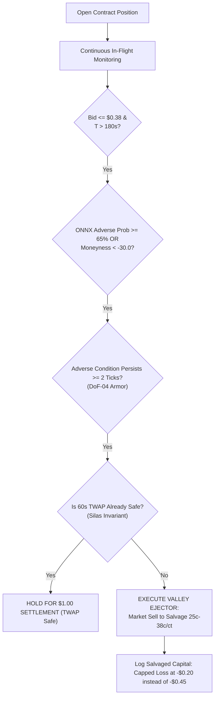

# The Balanced Division of Power: Quantitative Governance & In-Flight Derisking

**Path:** `docs/01_ARCHITECTURE/BALANCED_DIVISION_OF_POWER.md`  
**Classification:** Core System Constitutional Architecture  
**Active Production Branch:** `zero_hallucination_mode`  
**Governing Directives:** AGENTS.md Directives 1–8  

---

## 1. Executive Philosophy: Why Learning is the True Leader

A common failure mode in algorithmic and AI trading systems is the **Dictator Fallacy**—elevating a single component (such as an LLM prompt, a static decision oracle, or a raw neural net) to unchecked command over order execution. 

If a directional oracle like **Kev** acts as an absolute dictator whose decisions cannot be constrained, reshaped, or vetoed, **then continuous learning is purely decorative theatre**. No matter how many lessons the learning buffer records post-settlement, an unconstrained lead will repeat the exact same errors, buying into high-priced overconfidence traps and toxic orderbook cascades.

To achieve sustainable profitability and capital preservation, the Kalshi Simulator operates on a **Constitutional System of Checks and Balances**:

```
[THE LEARNING]         THE SUPREME GOVERNOR   → Controls the Rulebook, Confidence Multipliers & Boundaries
      │
      ├── [HMM Brain]            MACRO ADMIRAL          → Assesses Systemic Seas (RISK_OFF Circuit Breaker)
      ├── [ONNX Brain]           MICROSECOND RADAR      → Analyzes L2 Book Imbalance (< 1ms Physics)
      ├── [Kev AI Oracle]        TACTICAL LEAD TAKER    → Synthesizes Context & Directs Aggressive Entry
      └── [Dynamic Strategy]     PRICING ARMOR (DRSA)   → Enforces Limit Pricing (<= $0.51) & Eliminates Whipsaws
```

---

## 2. The 5-Pillar Functional Breakdown

| Pillar | Operational Role | Real-Time Execution Horizon | Core Constitutional Power |
| :--- | :--- | :--- | :--- |
| **1. The Learning Engine** | **The Supreme Governor** | **Post-Settlement ($T = 0$)** | **Absolute Rule Authority.** Calibrates model confidence via Platt scaling ($\alpha$), blacklists toxic state-space quadrants via the 3D Mistake Matrix, and lowers maximum price caps based on empirical PnL. |
| **2. HMM Brain** | **Macro Fleet Admiral** | **Multi-Asset Candle Horizon** | **Systemic Veto.** Categorizes macro market distributions into `STABLE_RANGE`, `VOL_EXPANSION`, or `RISK_OFF`. If `RISK_OFF`, all trading freezes immediately. |
| **3. ONNX Runtime** | **Microsecond Radar** | **Sub-Millisecond ($< 0.5\text{ms}$)** | **Microstructural Alpha.** Continuously evaluates 50 levels of Binance L2 orderbook depth and volume-synchronized toxicity (VPIN) to detect lead-lag sweeps invisible to textual models. |
| **4. Kev AI Oracle** | **Tactical Lead Taker** | **In-Flight Cycle ($\tau \in [120\text{s}, 840\text{s}]$)** | **Directional Decisiveness.** Synthesizes qualitative context (OFI, macro slope, moneyness) to decide direction (`YES`, `NO`, `WAIT`) and cross the spread when edge is mathematically positive. |
| **5. Dynamic Strategy (DRSA)** | **Pricing Armor & Fire Control** | **Real-Time Order Routing** | **Execution Discipline.** Houses the Schmitt Trigger with 30s dwell time to eliminate whipsaws, computes closed-form pricing surfaces ($\le \$0.51$), and governs Silas Settlement parity. |

---

## 3. How The Learning Governs Kev and Execution

Kev does not hold arbitrary authority; Kev operates on an **empirical leash held by the Learning Engine**:

```mermaid
flowchart TD
    subgraph InFlight ["In-Flight Live Trading"]
        CONTEXT[Market State Context] --> KEV[Kev Evaluates Scenario]
        KEV --> RAW_P["Raw Kev Output: P_Kev (e.g. 85%)"]
        RAW_P --> PLATT["Platt Leash: P_calibrated = alpha * P_Kev"]
        PLATT --> GATE{"P_calibrated >= 65% Hurdle?"}
        GATE -- No --> STAND_DOWN["STAND DOWN (Confidence Suppressed)"]
        GATE -- Yes --> QUAD_CHECK{"Quadrant Blacklisted by Mistake Matrix?"}
        QUAD_CHECK -- Yes --> VETO["VETO ENTRY (No-Fly Zone)"]
        QUAD_CHECK -- No --> DRSA_CLAMP["DRSA Enforces Price <= min(Cap, $0.51)"]
        DRSA_CLAMP --> ORDER["Submit 1 Contract Limit Taker"]
    end

    subgraph Settlement ["Post-Cycle Learning (The Supreme Governor)"]
        ORDER --> SETTLE[Cycle Settlement at T=0]
        SETTLE --> AUTOPSY[Forensic Failure Attribution]
        AUTOPSY --> BRIER[Compute Brier Error (P - Y)^2]
        BRIER --> RECALIB[Recalibrate Platt alpha and Decile Caps]
        RECALIB -.->|Update Dials| PLATT
        RECALIB -.->|Update Blacklist| QUAD_CHECK
        RECALIB -.->|Update Ceilings| DRSA_CLAMP
    end
```

### 1. The Platt Confidence Leash
If Kev exhibits overconfidence during losing streaks, the Learning Engine shrinks his multiplier:
$$\alpha_{t+1} = \text{clip}\left(\alpha_t - \eta \cdot (P_{\text{pred}} - Y_{\text{actual}}), \; 0.65, \; 1.10\right)$$
Even if Kev claims $85\%$ confidence, if $\alpha = 0.75$, the effective confidence is $63.7\%$, dropping below the $65\%$ hurdle and forcing a disciplined **STAND DOWN**.

### 2. The 3D Mistake Matrix (No-Fly Zones)
Every settled loss is mapped into 3 axes: *Spot-to-Strike Distance*, *Time to Expiry*, and *Macro Volatility*. If losses cluster in a specific quadrant (e.g., *Late-Cycle Chop with Tight Strike Proximity*), the Learning Engine marks that quadrant as toxic. Kev is physically prohibited from opening trades in blacklisted quadrants.

### 3. Decile Price Capping
If fills priced at $\ge 60\text{¢}$ show net negative EV over rolling windows, the Learning Engine forces the active price ceiling down to $55\text{¢}$ or $50\text{¢}$, overriding Kev's willingness to cross higher asks.

### 4. Empirical Calibration Math & Feature Parity (Audit Resolution)
- **True Empirical Win Rate:** Calculated strictly as the sum of binary win indicators over total settled trades:
  $$\text{Empirical Win Rate} = \frac{\sum_{i=1}^N \mathbb{I}(Y_i = 1)}{N}$$
  *(Eliminating the legacy count bug that pegged win rate to 100% unconditionally).*
- **Overconfidence Leash:** When confidence exceeds empirical win rate ($\text{Bias} > 0.05$), the Platt scaling multiplier shrinks down to $0.65$:
  $$\alpha = \max\Big(0.65, \; 1.0 - 1.5 \cdot (\overline{P}_{\text{confidence}} - \text{Empirical Win Rate})\Big)$$
- **Entry-Time Feature Parity:** The 3D Mistake Matrix indexes cycles strictly by **`entry_spot_diff`** ($S_{\text{entry}} - K$) and entry time-to-expiry ($\tau_{\text{entry}}$), rather than settlement drift 15 minutes later, ensuring historical bans match actual trade decision states.

---

## 4. In-Flight Derisking: The Valley Ejector & Salvage Protocol

A foundational tenet of the architecture is: **never hold a doomed contract to 0¢ when capital can be salvaged.**

In binary prediction markets, a position that is failing does not have to be held until settlement wipeout. If **ONNX**, **HMM**, and **Kinetic Spot Velocity** confirm with high confidence that the trade has failed, the engine triggers an early salvage sell.



### The Three Salvage Mechanisms in Code:

1. **Valley Ejector (`Rule 6` in `domination_exit_evaluator.py` & `lead_deer_quant_brain.py`):**
   - **Condition:** Contract bid decays to $\le \$0.38$ with $T > 180\text{s}$ remaining, and opposing ONNX probability $\ge 0.65$.
   - **Action:** Dumps position immediately to salvage $\$0.30\text{–}\$0.38/\text{contract}$.
   - **Quant Benefit:** Instead of losing the full $-100\%$ ($\$0.45$), the loss is capped at $-\$0.15$ to $-\$0.20$. Capital is preserved for the next high-conviction cycle.

2. **Kinetic Crash Salvage (`Rule 5.9` in `domination_exit_evaluator.py`):**
   - **Condition:** Adverse spot velocity spikes $\ge 12.0\text{ \$/3s}$, bid $\le \$0.40$, and reverse conviction $\ge 65\%$.
   - **Action:** Sells to top bid before the orderbook bid vacuum collapses to zero.

3. **Catastrophic Derisk (`DEF-03` in `btc_bot1v4_engine.py` & `eth_bot1v4_engine.py`):**
   - **Condition:** Spot drifts adverse past strike by $\ge \$2.00$ (ETH) or $\ge \$25.00$ (BTC) with intense negative orderflow ($\text{OFI} \le -0.70$) and $T \ge 45\text{s}$.
   - **Action:** Dispatches immediate market taker sell to capture resting bids $\ge \$0.15$.

### Anti-Whipsaw Guardrails on Early Exits:
To prevent "panic selling" on temporary 10-second wicks before a price rebound:
- **`DoF-04 Salvage Persistence`:** Adverse breakdown must persist across **$\ge 2$ consecutive evaluation ticks**.
- **`Silas TWAP Parity Guard`:** Inside $T \le 60\text{s}$, if the 60-second trailing TWAP is mathematically insurmountable by adverse velocity, salvage selling is **vetoed**, holding through spot noise to collect the full $\$1.00$ settlement.
- **Asset-Adaptive Cushion Calibration:**
  - **BTC (`KXBTC15M`):** Requires TWAP cushion $\ge \$25.00$ (1 full strike step, matching $\$15\text{--}\$25$ 1m noise).
  - **ETH (`KXETH15M`):** Requires TWAP cushion $\ge \$2.50$ (1 full strike step).
  *(Prevents sub-dollar noise from disabling Valley Ejector on BTC).*

---

## 5. Architectural Unified Equation & Pre-Inference Gates

### Zero Blackhole Credit Burning Gate (AGENTS.md Rule 8 & Law 2)
To eliminate wasteful LLM API calls and preserve computational credits:
$$\text{If } \big(\text{Turnovers} \ge 1\big) \lor \big(\text{CycleLocked}\big) \lor \big(\text{ActivePositionExists}\big) \implies \mathbf{STAND\;DOWN\;(Skip\;Kev\;Inference)}$$
The bot evaluates 1-trade locks and active inventory *before* initiating Kev Oracle evaluations.

### Unified Probability & Pricing Equations
The final execution ticket submitted to Kalshi is the product of this multi-pillar consensus:

$$P_{\text{win}} = \alpha_{\text{Learning}} \cdot \Big( 0.40 \cdot P_{\text{ONNX}} + 0.35 \cdot P_{\text{Kev}} + 0.25 \cdot P_{\text{Physics}} \Big)$$

$$\text{Final Limit Price} = \min\Big(\text{DRSA Surface Price}, \; \text{Learning Active Cap}, \; \$0.51\Big)$$

$$\text{Execution Condition} = \big( \text{HMM} \ne \text{RISK\_OFF} \big) \land \big( \text{Quadrant} \notin \text{BannedMistakes} \big) \land \big( \text{Tau} \in [120\text{s}, 840\text{s}] \big)$$

---

## 6. Summary: The Equilibrium

- **Kev is the Lead Taker** because he provides the directional aggression needed to cross the spread and capture fast momentum without passive maker adverse selection.
- **The Learning is the True Leader** because it holds the supreme constitutional power to calibrate Kev's confidence, set the price boundaries, and veto trades in historically toxic environments.
- **The Valley Ejector** ensures that when the consensus fails, the system cuts losses intelligently, salvaging capital to fight another cycle.
