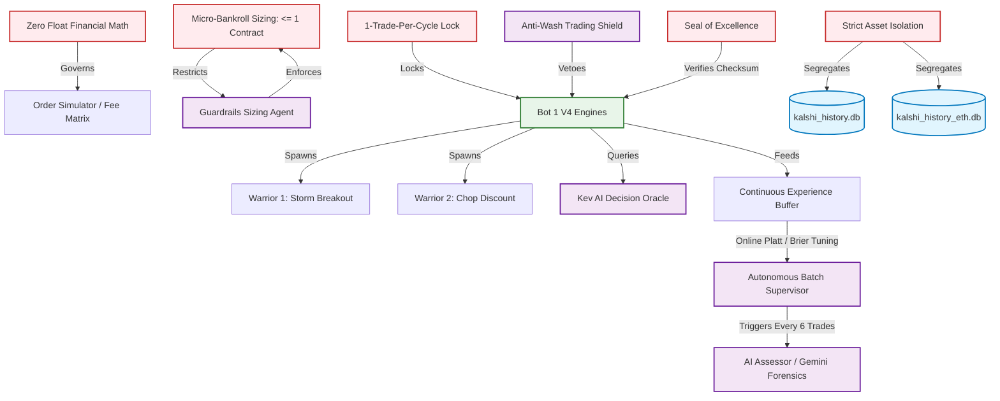
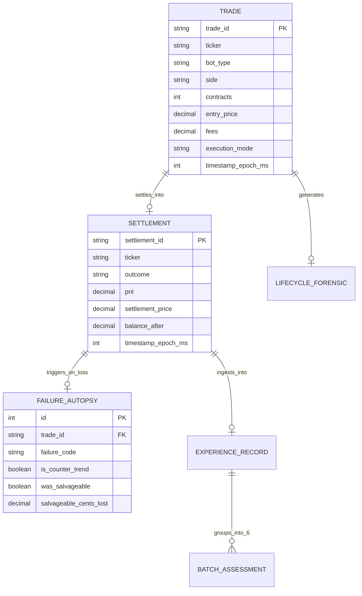

# Enterprise Knowledge Graph & Concept Ontology

**System:** Kalshi Autonomous Multi-Asset Trading Engine  
**Classification:** Enterprise Conceptual Ontology & Code Linkage Graph  

---

## 1. Domain Ontology Overview

The knowledge graph defines explicit semantic links between **Financial Invariants**, **Algorithmic Strategies**, **Autonomous Agents**, **Physical Code Modules**, and **Persistent Storage**.

---

## 2. Concept Relationship Dictionary

| Subject Concept | Relation | Target Concept | Code / File Anchor |
| :--- | :--- | :--- | :--- |
| **Zero Float Financial Math** | enforces | All Balance & Fee Computations | [`src/kalshi_sim/order_simulator.py`](file:///f:/012D_TRADE/Kalshi%20Simulator/src/kalshi_sim/order_simulator.py) |
| **Micro-Bankroll Armor** | limits sizing to | 1 Contract ($<\$75 balance) | [`docs/SCALEUP.md`](file:///f:/012D_TRADE/Kalshi%20Simulator/docs/SCALEUP.md) |
| **1-Trade-Per-Cycle Lock** | terminates loop on | 1 Completed Round-Trip | [`src/kalshi_sim/ml/bot1_v4_engine.py`](file:///f:/012D_TRADE/Kalshi%20Simulator/src/kalshi_sim/ml/bot1_v4_engine.py) |
| **Strict Asset Isolation** | partitions | BTC vs ETH History | [`src/kalshi_sim/db/queries.py`](file:///f:/012D_TRADE/Kalshi%20Simulator/src/kalshi_sim/db/queries.py) |
| **Warrior 1 (Storm)** | executes on | Momentum Breakout ($0.42–$0.45) | [`src/kalshi_sim/ml/eth_bot1v4/eth_bot1v4_engine.py`](file:///f:/012D_TRADE/Kalshi%20Simulator/src/kalshi_sim/ml/eth_bot1v4/eth_bot1v4_engine.py) |
| **Warrior 2 (Chop)** | executes on | Deep Discount Limit ($0.38–$0.42) | [`src/kalshi_sim/ml/eth_bot1v4/eth_bot1v4_engine.py`](file:///f:/012D_TRADE/Kalshi%20Simulator/src/kalshi_sim/ml/eth_bot1v4/eth_bot1v4_engine.py) |
| **Kev Decision Oracle** | shadow-validates | Bayesian Direction & Strike | [`src/kalshi_sim/ml/kev_oracle.py`](file:///f:/012D_TRADE/Kalshi%20Simulator/src/kalshi_sim/ml/kev_oracle.py) |
| **Platt Scaling** | calibrates | Empirical Win Probabilities | [`src/kalshi_sim/ml/experience_buffer.py`](file:///f:/012D_TRADE/Kalshi%20Simulator/src/kalshi_sim/ml/experience_buffer.py) |
| **Batch Supervisor** | orchestrates | Continuous 6-Trade Evolution | [`src/kalshi_sim/batch_supervisor.py`](file:///f:/012D_TRADE/Kalshi%20Simulator/src/kalshi_sim/batch_supervisor.py) |
| **AI Assessor** | conducts | Root-Cause Forensics | [`src/kalshi_sim/ai_assessor.py`](file:///f:/012D_TRADE/Kalshi%20Simulator/src/kalshi_sim/ai_assessor.py) |

---

## 3. Data & Entity Relationship Graph

