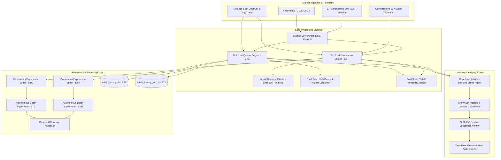

# System Map & Component Topology

**System:** Kalshi Autonomous Multi-Asset High-Frequency & Quantitative Prediction Engine  
**Tier:** Institutional Quantitative Trading Platform  
**Governance Standard:** AGENTS.md Laws 1–8, Zero Float Financial Math (`decimal.Decimal`)  
**Deployment Topology:** Dual Execution (AWS EC2 Production Monolith + Workstation Development)  

---

## 1. High-Level Subsystem Topology

---

## 2. Component Inventory & Directory Manifest

### 2.1 Core Services (`src/kalshi_sim/`)
- **`server.py`**: Monolithic FastAPI backend hosting REST APIs, WebSocket feeds, and state coordination.
- **`server_settlements.py`**: Settlement lifecycle listener, PnL calculation, and trade record generator.
- **`server_state_payload.py`**: Low-latency snapshot assembler for the trading terminal dashboard.
- **`order_simulator.py`**: CLOB simulator implementing Kalshi taker fee formulas and fill matching.
- **`kalshi_client.py`**: Production HTTP/WebSocket gateway with token-bucket throttling and RSA key auth.
- **`cfbenchmarks_sync.py`**: Real-time 5Hz polling and trailing 60-second TWAP calculation for contract settlement.
- **`batch_supervisor.py`**: Autonomous 6-trade evaluation supervisor with asset-isolated self-calibration loops.
- **`ai_assessor.py`**: Forensic root-cause investigator evaluating empirical losses against quant playbooks.

### 2.2 Machine Learning & Bot Engines (`src/kalshi_sim/ml/`)
- **`bot1_v4_engine.py`**: Primary Bitcoin 15-minute execution vessel (Dual Warrior: Storm Breakout + Chop Discount).
- **`eth_bot1v4/eth_bot1v4_engine.py`**: Dedicated Ethereum 15-minute execution vessel with dynamic proximity moats.
- **`experience_buffer.py`**: Online Platt scaling, Brier score calibration, and 3D mistake matrix pruner.
- **`kev_oracle.py`**: Ultra-fast latency shadow oracle providing directional bias, strike sanity, and vetoes.
- **`wave_classifier.py`**: Microstructural wave physics classifier (Choppy, Stormy, Bleed, Healing).
- **`statistical_ev_engine.py`**: Closed-form Gaussian error function (erf) calculating pricing edges ($P_{\text{win}} - P_{\text{market}}$).
- **`dynamic_regime_strategy.py`**: Dynamic Regime-State Architecture (DRSA) multi-regime adaptive execution vessel.
- **`onnx_engine.py`**: ONNX Runtime inferencing engine delivering non-linear probability estimates.

### 2.3 Council of Advisors (`src/kalshi_sim/council/`)
- **`councilors/silas.py`**: Settlement TWAP Gravity and CF Benchmarks specialist.
- **`councilors/nash.py`**: CLOB microstructure and Order Book Imbalance (OBI) quant.
- **`councilors/elena.py`**: Statistical arbitrage and market maker spread optimizer.
- **`councilors/koko.py`**: Retail sentiment inversion and psychological liquidity traps.
- **`councilors/vance.py`**: Smart flow and aggressive institutional delta tracker.
- **`councilors/dexter.py`**: Adversarial exploit hunter and edge stress-tester.
- **`councilors/atticus.py`**: Chief council moderator and consensus synthesizer.

### 2.4 Database Subsystem (`src/kalshi_sim/db/`)
- **`connection.py`**: WAL-mode SQLite connection pool with separate BTC (`kalshi_history.db`) and ETH (`kalshi_history_eth.db`) managers.
- **`schema.py`**: Versioned database migration engine (Schema V5).
- **`writer.py`**: Non-blocking asynchronous queue persistence daemon.
- **`queries.py`**: Historical query service with asset-isolated DB routing and performance metric calculations.

---

## 3. Communication & Inter-Process Protocols

| Rail | Protocol | Source | Destination | Latency Budget | Payload Type |
| :--- | :--- | :--- | :--- | :--- | :--- |
| **Market Depth** | WebSocket | Binance / Coinbase | Orderflow Feeds | $<100\text{ms}$ | JSON L2 Diff |
| **Exchange Orders** | REST / TLS | KalshiClient | Kalshi API v2 | $<350\text{ms}$ | Signed JSON |
| **Shadow Inference**| In-Memory | KevDecisionOracle | Bot1V4 Engines | $<2.0\text{ms}$ | Heuristic Vector |
| **DB Persistence** | Async Queue | Engine Workers | SQLite WAL | Background | Dict Row |
| **Dashboard Sync** | WebSocket | Mother Server | React Frontend | $250\text{ms}$ | Gzip JSON State |
