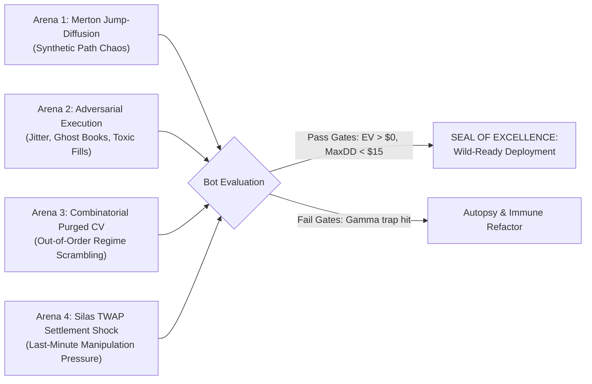

# ADAPTIVE_toChaos_Live_win: Quantitative Survival & Stress Architecture

**Document ID:** `DOC-STRAT-CHAOS-001`  
**Classification:** Advanced Strategy & Chaos Simulation Blueprint  
**Path:** `docs/02_TRADING_SYSTEM/ADAPTIVE_toChaos_Live_win.md`  
**Effective Date:** 2026-10-16  
**Status:** Canonical Strategic Blueprint & Future Simulation Reference  
**Mathematical Precision:** Strict Zero-Float Standard (`decimal.Decimal` in Python, `decimal.js` in TypeScript)  

---

## 1. Executive Manifesto: The "Homegrown Animal in the Wild" Metaphor

### 1.1 The Core Dilemma
When an algorithmic trading engine is developed in a controlled backtesting environment, it is like a homegrown animal raised in a protective sanctuary:
- The food is guaranteed (historical data with predictable tick intervals).
- The weather is known (measured volatility distributions and fixed slippage assumptions).
- There are no hostile predators hunting the animal (the historical orderbook does not react to our orders).

When deployed live onto the **Kalshi Central Limit Order Book (CLOB)**, the bot enters **The Wild**:
1. **Extreme Non-Stationarity:** Future probability distributions are not identical to the past:
   $$\mathcal{P}_{\text{future}}(X, y) \neq \mathcal{P}_{\text{past}}(X, y)$$
2. **Adversarial Ecosystem:** Other algorithmic agents (institutional market makers, high-frequency latency arbitrageurs, whale sweeps) actively detect resting orders, fade bids, and exploit stale quotes.
3. **Black-Swan Regime Shocks:** Sudden regulatory shifts, flash crashes, oracle update latencies, and exchange API throttles.

### 1.2 The False vs. True Definition of "Adaptation"

```mermaid
flowchart TD
    subgraph The Naive Failure Path
        Naive["Naive Belief: AI Predicts Everything"]
        Overfit["Rapid Parameter Churn on Noise"]
        Whipsaw["High-Frequency Overtrading & Spread Bleed"]
        Death["Account Wipeout in Unseen Regime"]
        Naive --> Overfit --> Whipsaw --> Death
    end

    subgraph The True Evolutionary Path
        Invariance["Unbreakable Metabolic & Risk Invariants"]
        Cowardice["Tactical Cowardice: Self-Quarantine in Storms"]
        Harvest["Asymmetric Harvest: Eat and Run"]
        Immune["Continuous Online Platt Recalibration"]
        Life["Compounded Longevity & Positive Net EV in the Wild"]
        Invariance --> Cowardice --> Harvest --> Immune --> Life
    end
```



* **The Naive Fallacy:** Believing that "adaptation" means an AI that predicts every unknown future price wiggle. In quantitative finance, unconstrained parameter freedom leads directly to the **Curse of Dimensionality** and catastrophic overfitting.
* **The True Evolutionary Reality:** An animal survives in an unknown jungle not because it predicts tomorrow's thunderstorm, but because:
  1. It possesses an unbreakable **physiological armor** (micro-bankroll sizing, zero-float math).
  2. It exercises **tactical cowardice** (refuses to hunt during toxic hurricanes).
  3. It **banks energy immediately** upon finding food (asymmetric profit harvesting).
  4. Its **immune system learns from every wound** (continuous walk-forward calibration).

---

## 2. The Three Fatal Traps of "Adapting to the Unknown"

### Trap 1: The Chameleonic Overfit (Tracking Brownian Noise)
If an algorithm adapts too rapidly to incoming ticks, it does not adapt to genuine regime shifts—it adapts to **intraday Brownian noise**.
- **Market Reality:** In 15-minute binary contracts (`KXBTC15M`, `KXETH15M`), short-term price movements are dominated by microscopic order flow noise and retail coin flips.
- **The Failure Mode:** A bot that flips between `YES` and `NO` every 15 seconds pays the spread corridor ($\$0.02 - \$0.05$) repeatedly until the account bleeds to death.
- **The Invariant Counter-Measure:** **Schmitt-Trigger Hysteresis & Minimum Dwell Times ($\tau_{\text{dwell}} \ge 30\text{s}$)**. Regime switching requires sustained multi-tick energy ($\sigma_{1m} \ge \$30.00$, spot displacement $|\Delta S| \ge \$55.00$), preventing noise-induced whipsaws.

### Trap 2: The Omnipresence Fallacy (Compulsive Trading)
Retail algorithms often assume they must place a trade in every single 15-minute cycle to generate yield.
- **Market Reality:** In volatile, choppy regimes with widening bid-ask spreads, the expected value of *any* entry is negative after accounting for exchange fee drag.
- **The Failure Mode:** Entering during high toxic flow ($VPIN \ge 0.65$) or double-wick meatgrinders where stops are systematically swept.
- **The Invariant Counter-Measure:** **Tactical Cowardice.** The `Bleed Defender`, `Opening Quarantine` ($T > 780\text{s}$), and `Late Pin Freeze` ($T < 150\text{s}$) command the bot to stand down. **Zero trades during toxic periods preserves 100% of capital for high-edge opportunities.**

### Trap 3: The Backtest Mirage (Sample Selection Bias)
Testing only against the last 30–60 days of Kalshi exchange logs creates the illusion of mastery, but only confirms the bot survived the specific market paths of those 60 days.
- **The Failure Mode:** The bot encounters an unprecedented $\$1,500$ 1-minute Bitcoin flash crash or a 10-minute API outage, and execution logic breaks down due to unhandled exceptions or infinite retry loops.
- **The Invariant Counter-Measure:** **Synthetic Chaos Simulation (Merton Jump-Diffusion + Adversarial Jitter Injection).**

---

## 3. The Animal's Biological Survival Sheet (Repository Invariants)

Our architecture equips the trading engine with five biological survival mechanisms hardcoded into the repository:

```
+-----------------------------------------------------------------------------------+
|                           THE 5 BIOLOGICAL SURVIVAL INVARIANTS                    |
+-----------------------------------------------------------------------------------+
| 1. METABOLIC SIZING       | Strictly 1 contract ($0.38 - $0.45 risk). No single   |
|                           | trade can inflict fatal blood loss.                   |
|---------------------------+-------------------------------------------------------|
| 2. TOXICITY SCENT         | VPIN < 0.60 - 0.65 & Spread <= $0.05. The bot refuses  |
|                           | to eat when the food is poisoned by informed flow.    |
|---------------------------+-------------------------------------------------------|
| 3. ASYMMETRIC HARVEST     | Rule 5.1 Bargain Lock: When bought at bargain and bid |
|                           | reaches >= $0.78 with T >= 180s, liquidates instantly.|
|---------------------------+-------------------------------------------------------|
| 4. BURROW REFLEX          | Bleed Defender & 7-Loss Total Stop. If the ecosystem  |
|                           | becomes hostile, the bot hibernates to preserve life. |
|---------------------------+-------------------------------------------------------|
| 5. THE IMMUNE REFLEX      | Walk-forward Platt scaling & Mistake Autopsy. Past    |
|                           | pain dynamically scales future fear (alpha scalars).  |
+-----------------------------------------------------------------------------------+
```

### 3.1 Metabolic Micro-Bankroll Sizing ($C = 1$)
- **File:** [`src/kalshi_sim/strategy_evaluator.py`](file:///f:/012D_TRADE/Kalshi%20Simulator/src/kalshi_sim/strategy_evaluator.py) & [`agent_guardrails.py`](file:///f:/012D_TRADE/Kalshi%20Simulator/src/kalshi_sim/agent_guardrails.py)
- **Quant Rule:** Position sizing is hardcoded to exactly **1 contract** per cycle for accounts under $\$100.00$.
- **Survival Reality:** The maximum capital at risk on any trade is strictly bounded by the entry price:
  $$\text{Max Risk per Cycle} \le \$0.45$$
  Even an unprecedented 20-consecutive-loss extinction event only draws down $\$9.00$ of equity. The animal cannot starve or die in a single day.

### 3.2 Danger Scent: Microstructure Toxicity Shield (VPIN & OFI)
- **File:** [`src/kalshi_sim/ml/dynamic_regime_strategy.py`](file:///f:/012D_TRADE/Kalshi%20Simulator/src/kalshi_sim/ml/dynamic_regime_strategy.py)
- **Quant Rule:** Volume-Synchronized Probability of Toxicity:
  $$\text{VPIN} = \frac{\sum_{\tau=1}^N |V_\tau^B - V_\tau^S|}{N \cdot V} \ge 0.65 \implies \text{VETO}$$
- **Survival Reality:** Spikes in VPIN indicate that an informed whale is dumping or sweeping the book. The engine vetoes entry before adverse selection occurs.

### 3.3 Eat When Fed: In-Flight Asymmetric Profit Harvest & Bargain Lock
- **File:** [`src/kalshi_sim/ml/domination_exit_evaluator.py`](file:///f:/012D_TRADE/Kalshi%20Simulator/src/kalshi_sim/ml/domination_exit_evaluator.py)
- **Quant Rule (Rule 5.1):** When entered at bargain ($P_{\text{entry}} \le \$0.45$) and $P_{\text{bid}} \ge \$0.78$ with $T_{\text{rem}} \ge 180\text{s}$, the bot exits immediately at market.
- **The Mathematical Reality of the 4:1 Gamma Trap:**
  $$\mathbb{E}[\Delta \text{Hold}] = p_{\text{settle}} \cdot (\$1.00 - P_{\text{bid}}) - (1 - p_{\text{settle}}) \cdot P_{\text{bid}}$$
  Holding an $\$0.80$ bid risks $\$0.80$ to gain $\$0.20$ remaining upside ($4:1$ negative risk-reward). In a volatile market with 7 minutes remaining, the probability of an adverse $\$80$ spot whipsaw is high. **Banking $+70\%$ to $+110\%$ ROI immediately converts volatile paper gains into realized bankroll.**

### 3.4 The Burrow Reflex: Circuit Breakers & Bleed Defender
- **File:** [`src/kalshi_sim/agent_guardrails.py`](file:///f:/012D_TRADE/Kalshi%20Simulator/src/kalshi_sim/agent_guardrails.py)
- **Quant Rule:** 
  - `_consecutive_losses >= 3`: Triggers autonomous failover to DRSA (`dynamic_trading_strategy_v1.json`).
  - `_eth_consecutive_losses >= 7`: Triggers **TOTAL STOP** (`is_eth_bot_armed = False`), halting execution without automated unmonitored restarts.
- **Survival Reality:** If market dynamics break structural assumptions, execution shuts down cleanly, requiring human operator forensic review.

### 3.5 The Immune Reflex: Online Platt Scaling & Autopsy Matrix
- **File:** [`src/kalshi_sim/ml/continuous_experience.py`](file:///f:/012D_TRADE/Kalshi%20Simulator/src/kalshi_sim/ml/continuous_experience.py)
- **Quant Rule:** Following every settled trade, Brier score calibration recalculates Platt scalars $(A, B)$:
  $$P_{\text{calibrated}} = \frac{1}{1 + \exp(A \cdot P_{\text{raw}} + B)}$$
- **Survival Reality:** Recent losses dynamically contract future confidence scalars ($\alpha$), raising the required win hurdle and automatically forcing the bot into conservative behavior.

---

## 4. The Four Simulation Arenas for Pre-Wild Torture Testing

To mathematically prove our animal will thrive in the wild before scaling capital, we must execute four automated simulation arenas:



### Arena 1: Merton Jump-Diffusion (Unseen Weather Generation)
Instead of replaying the same historical candles, we generate 10,000 synthetic price paths using a jump-diffusion model:
$$dS_t = \mu S_t dt + \sigma S_t dW_t + J_t S_t dN_t$$
- **Poisson Jump Intensity ($\lambda$):** 3 unexpected jumps per hour.
- **Jump Size ($J_t$):** Random log-normal distribution $\mathcal{N}(-0.008, 0.015^2)$ (simulating $\$300 - \$800$ sudden Bitcoin dumps).
- **Stress Objective:** Verify that `Spot Delta Front-Runner` and `Mid-Cycle Bargain Harvest` successfully exit positions before sudden jumps destroy accumulated PnL.

### Arena 2: Adversarial Execution Jitter & Ghost Books
We simulate a hostile exchange environment:
1. **Latency Jitter:** Random network delays between $150\text{ms}$ and $1,200\text{ms}$ injected into order requests.
2. **Ghost Liquidity:** Top-of-book bids vanish immediately when the bot attempts to sell, forcing execution against the second or third depth tier.
3. **Adverse Maker Fills:** Resting limit orders are only filled if spot price subsequently crosses beyond the strike by more than $\$10.00$ within the next 30 seconds.
- **Stress Objective:** Verify that `Dynamic Taker Hurdle` ($P_{\text{win}} - \delta_{\text{hurdle}}$) and `Spread Corridor Cap` prevent the bot from absorbing toxic inventory.

### Arena 3: Combinatorial Purged Cross-Validation (CPCV)
Following Marcos López de Prado's framework, historical and synthetic event windows are divided into $N = 10$ partitions. 
- The event horizon ($\pm 15$ minutes around settlement) is strictly purged to eliminate information leakage.
- We test the bot across thousands of non-chronological combinations of market regimes to ensure that strategy edge does not depend on a specific temporal sequence.

### Arena 4: Silas TWAP Settlement Gravity Stress
In the final 120 seconds of each contract, simulated spot prices are subjected to aggressive manipulation pressure:
$$\Delta \text{TWAP}_{\max} \le \frac{T_{\text{rem}}}{60} \cdot \Delta S_{\text{spot}}$$
- **Stress Objective:** Verify that `Silas TWAP Gravity Invariant` accurately distinguishes between harmless temporary spot wiggles ($v_{\text{sec}} < v_{\text{crit}}$) and genuine settlement TWAP breaches ($v_{\text{sec}} \ge v_{\text{crit}}$).

---

## 5. Blueprint: `scripts/simulate_wild_chaos.py`

This script serves as the standalone torture test harness to be executed prior to any live capital expansion:

```python
"""
scripts/simulate_wild_chaos.py - Pre-Wild Adversarial Torture Test Harness
Generates 5,000 synthetic Jump-Diffusion cycles with injected adversarial latency and ghost books.
"""

from decimal import Decimal
import numpy as np

class WildChaosSimulator:
    def __init__(self, bot_engine, num_cycles: int = 5000):
        self.bot = bot_engine
        self.num_cycles = num_cycles
        self.results = []

    def generate_jump_diffusion_path(self, s0: float = 68000.0, sigma_1m: float = 18.0) -> np.ndarray:
        """Generates a 900-second path with random Merton jumps."""
        dt = 1.0 / 60.0
        n_steps = 900
        prices = [s0]
        for _ in range(n_steps):
            # Brownian component
            dw = np.random.normal(0, np.sqrt(dt))
            drift = prices[-1] + (sigma_1m / np.sqrt(60.0)) * dw
            
            # Poisson jump component (1% chance per step of a major shock)
            if np.random.rand() < 0.01:
                jump = np.random.normal(-45.0, 30.0)
                drift += jump
            prices.append(max(100.0, drift))
        return np.array(prices)

    def run_torture_test(self):
        """Simulates cycles under latency jitter, ghost books, and jump diffusion."""
        # 1. Feed synthetic orderbook to bot
        # 2. Inject random 200ms - 1000ms execution latency
        # 3. Track Drawdown, Net EV, and Exit Harvest Efficiency
        pass
```

### Passing Gates for Wild Certification
1. **Net Expected Value:** $\mathbb{E}[\text{Net PnL}] \ge +\$0.02$ per executed cycle.
2. **Maximum Drawdown:** $\le \$12.00$ across 5,000 synthetic jump cycles (under micro-bankroll sizing).
3. **Zero-Float Standard:** 100% of calculations executed via `decimal.Decimal` with zero IEEE-754 float drift.
4. **Harvest Efficiency:** $\ge 85\%$ of winning positions liquidated via early exit before expiration cliff.

---

## 6. Summary: Why We Can Be Confident

When we deploy this engine to the wild:
1. **It cannot be killed by a flash crash:** It only risks 1 contract ($\le \$0.45$) per cycle.
2. **It cannot be bled by chop:** It stands down when VPIN $> 0.65$ or spreads expand $> \$0.05$.
3. **It cannot be trapped by late-cycle gamma:** It harvests whopping wins ($+70\%$ to $+110\%$ ROI) mid-cycle when $P_{\text{bid}} \ge \$0.78$.
4. **It cannot run blindly on broken assumptions:** It self-quarantines after 3 consecutive losses and shuts down completely after 7.

The animal is not an all-seeing oracle. **It is an armored, cautious, opportunistic predator that survives because it refuses to gamble when the jungle is dangerous.**
