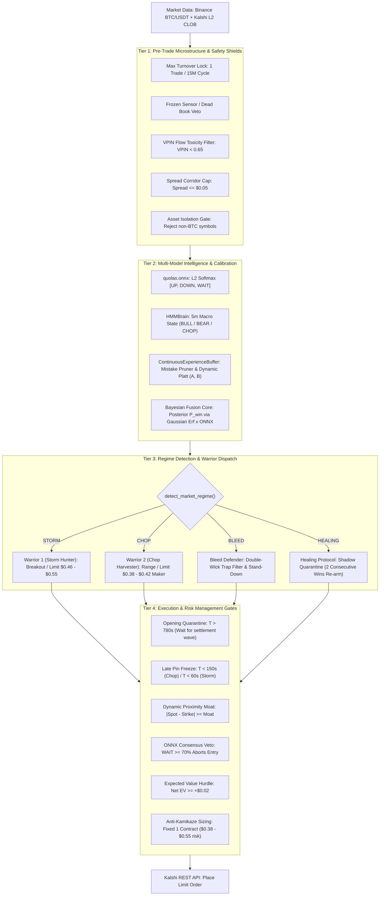

# Institutional Specification: Bot 1 V4 (QuoLas BTC Domination Engine)

**Path:** `docs/02_TRADING_SYSTEM/BOT1_V4_SPECIFICATION.md`  
**Classification:** Core Quantitative Architecture Specification  
**Asset Target:** Kalshi Bitcoin 15-Minute Binary Contracts (`KXBTC15M`)  
**Underlying Feed:** Binance BTC/USDT Spot WebSocket + Coinbase Pro Spot Feed  
**Execution Venue:** Kalshi Central Limit Order Book (CLOB)  
**Production Daemon:** Systemd `kalshi-bot.service` (AWS EC2)  
**Mathematical Precision:** Strict Zero-Float Math (`decimal.Decimal` in Python, `decimal.js` in TypeScript)  

---

## 1. Executive Strategy Architecture

Bot 1 V4 ("QuoLas") executes defense-first quantitative trading on Kalshi 15-minute Bitcoin binary options. The engine prohibits any single heuristic or naked technical indicator from initiating an order. Decisions pass through an immutable 5-tier evaluation pipeline combining low-latency ONNX microstructural inferences, Gaussian Hidden Markov Model (HMM) macro regime classification, continuous walk-forward Platt calibration, multi-regime execution warriors, and strict micro-bankroll sizing.



---

## 2. Mathematical Formulations & Invariants

### 2.1 Zero-Float Financial Standard
In accordance with Rule 1 of [`AGENTS.md`](file:///f:/012D_TRADE/Kalshi%20Simulator/AGENTS.md), floating-point arithmetic is prohibited. All balances, contract prices, probability products, and EV metrics are processed via `decimal.Decimal` with explicit rounding modes (`ROUND_HALF_EVEN` or `ROUND_DOWN`):

```python
from decimal import Decimal, ROUND_HALF_EVEN

def compute_expected_value(p_win: Decimal, price_cents: Decimal, fee_cents: Decimal) -> Decimal:
    """Computes expected value using exact Decimal operations."""
    p_win = Decimal(str(p_win))
    price = Decimal(str(price_cents))
    fee = Decimal(str(fee_cents))
    cost = price + fee
    payout = Decimal("100.00")
    
    # EV = (p_win * (payout - cost)) - ((1 - p_win) * cost)
    ev = (p_win * (payout - cost)) - ((Decimal("1.00") - p_win) * cost)
    return ev.quantize(Decimal("0.01"), rounding=ROUND_HALF_EVEN)
```

### 2.2 Microstructure Volume-Synchronized Probability of Toxicity (VPIN)
Informed toxic flow is measured over rolling volume buckets $V$:

$$\text{VPIN} = \frac{\sum_{\tau=1}^N |V_\tau^B - V_\tau^S|}{N \cdot V}$$

- If $\text{VPIN} > 0.65$: Entry is vetoed immediately (`ERR_TOXIC_FLOW`).

### 2.3 Bayesian Fusion Core
The uncalibrated physical strike-crossing probability $P_{\text{phys}}$ is computed via the Gaussian error function:

$$d_2 = \frac{\ln(S_t / K) - \frac{1}{2} \sigma^2 \tau}{\sigma \sqrt{\tau}}$$

$$P_{\text{phys}} = \Phi(d_2) = \frac{1}{2} \left[ 1 + \text{erf}\left( \frac{d_2}{\sqrt{2}} \right) \right]$$

Posterior win probability blends $P_{\text{phys}}$ with the ONNX microstructural output $P_{\text{onnx}}$:

$$P_{\text{raw}} = w_{\text{macro}} \cdot P_{\text{phys}} + (1 - w_{\text{macro}}) \cdot P_{\text{onnx}}$$

### 2.4 Continuous Platt Scaling
To counter probability overconfidence, posterior probabilities pass through online walk-forward Platt scaling:

$$P_{\text{calibrated}} = \frac{1}{1 + \exp(A \cdot P_{\text{raw}} + B)}$$

Parameters $A$ and $B$ are updated dynamically in [`ContinuousExperienceBuffer`](file:///f:/012D_TRADE/Kalshi%20Simulator/src/kalshi_sim/ml/continuous_experience.py) after every settled cycle.

---

## 3. Five-Tier System Decomposition

### 3.1 Tier 1: Microstructure & Liquidity Shields
1. **Cycle Lock (1 Trade/Cycle):** Once an order is placed for contract cycle $C_i$, the bot locks until settlement $T_3$ of $C_i$. Wash trading and cannibalistic flip-flopping are physically prevented.
2. **Dead Book / Frozen Sensor Veto:** Verifies that bid-ask depth has updated within the last 3,000ms and both bid/ask quantities $\ge 1$.
3. **CLOB Spread Corridor:** If $\text{Ask} - \text{Bid} > \$0.05$, market liquidity is classified as illiquid and execution is aborted.

### 3.2 Tier 2: Machine Learning Intelligence
- **`models/quolas.onnx`:** High-frequency neural network computing order flow imbalance, micro-price velocity, and top-of-book skew. Returns 3 probabilities: $[P(\text{UP}), P(\text{DOWN}), P(\text{WAIT})]$. If $P(\text{WAIT}) \ge 0.70$, trade execution is blocked.
- **`HMMBrain` (Macro Markov Regime):** Evaluates rolling 5-minute OHLCV bars into 3 states:
  - `BULL_MOMENTUM`: Restricts directional bids to YES contracts.
  - `BEAR_MOMENTUM`: Restricts directional bids to NO contracts.
  - `STABLE_RANGE`: Permits dual-sided harvesting under Warrior 2 rules.

### 3.3 Tier 3: Market Regime Routing (One Boat, Two Warriors)
- **Warrior 1 (Storm Hunter):**
  - Triggered when 15-minute range $> \$165.00$ and $|\Delta \text{Spot}| > \$100.00$.
  - Entry bounds: Limit order between **`$0.46 - $0.55`**.
  - Minimum probability hurdle: $P_{\text{calibrated}} \ge 72.0\%$.
- **Warrior 2 (Chop Harvester):**
  - Triggered when 15-minute range $\le \$165.00$ and realized volatility $\sigma \le \$12.00$.
  - Entry bounds: Limit order strictly between **`$0.38 - $0.42`** (Maker limit only, $0.00 fee).
  - Timing corridor: Only between $150\text{s} \le T \le 450\text{s}$ to expiry.

### 3.4 Tier 4: Execution Timing Gates
- **Opening Quarantine ($T \ge 780\text{s}$):** The first 120 seconds of each 15-minute contract are quarantined to let opening volatility settle.
- **Late Pin Freeze ($T < 150\text{s}$ for Chop, $T < 60\text{s}$ for Storm):** Prevents entering during gamma expiration traps where spreads widen and manipulation spikes.

### 3.5 Tier 5: Micro-Bankroll Risk Guardrail
- Maximum position size is hardcoded to **1 contract per trade**.
- Maximum loss per cycle is bounded to the entry price ($\le \$0.55$).
- Scale-up is locked until balance reaches the required milestone ($40+ / $50+).

---

## 4. Configuration Parameter Manifest (`data/bot_parameters.json`)

| Parameter Name | Canonical Value | Data Type | Operational Function |
| :--- | :--- | :--- | :--- |
| `min_time_remaining` | `150` | `int` | Late pin cutoff in seconds for Chop regime |
| `max_time_remaining` | `780` | `int` | Opening quarantine in seconds |
| `storm_max_time_remaining`| `840` | `int` | Maximum time allowed for Storm entries |
| `storm_min_time_remaining`| `60` | `int` | Late pin cutoff in seconds for Storm regime |
| `min_edge` | `Decimal("0.02")`| `Decimal` | Net Expected Value minimum hurdle |
| `min_probability` | `Decimal("0.58")`| `Decimal` | Floor calibrated probability threshold |
| `max_price_cents` | `Decimal("55")` | `Decimal` | Hard ceiling for buy order limit price |
| `min_price_cents` | `Decimal("38")` | `Decimal` | Hard floor for buy order limit price |
| `max_spread_cents` | `Decimal("5")` | `Decimal` | Maximum CLOB bid-ask spread permitted |
| `vpin_threshold` | `Decimal("0.65")`| `Decimal` | Maximum permissible order flow toxicity |
| `proximity_moat` | `Decimal("25.00")`| `Decimal` | Minimum absolute dollar distance to strike |

---

## 5. Audit, Forensics & Telemetry

Every settled contract triggers an automated telemetry record containing:
1. **$T_1$ (Decision):** Timestamp, feature vector, ONNX probabilities, HMM regime, selected Warrior.
2. **$T_2$ (Fill):** Order ID, execution price, fill latency in milliseconds, order type (Maker/Taker).
3. **$T_3$ (Settlement):** Official Kalshi settlement price, gross PnL, fee drag, final win/loss tag.
4. **Causal Mistake Attribution:** If the trade settled as a loss, the Autopsy Engine assigns an attribution code (`ERR_PIN_RISK`, `ERR_VOLATILITY_EXPANSION`, `ERR_SPREAD_SLIPPAGE`, etc.) and feeds it into the Mistake Matrix in [`ContinuousExperienceBuffer`](file:///f:/012D_TRADE/Kalshi%20Simulator/src/kalshi_sim/ml/continuous_experience.py).
