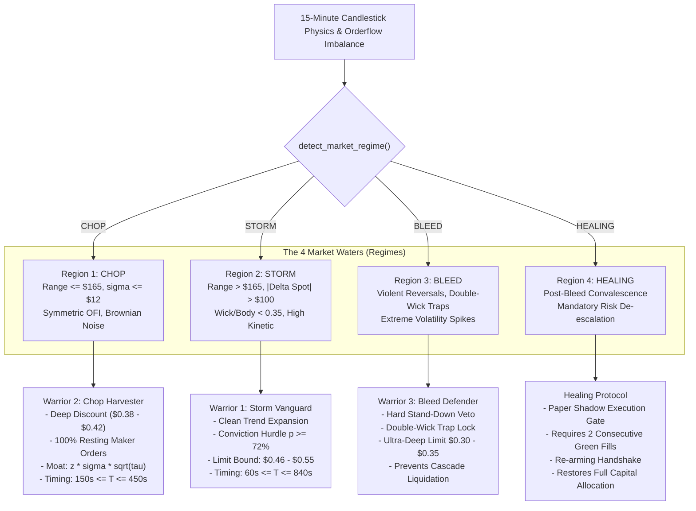

# The Fleet Doctrine: 1 Boat, 3 Warriors across 4 Market Regions

**Path:** `docs/02_TRADING_SYSTEM/DUAL_WARRIOR_4_REGIONS.md`  
**Classification:** Quantitative Fleet Architecture & Market State Dynamics  
**Authority:** The Quant Council & Arbiter Koko  
**Mathematical Standards:** Zero-Float Financial Math (`decimal.Decimal`)  

---

## 1. System Metaphor & Operational Architecture

A static trading algorithm cannot endure across shifting market regimes in 15-minute crypto binary options. The system adopts the **One Boat, Three Warriors** architectural doctrine:

> **The Boat:** The execution vessel and infrastructure hub (`Bot 1 V4 Engine`).  
> **The Waters:** The 4 physical market regimes (`CHOP`, `STORM`, `BLEED`, `HEALING`).  
> **The Crew:** The specialized execution warriors (`Chop Harvester`, `Storm Vanguard`, `Bleed Defender`).  
> **The Convalescence Harbor:** The `Healing Protocol` probationary safety gate.



---

## 2. Forensic Physics of the 4 Market Regions

### 2.1 Region 1: The Choppy Sea (`CHOP`)
- **Empirical Market Signature:**
  - 15-minute High-Low Range: $\le \$165.00$ ($\le 0.20\%$ of spot at $\$82,500$ BTC).
  - 1-minute Rolling Realized Volatility: $\sigma_{1\text{m}} \le \$12.00$.
  - Order Flow Imbalance (OFI): $|\text{OFI}| \le 0.15$ (symmetric quoting, zero aggressive net delta).
- **Failure Mode if Unmanaged:**
  - Momentum bots suffer rapid decay death. Brownian noise oscillates across strikes, and buying above $\$0.48$ yields negative expected value.
- **The Execution Protocol (Warrior 2 — Chop Harvester):**
  - **Limit Order Corridor:** Strictly **`$0.38 - $0.42`** resting maker bids ($0.00 fee).
  - **Dynamic Noise Moat:** Orders are placed outside the high-probability noise envelope:
    $$\text{Moat} = z \cdot \sigma \cdot \sqrt{\tau}$$
  - **Timing Gate:** Orders only placed when $150\text{s} \le T \le 450\text{s}$.

### 2.2 Region 2: The Stormy Sea (`STORM`)
- **Empirical Market Signature:**
  - Directional Candle Expansion: 15-minute range $> \$165.00$ with directional displacement $|\Delta \text{Spot}| > \$100.00$.
  - Candle Morphology: Wick-to-body ratio $\frac{\text{Wick}}{\text{Body}} < 0.35$ (clean body with minimal rejection).
  - Microstructural Unanimity: HMM Macro Brain and ONNX orderflow are directionally aligned.
- **Failure Mode if Unmanaged:**
  - Standing in front of a storm with mean-reversion bids causes total contract loss as the market sweeps through strikes.
- **The Execution Protocol (Warrior 1 — Storm Vanguard):**
  - **Conviction Gate:** Requires posterior calibrated win probability $P_{\text{win}} \ge 72.0\%$ and net $\text{EV} \ge +\$0.03$.
  - **Limit Order Corridor:** **`$0.46 - $0.55`**, never chasing tops above $\$0.55$.
  - **Timing Gate:** Active between $60\text{s} \le T \le 840\text{s}$.

### 2.3 Region 3: The Bleed Sea (`BLEED`)
- **Empirical Market Signature:**
  - Massive high-low candle ranges ($> \$250.00$) characterized by large upper and lower wicks ($\frac{\text{Wick}}{\text{Body}} > 1.2$).
  - Rapid directional whipsaws that trigger stop-outs and pin rejections within the same 15-minute cycle.
- **Failure Mode if Unmanaged:**
  - Consecutive losses due to double-wick stop hunts and gamma traps.
- **The Execution Protocol (Warrior 3 — Bleed Defender):**
  - **Double-Wick Trap Veto:** Automatically suppresses market entry if candle wicks exceed $60\%$ of total range.
  - **Ultra-Conservative Pricing:** Orders restricted to **`$0.30 - $0.35`** deep-discount liquidity traps.
  - **Mandatory Stand-Down:** If 2 consecutive losses occur in Bleed, the engine locks for 30 minutes.

### 2.4 Region 4: The Healing Sea (`HEALING`)
- **Empirical Market Signature:**
  - The market transitioning from high-volatility Bleed back toward stable Chop. Spreads remain elevated ($\approx \$0.04 - \$0.05$).
- **The Execution Protocol (Healing Protocol):**
  - **Shadow Gate:** The engine runs in paper-shadow mode for a minimum of 2 cycles.
  - **Re-Arming Handshake:** Full live trading capital is restored only after 2 consecutive profitable paper cycles pass all microstructural safety filters.

---

## 3. Market Preset Parameter Matrix

The engine loads operational presets dynamically from `data/market_condition_presets.json`:

```json
{
  "CHOP": {
    "min_price": "0.38",
    "max_price": "0.42",
    "min_probability": "0.58",
    "min_edge": "0.02",
    "min_time_sec": 150,
    "max_time_sec": 450,
    "moat_multiplier": "1.20"
  },
  "STORM": {
    "min_price": "0.46",
    "max_price": "0.55",
    "min_probability": "0.72",
    "min_edge": "0.03",
    "min_time_sec": 60,
    "max_time_sec": 840,
    "moat_multiplier": "1.80"
  },
  "BLEED": {
    "min_price": "0.30",
    "max_price": "0.35",
    "min_probability": "0.75",
    "min_edge": "0.04",
    "min_time_sec": 300,
    "max_time_sec": 600,
    "moat_multiplier": "2.50"
  }
}
```

All pricing parameters are parsed strictly into `decimal.Decimal` objects at runtime to satisfy Rule 1 of [`AGENTS.md`](file:///f:/012D_TRADE/Kalshi%20Simulator/AGENTS.md).
