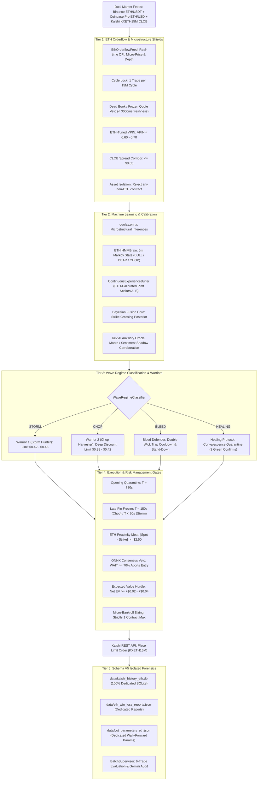

# Institutional Specification: ETH Bot 1 V4 (QuoLas ETH Domination Engine)

**Path:** `docs/02_TRADING_SYSTEM/ETH_DOMINATION_SPECIFICATION.md`  
**Classification:** Core Quantitative Architecture Specification  
**Asset Target:** Kalshi Ethereum 15-Minute Binary Contracts (`KXETH15M`)  
**Underlying Feed:** Binance ETH/USDT Spot WebSocket + Coinbase Pro ETH/USD Feed  
**Execution Venue:** Kalshi Central Limit Order Book (CLOB)  
**Production Daemon:** Systemd `kalshi-eth-bot.service` (AWS EC2)  
**Seal of Excellence:** SHA-256 Token `SEAL-ETH_-A37A256E23B8` (Verified on Disk)  
**Database Isolation:** Dedicated `data/kalshi_history_eth.db` (Schema V5)  
**Mathematical Precision:** Strict Zero-Float Math (`decimal.Decimal` in Python, `decimal.js` in TypeScript)  

---

## 1. Executive Strategy Architecture

ETH Bot 1 V4 ("QuoLas ETH") is an isolated algorithmic engine engineered specifically for the higher-volatility, lower-liquidity Ethereum binary options market on Kalshi. It maintains strict data, parameter, and process isolation from the BTC engine to prevent cross-asset history contamination.



---

## 2. Asset History Isolation Architecture

Prior to PR-014, evaluation cycles suffered from history cross-contamination where BTC historical settlement records polluted ETH assessment metrics. ETH Bot 1 V4 enforces strict physical separation across every layer of the software stack:

| Component | BTC Production Asset | ETH Production Asset | Separation Enforcer |
| :--- | :--- | :--- | :--- |
| **Database** | `data/kalshi_history.db` | `data/kalshi_history_eth.db` | `get_eth_db_writer()` |
| **Win/Loss Ledger** | `data/win_loss_reports.json` | `data/eth_win_loss_reports.json` | Explicit file path routing |
| **Parameter Vault** | `data/bot_parameters.json` | `data/bot_parameters_eth.json` | Isolated JSON config |
| **Process Daemon** | `kalshi-bot.service` | `kalshi-eth-bot.service` | Independent systemd daemons |
| **Seal Token** | `SEAL-BTC_-...` | `SEAL-ETH_-A37A256E23B8` | On-disk SHA-256 seal check |
| **Contract Prefix** | `KXBTC15M` | `KXETH15M` | `validate_asset_isolation()` |

### 2.1 The Isolation Invariant
```python
def validate_asset_isolation(contract_ticker: str, target_asset: str = "ETH") -> bool:
    """Verifies that an incoming contract strictly matches the bot's target asset."""
    expected_prefix = f"KX{target_asset.upper()}"
    if not contract_ticker.startswith(expected_prefix):
        raise ValueError(
            f"CONTAMINATION ERROR: {contract_ticker} does not match target asset {target_asset}"
        )
    return True
```

---

## 3. Kev Lead Taker Architecture & Math-of-Winning

Kev has been elevated from an auxiliary shadow oracle to the **Chief Directional Lead Taker**. Rather than passively waiting in the bid queue where adverse selection occurs, the engine executes crossing taker orders governed by real-time math-of-winning:

1. **Directional Conviction (75% Weight):** Kev evaluates real-time order flow imbalances (OFI), whale sweeps, and cross-venue spot momentum with sub-2ms latency to issue `YES` or `NO` signals ($\ge 60\%$ confidence).
2. **Physical Diffusion (25% Weight):** Continuous Black-Scholes Gaussian erf strike crossing probability:
   $$z = \frac{S_t - K}{\sigma_{15\text{m}} \sqrt{\tau / 900.0}}, \quad P_{\text{physics}} = \frac{1}{2}\left[1 + \text{erf}\left(\frac{z}{\sqrt{2}}\right)\right]$$
3. **Continuous Math-of-Winning Formulation:**
   $$P_{\text{win}} = 0.75 \cdot P_{\text{kev}} + 0.25 \cdot P_{\text{physics}}$$
4. **Anti-Toxic Dynamic Hurdle & Taker Ceiling:**
   $$\delta_{\text{hurdle}} = \$0.08 + (0.10 \times \text{VPIN})$$
   $$\text{Max Taker Price} = \min\left(P_{\text{win}} - \delta_{\text{hurdle}}, \$0.55\right)$$
   The bot refuses to overpay when the best ask exceeds this ceiling (`[MATH HURDLE VETO]`).
5. **Anti-OTM Moneyness Trap Protection:**
   Blocks speculative out-of-the-money purchases:
   - If Kev recommends `YES` but Spot $S < K - \$3.00$, the bot stands down to `WAIT`.
   - If Kev recommends `NO` but Spot $S > K + \$3.00$, the bot stands down to `WAIT`.
6. **Immediate-or-Cancel (IOC) Execution:**
   All taker limit orders specify `time_in_force="immediate_or_cancel"`. If liquidity is absent or price shifts, the order cancels immediately with zero resting exposure.
7. **Dedicated 7-Consecutive-Loss Total Stop Circuit Breaker:**
   Isolated from BTC, if the ETH bot incurs 7 consecutive live losses, execution enters an immediate **TOTAL STOP** (`is_eth_bot_armed = False`). No unmonitored hot-swap or failover occurs.

---

## 4. Parameter Manifest (`data/bot_parameters_eth.json`)

| Parameter Name | Canonical Value | Data Type | Purpose |
| :--- | :--- | :--- | :--- |
| `min_time_remaining` | `120` | `int` | Terminal freeze boundary |
| `max_time_remaining` | `840` | `int` | Opening quarantine boundary |
| `max_taker_ceiling` | `Decimal("0.55")` | `Decimal` | Hard ceiling for taker limit orders |
| `hurdle_base` | `Decimal("0.08")` | `Decimal` | Base mathematical edge requirement |
| `vpin_toxic_threshold`| `Decimal("0.60")` | `Decimal` | Max allowable orderflow toxicity |
| `proximity_moat` | `Decimal("2.50")` | `Decimal` | Dollar moat calibrated to ETH spot scale |
| `otm_trap_threshold` | `Decimal("3.00")` | `Decimal` | Anti-OTM moneyness tolerance |
| `eth_loss_limit` | `7` | `int` | Consecutive loss total stop threshold |

---

## 5. Walk-Forward Operational Protocol

1. **Trade Collection:** Batches run in increments of 6 settled trades.
2. **Forensic Autopsy:** Losses are analyzed by [`src/kalshi_sim/ml/eth_bot1v4/eth_autopsy.py`](file:///f:/012D_TRADE/Kalshi%20Simulator/src/kalshi_sim/ml/eth_bot1v4/eth_autopsy.py) with 6 causal failure codes.
3. **Dynamic Calibration:** Platt scalars $(A, B)$ are refreshed and written to `bot_parameters_eth.json`.
4. **ASVL Verification:** Post-batch parameter updates must pass the autonomous test suite:
   ```bash
   python -m pytest tests/test_eth_bot1v4.py -v
   ```

