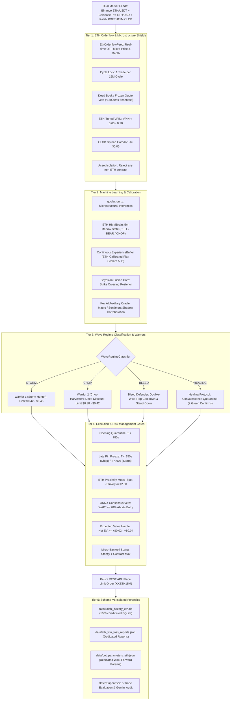

# Institutional Specification: ETH Bot 1 V4 (QuoLas ETH Domination Engine)

**Path:** `docs/02_TRADING_SYSTEM/ETH_DOMINATION_SPECIFICATION.md`  
**Classification:** Core Quantitative Architecture Specification  
**Asset Target:** Kalshi Ethereum 15-Minute Binary Contracts (`KXETH15M`)  
**Underlying Feed:** Binance ETH/USDT Spot WebSocket + Coinbase Pro ETH/USD Feed  
**Execution Venue:** Kalshi Central Limit Order Book (CLOB)  
**Production Daemon:** Systemd `kalshi-eth-bot.service` (AWS EC2)  
**Seal of Excellence:** SHA-256 Token `SEAL-ETH_-A37A256E23B8` (Verified on Disk)  
**Database Isolation:** Dedicated `data/kalshi_history_eth.db` (Schema V5)  
**Mathematical Precision:** Strict Zero-Float Math (`decimal.Decimal` in Python, `decimal.js` in TypeScript)  

---

## 1. Executive Strategy Architecture

ETH Bot 1 V4 ("QuoLas ETH") is an isolated algorithmic engine engineered specifically for the higher-volatility, lower-liquidity Ethereum binary options market on Kalshi. It maintains strict data, parameter, and process isolation from the BTC engine to prevent cross-asset history contamination.



---

## 2. Asset History Isolation Architecture

Prior to PR-014, evaluation cycles suffered from history cross-contamination where BTC historical settlement records polluted ETH assessment metrics. ETH Bot 1 V4 enforces strict physical separation across every layer of the software stack:

| Component | BTC Production Asset | ETH Production Asset | Separation Enforcer |
| :--- | :--- | :--- | :--- |
| **Database** | `data/kalshi_history.db` | `data/kalshi_history_eth.db` | `get_eth_db_writer()` |
| **Win/Loss Ledger** | `data/win_loss_reports.json` | `data/eth_win_loss_reports.json` | Explicit file path routing |
| **Parameter Vault** | `data/bot_parameters.json` | `data/bot_parameters_eth.json` | Isolated JSON config |
| **Process Daemon** | `kalshi-bot.service` | `kalshi-eth-bot.service` | Independent systemd daemons |
| **Seal Token** | `SEAL-BTC_-...` | `SEAL-ETH_-A37A256E23B8` | On-disk SHA-256 seal check |
| **Contract Prefix** | `KXBTC15M` | `KXETH15M` | `validate_asset_isolation()` |

### 2.1 The Isolation Invariant
```python
def validate_asset_isolation(contract_ticker: str, target_asset: str = "ETH") -> bool:
    """Verifies that an incoming contract strictly matches the bot's target asset."""
    expected_prefix = f"KX{target_asset.upper()}"
    if not contract_ticker.startswith(expected_prefix):
        raise ValueError(
            f"CONTAMINATION ERROR: {contract_ticker} does not match target asset {target_asset}"
        )
    return True
```

---

## 3. Kev AI Auxiliary Architecture Integration

Kev AI provides real-time auxiliary macro-sentiment and multi-timeframe pattern recognition. To protect execution latency and prevent credit burn, Kev AI operates strictly as an **asynchronous shadow oracle**:

1. **Non-Blocking Inference:** Kev AI runs in an asynchronous worker thread; execution on the Kalshi CLOB is never blocked waiting for external LLM inference.
2. **Confidence Corroboration:** When available, Kev AI provides a secondary confidence weight $w_{\text{kev}} \in [0.0, 1.0]$. If Kev AI flags extreme systemic distress ($w_{\text{kev}} < 0.20$), entry size is clamped to zero.
3. **Audit Ledger:** Kev AI outputs are stored in `data/kev_ai_shadow_ledger.jsonl` for offline counterfactual analysis.

---

## 4. Parameter Manifest (`data/bot_parameters_eth.json`)

| Parameter Name | Canonical Value | Data Type | Purpose |
| :--- | :--- | :--- | :--- |
| `min_time_remaining` | `150` | `int` | Late pin boundary for Chop |
| `max_time_remaining` | `780` | `int` | Opening quarantine boundary |
| `storm_max_time_remaining`| `840` | `int` | Max time allowed for Storm entries |
| `storm_min_time_remaining`| `60` | `int` | Late pin cutoff for Storm entries |
| `min_edge` | `Decimal("0.02")`| `Decimal` | Minimum expected value hurdle |
| `min_probability` | `Decimal("0.58")`| `Decimal` | Probability threshold |
| `max_price_cents` | `Decimal("45")` | `Decimal` | Conservative buy ceiling for ETH |
| `min_price_cents` | `Decimal("38")` | `Decimal` | Deep discount floor |
| `max_spread_cents` | `Decimal("5")` | `Decimal` | Spread limit |
| `vpin_threshold` | `Decimal("0.65")`| `Decimal` | Max allowable toxicity |
| `proximity_moat` | `Decimal("2.50")` | `Decimal` | Dollar moat calibrated to ETH spot scale |

---

## 5. Walk-Forward Operational Protocol

1. **Trade Collection:** Batches run in increments of 6 settled trades.
2. **Forensic Autopsy:** Losses are analyzed by [`src/kalshi_sim/ml/eth_bot1v4/eth_autopsy.py`](file:///f:/012D_TRADE/Kalshi%20Simulator/src/kalshi_sim/ml/eth_bot1v4/eth_autopsy.py) with 7 causal failure codes.
3. **Dynamic Calibration:** Platt scalars $(A, B)$ are refreshed and written to `bot_parameters_eth.json`.
4. **ASVL Verification:** Post-batch parameter updates must pass the autonomous test suite:
   ```bash
   python -m pytest tests/test_eth_bot1v4_integration.py -q
   ```
