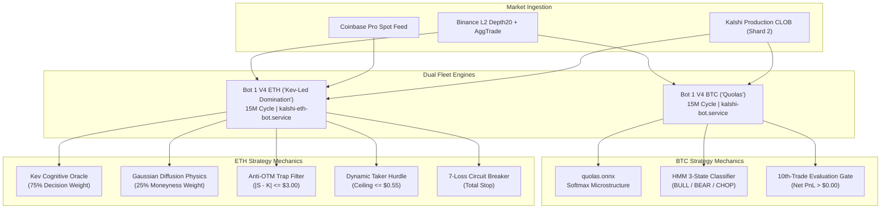

# Fleet Strategy Architecture & Operational Guide: 15-Minute Event Execution

**Document Classification:** Core Quantitative Fleet Manual  
**Effective Date:** 2026-10-16  
**Active Production Branch:** `zero_hallucination_mode`  
**Execution Venue:** Kalshi Central Limit Order Book (CLOB) Production  
**Production Host:** AWS EC2 (`13.63.158.94`)  
**Mathematical Standard:** Strict Zero-Float Financial Math (`decimal.Decimal` in Python, `decimal.js` in TypeScript)  

---

## 1. Executive Fleet Summary

The Kalshi Quantitative Fleet operates as a dual-engine algorithmic deployment engineered strictly and exclusively for **15-Minute Event Contracts** (`KXBTC15M`, `KXETH15M`). All experimental 5-minute contracts and sprint bots have been permanently decommissioned, purged from both frontend and backend, and barred by guardrails.



---

## 2. Active Strategy Specifications

### 2.1 Bot 1 V4 BTC ("Quolas")
- **Target Contract:** `KXBTC15M` (15-Minute Bitcoin Binary Events)
- **Production Service:** `kalshi-bot.service` (AWS EC2 PID 347264)
- **Exchange Shard:** Shard 2 (Crypto Matching Engine)
- **Core Signal Pipeline:**
  1. **Dual-Brain ONNX Model (`quolas.onnx`):** Ingests 15 spatial orderbook features and 13 toxic flow indicators, generating softmax probability distribution over `[UP, DOWN, WAIT]`.
  2. **Gaussian HMM Regime Classifier (`hmm_latest.pkl`):** Classifies the macroeconomic state into `BULL`, `BEAR`, or `CHOP` to toggle aggressive breakout vs. conservative discount behaviors.
  3. **Supervisory 10-Trade Gate:** Live capital is gated by a strict 10-trade evaluation checkpoint. Upon the settlement of the 10th live trade, if cumulative realized PnL is non-positive ($\le \$0.00$), the BTC bot is immediately and automatically disarmed.
  4. **Micro-Bankroll Sizing:** Strictly 1 contract per cycle, 1 trade per 15-minute event.

---

### 2.2 Bot 1 V4 ETH ("Kev the Lead Domination")
- **Target Contract:** `KXETH15M` (15-Minute Ethereum Binary Events)
- **Production Service:** `kalshi-eth-bot.service` (AWS EC2 PID 347260)
- **Exchange Shard:** Shard 2 (Crypto Matching Engine)
- **Core Signal Pipeline:**
  1. **Kev Cognitive Lead Taker (75% Weight):**
     Kev functions as Chief Directional Officer. Operating with sub-millisecond latency (0.5ms–1.6ms), Kev evaluates real-time order flow imbalances (OFI), whale sweeps, and cross-venue spot momentum to issue directional conviction (`YES` or `NO` with confidence $\ge 60\%$).
  2. **Gaussian Moneyness Physics ($P_{\text{physics}}$, 25% Weight):**
     Calculates instantaneous strike crossing probability:
     $$z = \frac{S_t - K}{\sigma_{15\text{m}} \sqrt{\tau / 900.0}}, \quad P_{\text{physics}} = \frac{1}{2}\left[1 + \text{erf}\left(\frac{z}{\sqrt{2}}\right)\right]$$
  3. **Continuous Math-of-Winning Formulation:**
     $$P_{\text{win}} = 0.75 \cdot P_{\text{Kev}} + 0.25 \cdot P_{\text{physics}}$$
  4. **Anti-Toxic Dynamic Hurdle:**
     $$\text{Hurdle} = \$0.08 + (0.10 \times \text{VPIN})$$
     $$\text{Max Taker Price} = \min\left(P_{\text{win}} - \text{Hurdle}, \$0.55\right)$$
     The engine refuses to overpay when book ask exceeds the taker ceiling or when VPIN indicates toxic flow.
  5. **Anti-OTM Moneyness Trap Protection:**
     Prevents buying out-of-the-money lottery bets when spot is contrary to strike:
     - If Kev recommends `YES` but Spot $S < K - \$3.00$, execution overrides to `WAIT`.
     - If Kev recommends `NO` but Spot $S > K + \$3.00$, execution overrides to `WAIT`.
  6. **Zero-Liquidity Orderbook Protection:**
     Instantly vetoes order placement if the CLOB ask side is completely empty, preventing resting maker drift.
  7. **Immediate-or-Cancel (IOC) Execution:**
     All taker orders specify `time_in_force="immediate_or_cancel"`. If liquidity moves before match, the order is cancelled immediately with zero unmonitored resting exposure.
  8. **7-Consecutive-Loss Total Stop Circuit Breaker:**
     ETH bot maintains an isolated loss-streak counter (`_eth_consecutive_losses`). Reaching 7 consecutive live losses triggers a **TOTAL STOP** (`is_eth_bot_armed = False`), halting execution without automated failover or hot-swap.

---

## 3. Dynamism: Conceptual & Mathematical Reality

In this architecture, **Dynamism does NOT mean random or unstable behavior.** It means that order pricing, risk hurdles, and execution timing are recalculated dynamically on every market tick rather than being governed by hardcoded static values.

| Dimension | Static Legacy Model (Vulnerable) | Dynamic Math-of-Winning Model (Active) |
| :--- | :--- | :--- |
| **Taker Price Limit** | Fixed $\$0.42$ or $\$0.50$ bid | Calculated per second: $P_{\text{win}} - (0.08 + 0.10 \times \text{VPIN})$ |
| **Orderbook Toxicity** | Ignored; orders blindly fill | VPIN dynamically widens hurdle or triggers immediate Toxic Sweep Veto |
| **Moneyness Verification** | Assumed from signal | Real-time distance $|S_t - K|$ checked against $\$3.00$ noise threshold |
| **Time Decay ($\tau$)** | Uniform 15-minute treatment | Dynamic volatility scaling: $\sigma_{\tau} = \sigma_{15\text{m}} \sqrt{\tau / 900.0}$ |
| **Liquidity Handling** | Resting maker order waits | Strict IOC taker; stands down if asks are empty |

---

## 4. Continuous Learning & Alignment

Every settled 15-minute cycle updates the bot's internal experience memory:

### 4.1 Platt Scaling Recalibration ($\alpha$)
Following each settled trade, the bot's Brier score calibration curve is recalculated:
$$\text{Confidence}_{\text{calibrated}} = \frac{1}{1 + \exp(-\alpha \cdot z)}$$
If previous cycles resulted in losses, $\alpha$ contracts future probabilities to prevent aggressive entries.

### 4.2 Automated Failure Autopsies
Every losing trade is categorized into one of 6 failure codes and persisted to SQLite:
- `ERR_TWAP_PIN_VICTIM`: Spot settled near strike, but 60-second TWAP pinned the contract against the position.
- `ADVERSE_SELECTION_SWEEP`: Entry filled immediately preceding an informed whale dump.
- `ERR_COUNTER_TREND`: Bet conflicted with the prevailing 1-hour macro price slope.
- `ERR_DOUBLE_WICK_TRAP`: Long wicks on both sides indicated exhaustion chop.
- `ERR_DOOMED_HOLD_TO_ZERO`: High entry price held into expiration without early exit.
- `STRIKE_PROXIMITY_TRAP`: Spot was within $\$2.00$ of strike at settlement (coin flip).

### 4.3 Quadrant Pruning
If a specific regime (e.g. `CHOP` with high volatility) produces a statistically negative win rate in recent history, that market quadrant is pruned, commanding the bot to stand down on identical setups until conditions improve.

---

## 5. Decommissioned Strategies (Permanent Tombstone)

Per explicit operator directive, the following strategies and contracts are permanently decommissioned and forbidden:

| Strategy / Contract | Status | Reason |
| :--- | :--- | :--- |
| **`bot5_5min_btc`** | 🪦 PERMANENTLY DELETED | 5-Minute noise incubator; high slippage, zero edge |
| **`ofi_sprint_scalper`** | 🪦 PERMANENTLY DELETED | Sub-15M high-frequency sprint scalper; deprecated |
| **`KXBTC5M` / `KXETH5M`** | 🚫 PERMANENTLY PROHIBITED | All 5M contracts immediately vetoed by `AgentGuardrails` (`5m_decommissioned`) |

---

## 6. AWS EC2 Operations & Monitoring Runbook

### Service Manifest
| Service | Script / Entrypoint | Target Asset | Log Command |
| :--- | :--- | :--- | :--- |
| `kalshi-bot.service` | `aws_headless_daemon.py` | `KXBTC15M` | `journalctl -u kalshi-bot.service -f` |
| `kalshi-eth-bot.service` | `paper_trade_ethbot.py --mode live` | `KXETH15M` | `journalctl -u kalshi-eth-bot.service -f` |

### Key Operator Commands
```bash
# Check service status
systemctl status kalshi-bot.service kalshi-eth-bot.service --no-pager

# Restart both bots cleanly (Rule 6 Cache Invalidation Protocol)
sudo systemctl restart kalshi-bot.service kalshi-eth-bot.service

# View live telemetry stream for ETH Bot
journalctl -u kalshi-eth-bot.service -f -n 50

# View live account balance and order logs for BTC Bot
journalctl -u kalshi-bot.service -f -n 50
```
