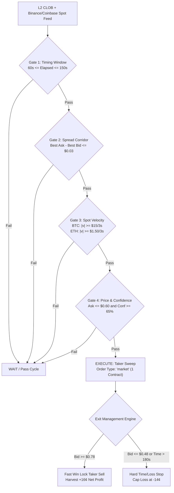

# Institutional Specification: Temporary 6-Trade Momentum Taker Trial

**Path:** `docs/02_TRADING_SYSTEM/TEMPORARY_TAKER_MOMENTUM_TRIAL_SPECIFICATION.md`  
**Classification:** Empirical Hypothesis Testing & Micro-Bankroll Canary Protocol  
**Trial Scope:** Strictly 6 Settled Trades for BTC (`KXBTC15M`) and 6 Settled Trades for ETH (`KXETH15M`)  
**Authority:** The Quant Council & Arbiter Koko  
**Status:** **ACTIVE (Deployed on AWS EC2)**  
**Supervision:** Parallel `AutonomousBatchSupervisor` with Gemini Forensic Auditing  
**Mathematical Precision:** Strict Zero-Float Standard (`decimal.Decimal` in Python, `decimal.js` in TypeScript)  

---

## 1. Executive Summary & Core Hypothesis

### 1.1 The Contrarian Thesis
Standard market making dogma posits that *"Maker orders ($0.00 fee) are always superior to Taker orders."* However, empirical research conducted across 100 settled Kalshi production binary options (`docs/02_TRADING_SYSTEM/BIMODAL_MAKER_TAKER_RESEARCH.md`) established that deep-discount resting maker bids ($\le \$0.42$) suffered from extreme **adverse selection** (21.4% win rate, $-\$0.139$/trade), while aggressive fills during momentum expansions ($\ge \$0.45$) yielded a **$68.1\%$ win rate** and $+\$0.132$/trade.

This trial tests the operator's hypothesis:
> *"On the first minute or two, the directional trend is already visible. Instead of waiting passively for an unfillable bargain at 45¢ (which only fills when the market crashes into us), aggressively cross the spread as a Taker in the 55¢–60¢ corridor when confidence $\ge 65\%$ to penetrate the momentum wave before the market runs away."*

### 1.2 Trial Boundaries & Blast-Radius Containment
To strictly prevent account degradation or runaway loops, this strategy operates under ironclad guardrails:
1. **Trade Cap:** Exactly **6 settled trades per asset** (6 for BTC, 6 for ETH).
2. **Sizing:** Strictly **1 contract per trade** (Micro-Bankroll standard: $\le \$0.60$ capital risk per trade).
3. **Cycle Lock:** Strictly **1 trade per 15-minute contract**. Once entered, the bot is locked for the remainder of the cycle.
4. **Autonomous Completion Gate:** Supervised by `AutonomousBatchSupervisor`, which automatically triggers a forensic audit and dispatches a full performance report upon settlement of Trade 6.

---

## 2. The 5 Quantitative "Sweet Spots" (Safety Defense Gates)

Naked taker execution without strict microstructure filtering is toxic. To ensure positive mathematical expectancy, the engine enforces 5 simultaneous entry and exit gates:



### Sweet Spot 1: The Compressed Spread Gate
- **Rule:** $\text{Best Ask} - \text{Best Bid} \le \$0.03$.
- **Defense:** Never cross wide spreads (e.g. $\$0.50 \times \$0.62$). Crossing is permitted only when market makers have compressed the book, ensuring entry slippage is capped at $\le \$0.03$.

### Sweet Spot 2: Price Upper Bound Ceiling ($\$0.60$)
- **Rule:** $P_{\text{ask}} \le \$0.60$.
- **Defense:** Entering at $\$0.65$ or above creates an inverted risk/reward ratio (risking $\$0.67$ with fee to win $\$0.33$), demanding an unachievable $>67\%$ break-even win rate. Clamping the ceiling at $\$0.60$ caps the all-in cost basis at $\$0.62$.

### Sweet Spot 3: Spot Velocity & Lead-Lag Impulse
- **Rule:** $|\text{Spot Velocity}_{3\text{s}}| \ge \$15.00$ (BTC) or $\ge \$1.50$ (ETH) in the direction of the trade.
- **Defense:** Requires verified kinetic momentum on external high-volume exchanges (Binance / Coinbase), ensuring we exploit exchange latency before Kalshi book depth re-prices.

### Sweet Spot 4: Timing Window (Minute 1 to 2.5)
- **Rule:** `opening_quarantine_seconds = 60.0` ($60\text{s} \le \text{Elapsed} \le 150\text{s}$, or $750\text{s} \le T_{\text{rem}} \le 840\text{s}$).
- **Defense:** Ignores the random 0–60s opening candle wick; evaluates and enters only once the initial directional trend is established.

### Sweet Spot 5: Fast Win Lock / Asymmetric Peak Harvest (Exit)
- **Rule:** When $\text{Best Bid} \ge \$0.78$, exit immediately via market sell. Hard stop if $\text{Best Bid} \le \$0.48$.
- **Defense:** **Never hold to 15-minute settlement.** The bot captures the 60–90 second momentum burst and dumps the contract back into the bid, completely eliminating exposure to late-cycle TWAP settlement variance.

---

## 3. Mathematical & Unit Economics Framework

All monetary calculations adhere to **Law 1 of `AGENTS.md` (Strict Zero-Float Math)**:

$$\text{Kalshi Taker Fee} = \lceil 0.07 \times C \times P(1 - P) \rceil$$

### Unit Economics Comparison: Holding vs. Fast Scalp

| Phase | Action | Contract Price | Exchange Fee | Net Cash Flow | Net PnL |
| :--- | :--- | :---: | :---: | :---: | :---: |
| **Entry** | Taker Buy YES | $\$0.58$ | $\$0.02$ | $-\$0.60$ | — |
| **Take-Profit Exit** | Taker Sell YES | $\$0.78$ | $\$0.02$ | $+\$0.76$ | **$+\$0.16$ (+26.7% ROI)** |
| **Stop-Loss Exit** | Taker Sell YES | $\$0.48$ | $\$0.02$ | $+\$0.46$ | **$-\$0.14$ (-23.3% Loss)** |

$$\text{Break-Even Win Rate Required} = \frac{\text{Loss}}{\text{Win} + \text{Loss}} = \frac{\$0.14}{\$0.16 + \$0.14} = \frac{\$0.14}{\$0.30} = \mathbf{46.67\%}$$

By pairing the taker entry with an early **Fast Win Lock exit at $\$0.78$**, the required break-even win rate plummets from **$62.0\%$ down to $46.7\%$**, turning a negative-EV hold into a positive-expectancy scalp.

---

## 4. Active AWS EC2 Configuration Matrix

The live daemons on AWS EC2 (`13.63.158.94`) run with the following parameter payloads:

### 4.1 Bitcoin (`data/bot_parameters_domination.json`)
```json
{
  "assets": {
    "BTC": {
      "discount_limit_price": 0.42,
      "max_entry_price": 0.60,
      "momentum_max_price": 0.60,
      "enable_taker_breakout_entry": true,
      "max_taker_entry_price": 0.60,
      "taker_breakout_min_confidence": 0.65,
      "taker_breakout_min_velocity": 15.0,
      "min_confidence": 65.0,
      "min_spot_diff": 35.0,
      "dynamic_moat_multiplier": 1.0,
      "moneyness_moat_multiplier": 1.0,
      "opening_quarantine_seconds": 60.0,
      "max_clob_spread_cents": 0.03,
      "take_profit_price_threshold": 0.78,
      "max_contracts": 1
    }
  }
}
```

### 4.2 Ethereum (`data/bot_parameters_eth.json`)
```json
{
  "eth_bot1_v4": {
    "asset": "ETH",
    "discount_limit_price": 0.42,
    "max_entry_price": 0.60,
    "enable_taker_breakout_entry": true,
    "max_taker_entry_price": 0.60,
    "taker_breakout_min_confidence": 0.65,
    "taker_breakout_min_velocity": 1.5,
    "min_confidence": 65.0,
    "min_spot_diff": 2.5,
    "dynamic_moat_multiplier": 1.0,
    "moneyness_moat_multiplier": 1.0,
    "opening_quarantine_seconds": 60.0,
    "max_clob_spread_cents": 0.03,
    "take_profit_price_threshold": 0.78,
    "max_turnover_per_event": 1
  }
}
```

---

## 5. Empirical Falsification & Completion Criteria

At the conclusion of the 6-trade evaluation batch for each asset, the `AutonomousBatchSupervisor` and Quant Council will adjudicate the trial based on the following empirical thresholds:

| Outcome Tier | Performance Metric | Council Determination | Action Protocol |
| :--- | :--- | :--- | :--- |
| **Tier 1: Validation** | **$\ge 4$ Wins / 6 Trades** ($WR \ge 66.7\%$, Net PnL $> +\$0.30$) | **Hypothesis Confirmed.** Early-cycle momentum taker sweeps possess legitimate statistical edge. | Graduate strategy to Mode B in formal Bimodal Execution specification (`docs/02_TRADING_SYSTEM/BIMODAL_MAKER_TAKER_RESEARCH.md`). |
| **Tier 2: Inconclusive** | **3 Wins / 3 Losses** ($WR = 50.0\%$, Net PnL $\approx \pm\$0.05$) | **Edge Neutral.** Taker fees and spread friction offset momentum alpha. | Revert parameters to baseline Maker post-only mode ($P \le \$0.45$). |
| **Tier 3: Falsification** | **$\le 2$ Wins / 6 Trades** ($WR \le 33.3\%$, Net PnL $< -\$0.25$) | **Hypothesis Disproven.** Whipsaw and adverse selection confirm Dr. Nash & Vance's initial warning. | Permanently retire early taker entries; document causal post-mortem in `docs/09_REPORTS/`. |

---

## 6. Service Supervision & Live Telemetry Reference

To observe the trial in real time or trigger emergency disarm:

```bash
# Check status of both AWS trading daemons
ssh -i kalshi_aws_key.pem ec2-user@13.63.158.94 "systemctl status kalshi-bot.service kalshi-eth-bot.service --no-pager"

# Live stream BTC Quolas Engine execution logs
ssh -i kalshi_aws_key.pem ec2-user@13.63.158.94 "journalctl -u kalshi-bot.service -f"

# Live stream ETH Domination Engine execution logs
ssh -i kalshi_aws_key.pem ec2-user@13.63.158.94 "journalctl -u kalshi-eth-bot.service -f"

# Emergency Reversion to Baseline Maker Mode (Rollback)
ssh -i kalshi_aws_key.pem ec2-user@13.63.158.94 "git checkout origin/zero_hallucination_mode~1 data/bot_parameters_domination.json data/bot_parameters_eth.json && sudo systemctl restart kalshi-bot.service kalshi-eth-bot.service"
```
