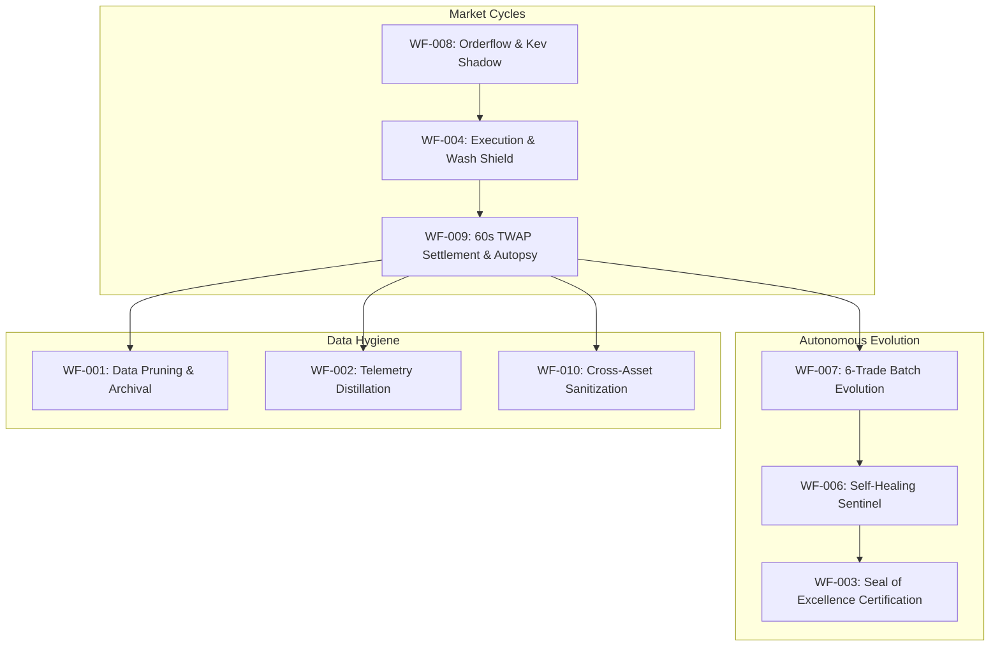

# Master Workflow Registry & Execution Specifications

**Standard:** Structured Production Workflow Specifications  
**Mandate:** Every workflow must define Purpose, Inputs, Outputs, Dependencies, Failure Modes, Owner Agent, and Related Metrics.  

---

## 1. Workflow Architecture Map

---

## 2. Granular Workflow Specifications

### WF-001: Data Pruning & Archival
- **Purpose:** Prevent disk bloat on low-overhead cloud instances (AWS EC2 EBS volumes) by archiving tick-level orderbook streams while preserving aggregated cycle telemetry.
- **Inputs:** Raw `.stream` files, SQLite journal logs, tick database entries $> 7$ days old.
- **Outputs:** Compressed `.tar.gz` cold archives, pruned SQLite vacuumed tables.
- **Dependencies:** Python `gzip`, `shutil`, `sqlite3` VACUUM support.
- **Failure Modes:** Incomplete compression, file lock contention during live bot writing.
- **Owner Agent:** `agent-token-credit` / `high-throughput-data-memory-manager`.
- **Related Metrics:** EBS Disk Utilization ($\le 75\%$), I/O Write Latency ($< 15\text{ms}$).

### WF-002: Real-Time Telemetry Distillation
- **Purpose:** Aggregate high-frequency orderbook ticks and orderflow imbalances into structured 1-second and 5-second candle features for model inference.
- **Inputs:** Binance Level-2 depth snapshots (100ms), trade prints, Coinbase Pro matches.
- **Outputs:** Feature vectors containing VPIN, OFI, Spread, Micro-price, Volatility.
- **Dependencies:** `btc_orderflow_feed.py`, `eth_orderflow_feed.py`, NumPy.
- **Failure Modes:** WebSocket connection drops, gap in sequence numbers, timestamp drift.
- **Owner Agent:** `agent-simudata` / `OrderflowFeeds`.
- **Related Metrics:** Feeds sequence drop rate ($0.0\%$), feature generation latency ($< 5\text{ms}$).

### WF-003: University Strategy Certification (Seal of Excellence)
- **Purpose:** Cryptographically verify that a trading strategy meets quantitative hurdles before capital allocation.
- **Inputs:** Monte Carlo simulation traces (1,000+ runs), backtest metrics, live shadow paper records.
- **Outputs:** Signed `data/seal_of_excellence.json` containing SHA-256 code hash and audit timestamp.
- **Dependencies:** `scripts/self_healing/verify_seal.py`, Python `hashlib`.
- **Failure Modes:** Strategy fails minimum Sharpe hurdle ($\ge 1.50$), max drawdown $> 15\%$, code hash mismatch.
- **Owner Agent:** `agent-integrity-check` / `agent-poe`.
- **Related Metrics:** Strategy Sharpe Ratio, Max Drawdown \%, SHA-256 validity.

### WF-004: Multi-Bot Portfolio Coordination & Wash Trading Veto
- **Purpose:** Synchronously arbitrate trade intent across all active bots (BTC, ETH, Gold) to prevent CFTC wash trading and double-order execution.
- **Inputs:** Proposed trade intent (`ticker`, `side`, `contracts`, `entry_price`).
- **Outputs:** Atomic trade authorization ticket or immediate regulatory/risk veto.
- **Dependencies:** `LiveCoordinator`, `GuardrailsAgent`, in-flight memory locks.
- **Failure Modes:** Race condition during rapid concurrent market triggers, lock timeout expiration ($15\text{s}$).
- **Owner Agent:** `agent-law-order` / `LiveCoordinator`.
- **Related Metrics:** Zero wash violations, lock acquisition latency ($< 3\text{ms}$).

### WF-005: Jules PR Fleet Consolidation
- **Purpose:** Manage autonomous PR reviews, conventional commits, and Git branch sanity between local development and AWS EC2 production.
- **Inputs:** Git commits, diff blocks, CI/CD test results.
- **Outputs:** Merged, tested release on `zero_hallucination_mode` branch.
- **Dependencies:** Git CLI, GitHub remote repository.
- **Failure Modes:** Merge conflicts, failing ASVL test gates, uncommitted dirty files.
- **Owner Agent:** `agency-git-workflow-master` / `agent-codeflow`.
- **Related Metrics:** CI pass rate (100%), branch divergence ($0$ commits).

### WF-006: Autonomous Self-Healing Sentinel
- **Purpose:** Detect runtime anomalies (e.g., stale WebSocket connections, memory leaks, failing endpoints) and self-remedy without human intervention.
- **Inputs:** Process health checks, socket heartbeat timestamps, error log patterns.
- **Outputs:** Auto-restarted connection loops, invalidated caches, alert dispatches.
- **Dependencies:** `src/kalshi_sim/sentinel.py`, `systemd`.
- **Failure Modes:** Flapping restart loops, runaway CPU utilization during recovery.
- **Owner Agent:** `agent-deer` / `AutonomousSentinel`.
- **Related Metrics:** Mean Time to Recovery (MTTR $< 10\text{s}$), uptime ($> 99.9\%$).

### WF-007: Continuous 6-Trade Evaluation & Batch Parameter Evolution
- **Purpose:** Evaluate real trading results in consecutive 6-trade batches, run forensic autopsies, and adjust model parameters within strict blast-radii.
- **Inputs:** Settled cycle reports from `data/win_loss_reports.json` or `data/eth_win_loss_reports.json`.
- **Outputs:** Generated markdown chronicle in `docs/` (`assessment_{date}_#{num}_{asset}_.md`), updated `bot_parameters.json`.
- **Dependencies:** `AutonomousBatchSupervisor`, `ai_assessor.py`, Gemini LLM API.
- **Failure Modes:** API rate limit exhaustion, batch drawdowns ($< 2\text{W}-4\text{L}$) triggering healing protocol.
- **Owner Agent:** `AutonomousBatchSupervisor` / `AI Assessor`.
- **Related Metrics:** Batch Win Rate ($\ge 66.7\%$), Net Batch PnL ($> \$0.00$), Tweaks applied.

### WF-008: Kev AI Shadow Inference & Validation
- **Purpose:** Provide ultra-low-latency, heuristic validation of Bayesian model outputs prior to order routing.
- **Inputs:** Spot price, strike price, time-to-expiry ($\tau$), orderbook imbalance (OFI), Bayesian $P_{\text{win}}$.
- **Outputs:** Shadow decision recommendation (`YES`, `NO`, `WAIT`), heuristic confidence, agreement flag.
- **Dependencies:** `src/kalshi_sim/ml/kev_oracle.py`.
- **Failure Modes:** Inference timeout ($> 2.0\text{ms}$), missing feature inputs.
- **Owner Agent:** `KevDecisionOracle`.
- **Related Metrics:** Sub-2ms execution latency, recommendation agreement rate ($> 85\%$).

### WF-009: 60s TWAP Settlement & Forensic Autopsy
- **Purpose:** Listen for market settlement events, calculate exact realized PnL using Zero Float Financial Math, and trigger root-cause autopsies on losses.
- **Inputs:** Kalshi settlement messages, CF Benchmarks trailing 60s TWAP price.
- **Outputs:** Realized settlement record in SQLite, trade failure autopsy entry in `trade_failure_autopsies`.
- **Dependencies:** `server_settlements.py`, `cfbenchmarks_sync.py`, `DatabaseWriter`.
- **Failure Modes:** Delayed Kalshi settlement notification, missing TWAP tick data.
- **Owner Agent:** `agent-integrity-check` / `server_settlements`.
- **Related Metrics:** PnL calculation accuracy ($100\%$), autopsy attribution rate ($100\%$).

### WF-010: Cross-Asset Contamination Sanitization
- **Purpose:** Audit and purge cross-polluted historical records between Bitcoin and Ethereum databases and JSON ledgers.
- **Inputs:** `data/kalshi_history.db`, `data/kalshi_history_eth.db`, `win_loss_reports.json`, `eth_win_loss_reports.json`.
- **Outputs:** Transactionally cleaned, asset-pure data stores with timestamped backups.
- **Dependencies:** `scripts/sanitize_history_contamination.py`, SQLite WAL mode.
- **Failure Modes:** Foreign key constraint errors, unhandled ticker formats.
- **Owner Agent:** `agent-simudata` / `HistoricalQueryService`.
- **Related Metrics:** Contaminated cross-asset rows ($0$).
