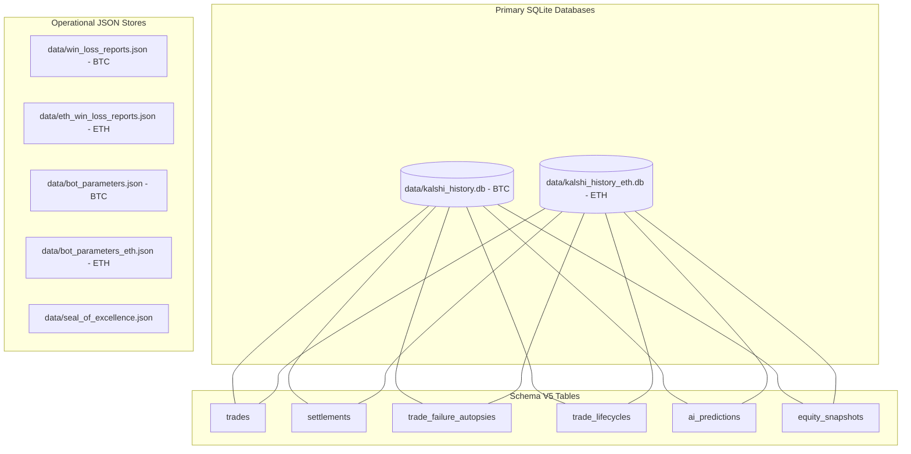

# Master Data Registry & Storage Topology

**System:** Kalshi Autonomous Multi-Asset Trading Platform  
**Data Standards:** Schema V5, Zero Float Financial Math (`decimal.Decimal`), WAL Durability  
**Storage Engine:** SQLite (aiosqlite WAL mode) + Atomic JSON State Files  

---

## 1. Physical Storage Architecture

---

## 2. SQLite Database Catalog (Schema V5)

### 2.1 Table Schemas & Invariants

#### `trades`
- **Purpose:** Authoritative ledger of every executed order across live, simulated, and shadow lanes.
- **Columns:**
  - `id` (INTEGER PRIMARY KEY AUTOINCREMENT)
  - `trade_id` (TEXT UNIQUE NOT NULL)
  - `ticker` (TEXT NOT NULL, e.g., `KXBTC15M-26OCT14-T68000`)
  - `side` (TEXT NOT NULL: `yes` | `no`)
  - `size` (INTEGER NOT NULL)
  - `price` (DECIMAL/REAL NOT NULL)
  - `gross_value` (DECIMAL/REAL NOT NULL)
  - `fees` (DECIMAL/REAL NOT NULL, Kalshi taker schedule)
  - `timeframe` (TEXT NOT NULL, e.g., `15m`)
  - `execution_mode` (TEXT NOT NULL: `live` | `simulated`)
  - `bot_type` (TEXT NOT NULL, e.g., `3_step_domination_bot`, `eth_bot1v4`)
  - `timestamp_epoch_ms` (INTEGER NOT NULL)

#### `settlements`
- **Purpose:** Final settlement outcomes, net PnL, and balance watermarks.
- **Columns:**
  - `id` (INTEGER PRIMARY KEY AUTOINCREMENT)
  - `settlement_id` (TEXT UNIQUE NOT NULL)
  - `ticker` (TEXT NOT NULL)
  - `side` (TEXT NOT NULL)
  - `size` (INTEGER NOT NULL)
  - `entry_price` (DECIMAL/REAL NOT NULL)
  - `settlement_price` (DECIMAL/REAL NOT NULL: `1.00` | `0.00`)
  - `outcome` (TEXT NOT NULL: `win` | `loss` | `flat`)
  - `pnl` (DECIMAL/REAL NOT NULL)
  - `balance_after` (DECIMAL/REAL NOT NULL)
  - `execution_mode` (TEXT NOT NULL)
  - `timestamp_epoch_ms` (INTEGER NOT NULL)

#### `trade_failure_autopsies`
- **Purpose:** Deterministic root-cause attribution for losing trades.
- **Columns:**
  - `id` (INTEGER PRIMARY KEY AUTOINCREMENT)
  - `trade_id` (TEXT NOT NULL)
  - `ticker` (TEXT NOT NULL)
  - `outcome` (TEXT NOT NULL)
  - `realized_pnl` (DECIMAL/REAL NOT NULL)
  - `failure_code` (TEXT NOT NULL: `ERR_COUNTER_TREND`, `ERR_DOOMED_HOLD_TO_ZERO`, `ERR_DOUBLE_WICK_TRAP`, `ERR_TWAP_PIN_VICTIM`, `ERR_DISPERSION_VARIANCE`)
  - `is_counter_trend` (BOOLEAN NOT NULL)
  - `was_salvageable` (BOOLEAN NOT NULL)
  - `salvageable_cents_lost` (DECIMAL/REAL NOT NULL)
  - `is_twap_pin_victim` (BOOLEAN NOT NULL)
  - `timestamp_epoch_ms` (INTEGER NOT NULL)

#### `trade_lifecycles`
- **Purpose:** Full forensic timestamps and latency tracking ($T_1 \to T_2 \to T_3$).
- **Columns:** `id`, `trade_id`, `t1_placement_epoch_ms`, `t2_fill_epoch_ms`, `t3_settle_epoch_ms`, `execution_latency_ms`.

---

## 3. Operational JSON State Files

| File Path | Owning Module | Update Frequency | Purpose |
| :--- | :--- | :--- | :--- |
| `data/win_loss_reports.json` | `server_settlements.py` | On BTC Settlement | Rolling 100-cycle Bitcoin settlement memory. |
| `data/eth_win_loss_reports.json` | `eth_bot1v4_engine.py` | On ETH Settlement | Dedicated Ethereum settlement memory. |
| `data/bot_parameters.json` | `batch_supervisor.py` | Autonomous / Batch | Live active parameters for Bitcoin fleet. |
| `data/bot_parameters_eth.json` | `batch_supervisor.py` | Autonomous / Batch | Live active parameters for Ethereum fleet. |
| `data/seal_of_excellence.json` | `verify_seal.py` | On Certification | SHA-256 cryptographic authorization seals. |
| `data/incubator_state.json` | `incubator_agent.py` | Continuous | Shadow lane paper performance metrics. |

---

## 4. In-Memory Ring Buffers & Tensors

1. **CF Benchmarks TWAP Ring Buffer:**
   - 60-second sliding window at 5Hz (300 ticks max).
   - Computes exact rolling mean spot price for expiration parity checks.
2. **Orderflow Depth Ring Buffer:**
   - Rolling 20-level depth snapshots from Binance and Coinbase.
   - Computes Orderflow Imbalance (OFI) and Volume-Synchronized Probability of Toxicity (VPIN).
3. **ONNX Probability Tensors:**
   - `models/quolas_lead_deer.onnx`: Bitcoin 15M multi-feature probability network.
   - `models/quolas_eth.onnx`: Ethereum 15M multi-feature probability network.
   - Static inference graphs evaluated in $< 2\text{ms}$ per cycle.
