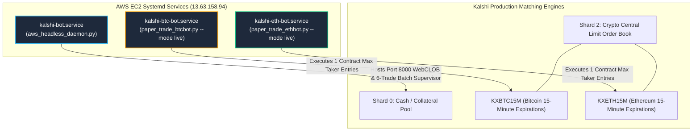
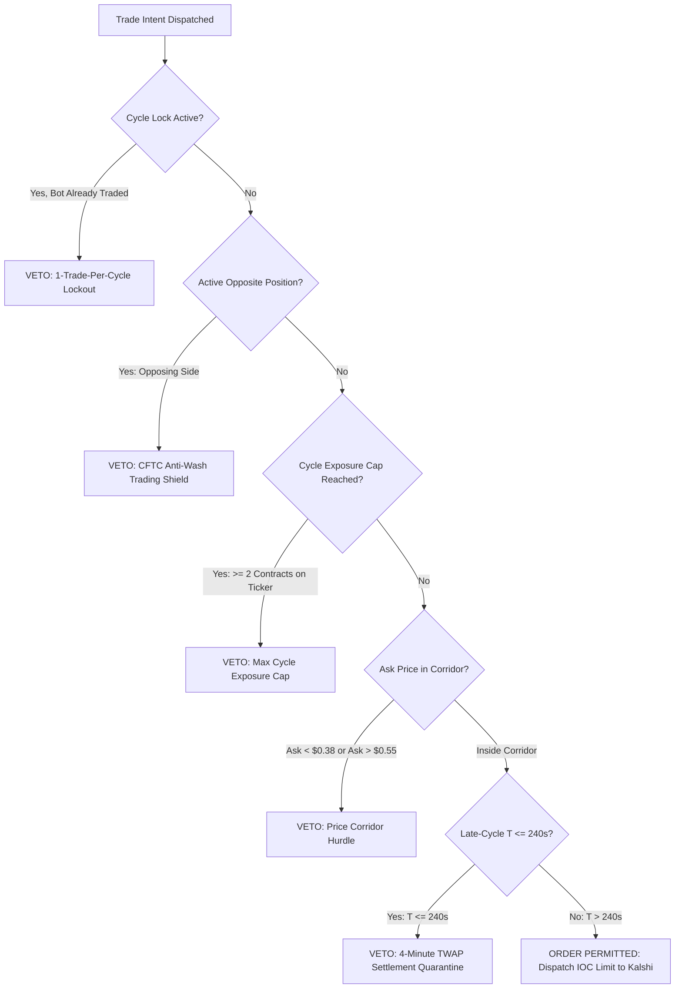

# Fleet Execution Topology, Multi-Asset Concurrency & Guardrails Architecture

**Document ID:** `FLEET_EXECUTION_AND_GUARDRAILS.md`  
**Classification:** Canonical Operations, Execution Guardrails & Fleet Architecture Specification  
**Infrastructure Target:** AWS EC2 Production (`13.63.158.94`) & Local Terminal  
**Compliance Standard:** CFTC Regulatory Directives, Zero Float Financial Math (`decimal.Decimal`), and AGENTS.md Directives  

---

## 1. Fleet Topology & Daemon Overview

The Kalshi Simulator production environment on AWS EC2 operates a **3-daemon concurrent architecture** overseen by systemd:



### Detailed Daemon Responsibilities:
1. **`kalshi-bot.service` (Headless Monolith & Supervisory Hub):**
   - **Entrypoint:** `/home/ec2-user/kalshi-bot/venv/bin/python aws_headless_daemon.py`
   - **Role:** Binds FastAPI/WebCLOB to `0.0.0.0:8000`, operates the central simulation engine, and runs the [`AutonomousBatchSupervisor`](file:///f:/012D_TRADE/Kalshi%20Simulator/src/kalshi_sim/batch_supervisor.py) to dispatch periodic 6-trade batch post-mortems via [`ai_assessor.py`](file:///f:/012D_TRADE/Kalshi%20Simulator/src/kalshi_sim/ai_assessor.py).
2. **`kalshi-btc-bot.service` (Dedicated BTC Taker Daemon):**
   - **Entrypoint:** `src/kalshi_sim/ml/btc_bot1v4/paper_trade_btcbot.py --mode live --cycle-interval 5`
   - **Role:** Dedicated taker execution engine targeting `KXBTC15M`. Subscribes to Binance BTC depth20@100ms and Kalshi L2 books. Governed by Kev qualitative conviction, diffusion physics, and dynamic volatility moats.
3. **`kalshi-eth-bot.service` (Dedicated ETH Taker Daemon):**
   - **Entrypoint:** `src/kalshi_sim/ml/eth_bot1v4/paper_trade_ethbot.py --mode live --cycle-interval 5`
   - **Role:** Dedicated taker execution engine targeting `KXETH15M`. Subscribes to Binance and Coinbase ETH feeds, actively harvesting 15-minute expiration mispricings.

---

## 2. Multi-Asset Concurrency & Execution Capacity

### The Core Law: **1 Trade Per Bot Per Event Cycle**
A fundamental question in fleet orchestration is: *Can two bots execute in the same 15-minute window?*

**YES.** In our multi-asset architecture, each bot targets an independent asset and contract ticker:

```
┌────────────────────────────────────────────────────────────────────────────────────────┐
│                   15-MINUTE CYCLE EXECUTION CAPACITY (e.g. 07:00 – 07:15 UTC)          │
├─────────────────────┬───────────────────┬───────────────────────┬──────────────────────┤
│ Daemon              │ Target Ticker     │ Settlement Index      │ Max Contracts Filled │
├─────────────────────┼───────────────────┼───────────────────────┼──────────────────────┤
│ kalshi-btc-bot      │ KXBTC15M-...      │ CF Benchmarks BRTI    │ 1 Contract           │
│ kalshi-eth-bot      │ KXETH15M-...      │ CF Benchmarks ETHUSD  │ 1 Contract           │
├─────────────────────┴───────────────────┴───────────────────────┼──────────────────────┤
│ TOTAL SIMULTANEOUS FLEET CAPACITY PER 15-MINUTE CYCLE:          │ 2 CONTRACTS FILLED   │
└─────────────────────────────────────────────────────────────────┴──────────────────────┘
```

### Architectural Properties:
- **Zero Cannibalism:** `KXBTC15M` and `KXETH15M` operate on separate matching books. The bots never cross or cannibalize each other's fills.
- **Micro-Bankroll Sizing:** Each order is capped at strictly **1 contract**. If both BTC and ETH bots enter simultaneously, total capital at risk is approximately $\sim \$0.85\text{--}\$1.00$ ($<\$0.50$ per contract).
- **Hard Cycle Lock:** As soon as an order fill is confirmed on Kalshi, that specific bot enters a hard lock for that ticker until settlement, preventing wash trading and multiple entries.

---

## 3. Execution Guardrails & Regulatory Shields ([`agent_guardrails.py`](file:///f:/012D_TRADE/Kalshi%20Simulator/src/kalshi_sim/agent_guardrails.py))

All trade intents dispatched by any bot must pass through the synchronous pre-trade validation gate in `AgentGuardrails.validate_pre_trade_intent()`:



### Key Regulatory & Quantitative Guardrails:
1. **CFTC Anti-Wash Trading Directional Harmony Check:**  
   If Bot A holds a **YES** position on a contract, Bot B is **permanently prohibited from buying NO** on that same contract. Self-crossing or betting against your own positions violates federal CFTC market conduct rules; the guardrail rejects the opposing order synchronously.
2. **Per-Bot Cycle Lock (`_bot_cycle_locks`):**  
   Tracks `(cycle_key, bot_key) -> trade_id`. Once Bot A executes, its key is locked until cycle expiration.
3. **Single-Event Exposure Cap:**  
   For micro-bankrolls ($< \$50$ total equity), aggregate fleet exposure on a single ticker is clamped to **2 contracts maximum**, eliminating accidental over-concentration.
4. **Mandatory Cooldown Throttle:**  
   Enforces a minimum interval between bot orders to prevent high-frequency message spamming.

---

## 4. Standalone Daemon Unification (Argon Microstructure Armor)

Both [`btc_bot1v4_engine.py`](file:///f:/012D_TRADE/Kalshi%20Simulator/src/kalshi_sim/ml/btc_bot1v4/btc_bot1v4_engine.py) and [`eth_bot1v4_engine.py`](file:///f:/012D_TRADE/Kalshi%20Simulator/src/kalshi_sim/ml/eth_bot1v4/eth_bot1v4_engine.py) now run the exact same unified microstructure armor as the central simulator:

```
┌────────────────────────────────────────────────────────────────────────────────────────┐
│                              ARGON ARMOR UNIFICATION MATRIX                            │
├──────────────────────────┬─────────────────────────────┬───────────────────────────────┤
│ Feature                  │ Standalone Implementation   │ Quantitative Benefit          │
├──────────────────────────┼─────────────────────────────┼───────────────────────────────┤
│ Adverse OTM Ask Floor    │ if best_ask < $0.38: VETO   │ Kills 12.0% WR lotto tickets. │
│ Price Corridor Ceiling   │ base_cap = Decimal("0.55")  │ Eliminates -4:1 negative skew.│
│ Strike Parser Fallback   │ extract_strike_from_ticker  │ Rejects -00 minute suffixes.  │
│ 3s Spot Velocity         │ Monotonic rolling lookback  │ Feeds real kinetic momentum.  │
│ Late-Cycle Quarantine    │ T <= 240s stand-down        │ Protects against 30s pin risk.│
└──────────────────────────┴─────────────────────────────┴───────────────────────────────┘
```

---

## 5. Real-Money Production Architecture & Multi-Shard Collateral

### Authentication & Exchange Routing:
- **Production REST URL:** `https://api.elections.kalshi.com/trade-api/v2`
- **Request Signing:** Every private API call is signed using RSA-PSS SHA-256 via `keys/kalshi_live.pem` and verified against `KALSHI_API_KEY_ID`.
- **Seal of Excellence:** Both bots hold verified SHA-256 tokens on disk (`SEAL-BOT1-4127024668F8` for BTC and `SEAL-ETH_-A37A256E23B8` for ETH) with `live_trading_authorized: true`.

### Multi-Shard Collateral Balancing:
Kalshi isolates exchange matching engines across numbered shards:
- **Shard 0:** Primary USD Cash / Collateral Pool.
- **Shard 2:** Crypto Central Limit Order Book Matching Engine (`KXBTC15M` & `KXETH15M`).
- **Automated Rebalancing (`ensure_crypto_collateral`):** If Shard 2 collateral falls below `$5.00`, the order client automatically initiates an intra-exchange transfer from Shard 0 to Shard 2 via `/trade-api/v2/portfolio/intra_exchange_instance_transfer`.

---

## 6. Production Anti-Bloat & Cache Invalidation Protocol (Rule 6)

To prevent resource exhaustion on cloud micro-instances (913 MiB RAM), operations follow a mandatory maintenance routine:

### Anti-Bloat Hygiene Standards:
1. **Journal Log Vacuuming:** Systemd journal disk consumption is capped at 50MB:
   ```bash
   sudo journalctl --vacuum-size=50M
   ```
2. **SQLite Database Defragmentation:** Rebuilds B-trees and reclaims unallocated pages:
   ```bash
   python3 -c "import sqlite3; [sqlite3.connect(p).execute('VACUUM') for p in ['data/kalshi_history.db', 'data/kalshi_history_eth.db']]"
   ```
3. **Bytecode Pruning:** Removes stale `__pycache__` and test artifacts to maintain a clean filesystem:
   ```bash
   find . -type d -name "__pycache__" -exec rm -rf {} + 2>/dev/null
   rm -rf .pytest_cache
   ```
4. **Kernel Cache Invalidation & Swap Flush:**
   ```bash
   sudo sync && echo 3 | sudo tee /proc/sys/vm/drop_caches
   sudo swapoff -a && sudo swapon -a
   ```
5. **Daemon Force Restart ("Kick Out the Old"):**
   ```bash
   sudo systemctl restart kalshi-bot kalshi-btc-bot kalshi-eth-bot
   ```
