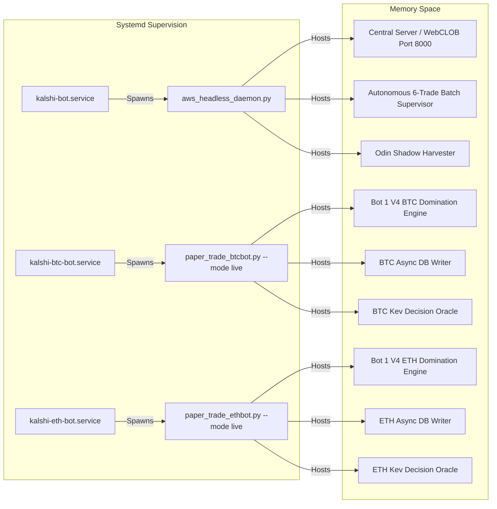

# Master Service Registry & Daemon Operations

**System:** Kalshi Autonomous Multi-Asset Trading Platform  
**Operational Tier:** 24/7 Continuous Cloud & Local Monolith Execution  
**Infrastructure Target:** AWS EC2 (`13.63.158.94`) & Workstation Development  

---

## 1. Production Daemon Registry (AWS EC2)



### 1.1 `kalshi-bot.service` (Headless Monolith & 6-Trade Batch Supervisor)
- **Unit File:** `/etc/systemd/system/kalshi-bot.service`
- **Entrypoint:** `/home/ec2-user/kalshi-bot/venv/bin/python aws_headless_daemon.py`
- **Process Target:** Central FastAPI / WebCLOB server (Port 8000) & Autonomous Batch Supervisor.
- **Restart Policy:** `always`, restart delay 5 seconds.
- **Resources:** Limit 1059 tasks, ~120MB RAM, sub-5% CPU.
- **Log Source:** `journalctl -u kalshi-bot.service -f`
- **Health Verification:** `curl -s http://localhost:8000/api/health`

### 1.2 `kalshi-btc-bot.service` (Dedicated Standalone BTC Live Taker Daemon)
- **Unit File:** `/etc/systemd/system/kalshi-btc-bot.service`
- **Entrypoint:** `/home/ec2-user/kalshi-bot/venv/bin/python src/kalshi_sim/ml/btc_bot1v4/paper_trade_btcbot.py --mode live --cycle-interval 5`
- **Process Target:** Headless Bitcoin (`KXBTC15M`) Domination Engine with unified Argon armor ($0.38 floor, $0.55 cap, 3s velocity).
- **Restart Policy:** `always`, restart delay 5 seconds.
- **Resources:** Limit 1059 tasks, ~140MB RAM, sub-5% CPU.
- **Log Source:** `journalctl -u kalshi-btc-bot.service -f`
- **Health Verification:** `journalctl -u kalshi-btc-bot | grep "LIVE CAPITAL TRADING ENGAGED"`

### 1.3 `kalshi-eth-bot.service` (Dedicated Standalone ETH Live Taker Daemon)
- **Unit File:** `/etc/systemd/system/kalshi-eth-bot.service`
- **Entrypoint:** `/home/ec2-user/kalshi-bot/venv/bin/python src/kalshi_sim/ml/eth_bot1v4/paper_trade_ethbot.py --mode live --cycle-interval 5`
- **Process Target:** Headless Ethereum (`KXETH15M`) Domination Engine with Kev AI Oracle and unified Argon armor.
- **Restart Policy:** `always`, restart delay 5 seconds.
- **Resources:** Limit 1059 tasks, ~160MB RAM, sub-5% CPU.
- **Log Source:** `journalctl -u kalshi-eth-bot.service -f`
- **Health Verification:** Verified orderflow connection to Binance depth20@100ms and active settlement listener.

---

## 2. In-Process & Background Service Inventory

| Service Name | Source Module | Execution Context | Protocol / Ports | Failure Mode & Recovery |
| :--- | :--- | :--- | :--- | :--- |
| **Mother Server** | [`src/kalshi_sim/server.py`](file:///f:/012D_TRADE/Kalshi%20Simulator/src/kalshi_sim/server.py) | Monolith Process | HTTP / WS Port `8000` | Process crash triggers systemd restart; locks auto-expire in 15s. |
| **BTC DB Writer** | [`src/kalshi_sim/db/writer.py`](file:///f:/012D_TRADE/Kalshi%20Simulator/src/kalshi_sim/db/writer.py) | In-Process Async Task | Async Queue $\to$ SQLite | Queue buffered up to 5,000 events; auto-flushed every 10ms. |
| **ETH DB Writer** | [`src/kalshi_sim/db/writer.py`](file:///f:/012D_TRADE/Kalshi%20Simulator/src/kalshi_sim/db/writer.py) | In-Process Async Task | Async Queue $\to$ SQLite ETH | Independent queue isolation; isolates write pressure from BTC. |
| **Binance BTC Feed** | [`src/kalshi_sim/orderflow/btc_orderflow_feed.py`](file:///f:/012D_TRADE/Kalshi%20Simulator/src/kalshi_sim/orderflow/btc_orderflow_feed.py) | Background Daemon Thread | WebSocket `wss://stream.binance.com` | Reconnection backoff (1s to 30s); falls back to Kalshi L2 depth. |
| **Binance ETH Feed** | [`src/kalshi_sim/orderflow/eth_orderflow_feed.py`](file:///f:/012D_TRADE/Kalshi%20Simulator/src/kalshi_sim/orderflow/eth_orderflow_feed.py) | Background Daemon Thread | WebSocket `wss://stream.binance.com` | Auto-reconnect on socket drop; buffers last 20 depth snapshots. |
| **Coinbase ETH Feed** | [`src/kalshi_sim/orderflow/eth_orderflow_feed.py`](file:///f:/012D_TRADE/Kalshi%20Simulator/src/kalshi_sim/orderflow/eth_orderflow_feed.py) | Background Daemon Thread | WebSocket `wss://ws-feed.exchange.coinbase.com` | Redundant secondary pricing feed; cross-checks Binance spot. |
| **CF Benchmarks TWAP** | [`src/kalshi_sim/cfbenchmarks_sync.py`](file:///f:/012D_TRADE/Kalshi%20Simulator/src/kalshi_sim/cfbenchmarks_sync.py) | Async Polling Loop | HTTP REST 5Hz | Rolling 60s ring buffer; flags staleness if gap $> 2.0\text{s}$. |
| **Batch Supervisor** | [`src/kalshi_sim/batch_supervisor.py`](file:///f:/012D_TRADE/Kalshi%20Simulator/src/kalshi_sim/batch_supervisor.py) | Async Background Task | Internal Polling (60s) | Non-blocking execution; catches exceptions without stopping bot. |
| **Web UI Dashboard** | [`frontend/`](file:///f:/012D_TRADE/Kalshi%20Simulator/frontend/) | Node.js / Vite / React | HTTP Port `5173` | UI state reconnects WebSocket automatically upon disconnect. |

---

## 3. Operational Runbooks & Emergency Commands

### 3.1 Service Lifecycle Commands
```bash
# Check status of all 3 AWS trading daemons
sudo systemctl status kalshi-bot kalshi-btc-bot kalshi-eth-bot --no-pager

# Restart entire fleet forcefully (Rule 6 Protocol)
sudo systemctl restart kalshi-bot kalshi-btc-bot kalshi-eth-bot

# Live tail logs
journalctl -u kalshi-bot.service -f
journalctl -u kalshi-btc-bot.service -f
journalctl -u kalshi-eth-bot.service -f
```

### 3.2 Emergency Circuit Breaker (Kill Switch)
```bash
# Immediately halt all trading services on AWS EC2
sudo systemctl stop kalshi-bot kalshi-btc-bot kalshi-eth-bot
pkill -f "python.*kalshi"
```
