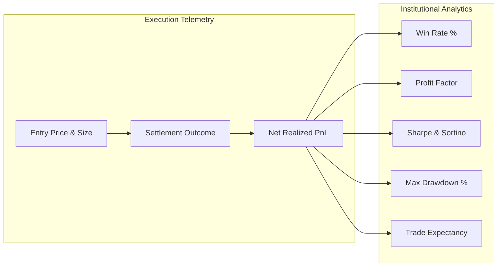

# Master Metric Registry & Quantitative Formulations

**System:** Kalshi Autonomous Multi-Asset Trading Platform  
**Standard:** Institutional Financial & Statistical Formulations  
**Math Directive:** AGENTS.md Law 1 — Zero Float Financial Math (`decimal.Decimal` in Python, `decimal.js` in TypeScript)  

---

## 1. Portfolio & Risk Metrics

### 1.1 Win Rate ($\text{WR}$)
$$\text{WR} = \left( \frac{\text{Total Winning Trades}}{\text{Total Settled Trades}} \right) \times 100\%$$
- **Benchmark:** $\ge 60.0\%$ (Pass), $\ge 66.7\%$ (Target Apex).
- **Enforcement:** Evaluated per 6-trade evaluation batch.

### 1.2 Profit Factor ($\text{PF}$)
$$\text{PF} = \frac{\sum \text{Gross Profits}}{\sum |\text{Gross Losses}|}$$
- **Benchmark:** $\ge 1.50$ (Viable), $\ge 2.00$ (Institutional Excellence).
- **Edge Case:** If Gross Losses $= 0$, $\text{PF} = 99.9$.

### 1.3 Expected Value Edge ($\text{EV}$)
$$\text{EV} = P_{\text{win}} \cdot (\text{Payout} - \text{Price}) - (1 - P_{\text{win}}) \cdot \text{Price} - \text{Taker Fee}$$
- **Benchmark:** $\ge \$0.05$ (5¢ positive mathematical edge per contract).
- **Rule:** If $\text{EV} \le 0$, order placement is strictly vetoed.

### 1.4 Maximum Drawdown ($\text{MDD}$)
$$\text{MDD}_t = \max_{\tau \in [0, t]} \left( \frac{\text{Peak Equity}_\tau - \text{Equity}_t}{\text{Peak Equity}_\tau} \right) \times 100\%$$
- **Hard Circuit Breaker:** If $\text{MDD} \ge 15.0\%$, the bot halts and disarms live capital.

---

## 2. Machine Learning & Calibration Metrics

### 2.1 Brier Calibration Score ($BS$)
$$BS = \frac{1}{N} \sum_{i=1}^N (P_i - Y_i)^2$$
Where $P_i \in [0, 1]$ is predicted probability and $Y_i \in \{0, 1\}$ is empirical outcome.
- **Perfect Score:** $0.00$.
- **Baseline Coin-Flip:** $0.25$.
- **Target:** $< 0.22$.

### 2.2 Online Platt Scaling Multpliers
$$P_{\text{calibrated}} = \frac{1}{1 + \exp(-(\alpha \cdot z + \beta))}$$
- **$\alpha$ (Alpha Multiplier):** Scale factor damping overconfidence ($0.8 \le \alpha \le 1.2$).
- **$\beta$ (Beta Bias):** Directional drift correction ($-0.2 \le \beta \le 0.2$).

---

## 3. Microstructural Orderflow Metrics

### 3.1 Order Flow Imbalance ($\text{OFI}$)
$$\text{OFI}_t = \Delta \text{Bid Size}_t \cdot \mathbb{I}_{(\Delta P_{\text{bid}} \ge 0)} - \Delta \text{Ask Size}_t \cdot \mathbb{I}_{(\Delta P_{\text{ask}} \le 0)}$$
- **Interpretation:** Positive OFI indicates aggressive buyer pressure absorbing liquidity at the top of the book.

### 3.2 Volume-Synchronized Probability of Toxicity ($\text{VPIN}$)
$$\text{VPIN} = \frac{\sum_{\tau=1}^V |V_\tau^B - V_\tau^S|}{V \times N}$$
- **Threshold:** $\text{VPIN} > 0.25$ indicates an informed toxicity storm; triggers Warrior 1 breakout mode and widens Warrior 2 proximity bounds.

---

## 4. Execution & Latency Telemetry

| Metric Name | Measurement Points | Target Threshold | Critical Alert |
| :--- | :--- | :--- | :--- |
| **Kev Oracle Latency** | Heuristic vector compute time | $< 1.5\text{ms}$ | $> 3.0\text{ms}$ |
| **Order Routing Latency ($T_2 - T_1$)** | Socket send to exchange ACK | $< 250\text{ms}$ | $> 500\text{ms}$ |
| **Settlement Detection Latency ($T_3$)** | Expiration timestamp to DB commit | $< 5.0\text{s}$ | $> 15.0\text{s}$ |
| **Orderbook Snapshot Gap** | Sequence gap between L2 diffs | $0$ dropped | $> 1$ dropped |
| **In-Flight Lock Wait** | Lock acquire to lock release | $< 2.0\text{ms}$ | $> 15.0\text{ms}$ |
