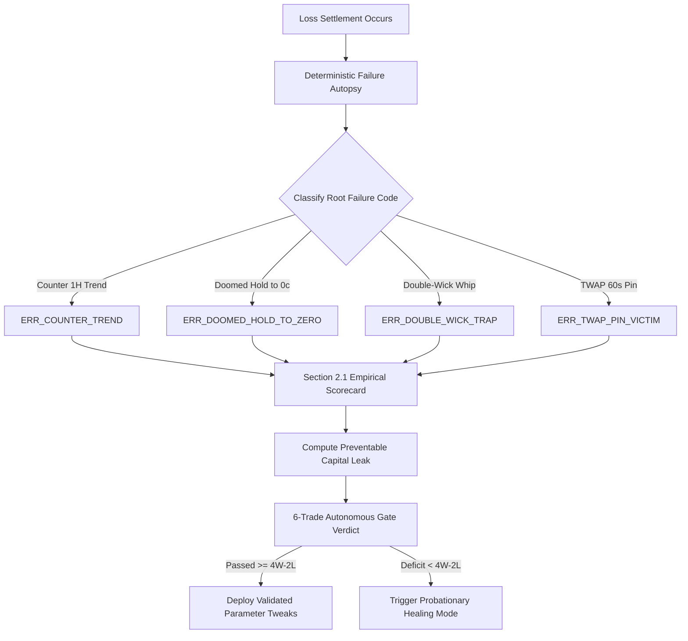

# Autonomous Forensic Audit Loop

**Standard:** ASVL (Autonomous Self-Verification Loop) & POE Empirical Ground Truth  
**Cadence:** Continuous 6-Trade Rolling Windows & Post-Loss Event Triggers  

---

## 1. Audit Hierarchy

---

## 2. Audit Protocols

### 2.1 Root-Cause Failure Attribution
The audit loop applies strict algorithmic criteria to classify loss mechanics without relying on subjective guesswork:
- **`ERR_COUNTER_TREND`:** Entry fought institutional 1-hour exponential moving average slope (DEF-01).
- **`ERR_DOOMED_HOLD_TO_ZERO`:** Contract decayed to 0¢ when mid-cycle exit was salvageable at $> 15\text{¢}$ (DEF-03).
- **`ERR_DOUBLE_WICK_TRAP`:** Entry occurred during high dispersion where both upper and lower wicks exceeded 2.5 standard deviations.
- **`ERR_TWAP_PIN_VICTIM`:** Spot price crossed strike, but trailing 60s TWAP pinned opposite at expiration.

### 2.2 ASVL Test Gates
Prior to committing or deploying any parameter modification or code patch:
- Python test suite executed via `pytest`: 100% pass required.
- TypeScript frontend verification via `tsc --noEmit` and `vite build`: 100% pass required.
- Zero Float Financial Math check: verified all computations use `Decimal` with zero IEEE-754 primitives.
