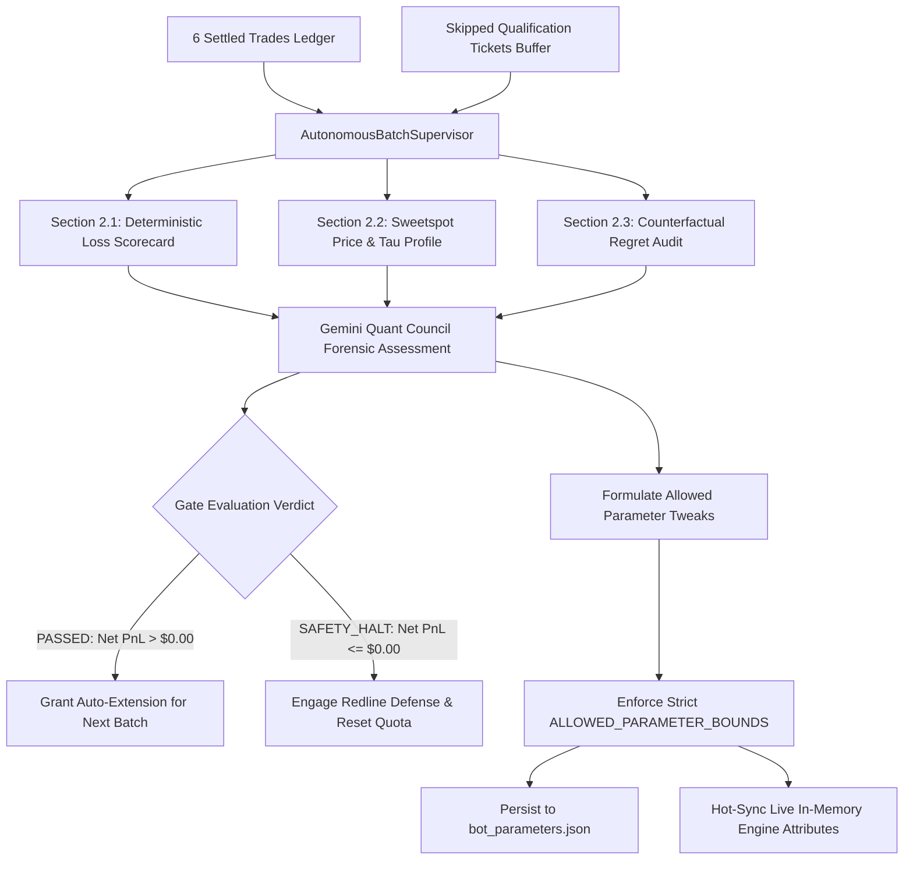

# Autonomous Forensic Audit Loop

**Standard:** ASVL (Autonomous Self-Verification Loop) & POE Empirical Ground Truth  
**Cadence:** Continuous 6-Trade Rolling Windows & Post-Loss Event Triggers  
**Core Reference:** [`ONE_DECISION_FRAMEWORK_SWEETSPOT.md`](file:///f:/012D_TRADE/Kalshi%20Simulator/docs/01_ARCHITECTURE/ONE_DECISION_FRAMEWORK_SWEETSPOT.md)

---

## 1. Audit Hierarchy

---

## 2. Audit Protocols & Report Sections

### 2.1 Root-Cause Failure Attribution (Section 2.1)
The audit loop applies strict deterministic criteria to classify loss mechanics without relying on subjective guesswork:
- **`ERR_COUNTER_TREND`:** Entry fought institutional 1-hour exponential moving average slope (DEF-01).
- **`ERR_DOOMED_HOLD_TO_ZERO`:** Contract decayed to 0¢ when mid-cycle exit was salvageable at $> 15\text{¢}$ (DEF-03).
- **`ERR_DOUBLE_WICK_TRAP`:** Entry occurred during high dispersion where both upper and lower wicks exceeded 2.5 standard deviations.
- **`ERR_TWAP_PIN_VICTIM`:** Spot price crossed strike, but trailing 60s TWAP pinned opposite at expiration.

### 2.2 Empirical Sweetspot & Corridor Profile (Section 2.2)
Settled entries are dynamically segmented into empirical corridors to detect adverse selection zones:
- **Entry Price Corridors:** Deep Discount (`$0.38-$0.43`), Prime Sweetspot (`$0.44-$0.48`), Momentum Upper (`$0.49-$0.52`), High Ceiling (`>$0.52`), and OTM Hazard (`<$0.38`).
- **Expiration Timing Windows ($\tau$):** Early Cycle (`>600s`), Prime Mid-Cycle (`300s-600s`), Late Mid-Cycle (`180s-300s`), and Pin Zone (`<180s`).

### 2.3 Counterfactual Regret Audit (Section 2.3)
Audits the unexecuted candidate trades emitted as immutable `QualificationTicket` objects:
- **True Negatives (Capital Saved):** Candidate trades vetoed by Golden Gates (**G1 Silas Pinning**, **G5 Vance CLOB Depth & Ask Floor**, **G12 Dr. Nash Slippage Shock**) that would have settled out-of-the-money.
- **False Negatives (Missed Alpha):** Candidate trades vetoed by over-conservative filters that would have settled in-the-money. Detects strategy starvation before it impedes profitability.

### 2.4 Quant Council Bounded Evolution (`ALLOWED_PARAMETER_BOUNDS`)
Any evolutionary parameter adaptation is strictly bounded by the Quant Council risk envelope:
- `discount_limit_price`: `[0.42, 0.52]`
- `min_viable_ask_floor`: `[0.35, 0.42]` (Gate 5)
- `silas_pinning_blackout_seconds`: `[60.0, 180.0]` (Gate 1)
- `adverse_slippage_stress_cents`: `[0.01, 0.03]` (Gate 12)
- `min_confidence`: `[75.0, 88.0]`
- `min_ev_dollars`: `[0.015, 0.040]`
- `vpin_toxic_threshold`: `[0.50, 0.75]`
- `moneyness_moat_multiplier`: `[1.00, 1.50]`

---

## 3. ASVL Test Gates
Prior to committing or deploying any parameter modification or code patch:
- Python test suite executed via `pytest`: 100% pass required across unit, engine, supervisor, and assessor suites.
- Zero Float Financial Math check: verified all computations use `Decimal` with zero IEEE-754 primitives.
- Micro-Bankroll Sizing Clamp: verified all positions strictly clamped to 1 contract ($\le \$0.48$ max risk).
