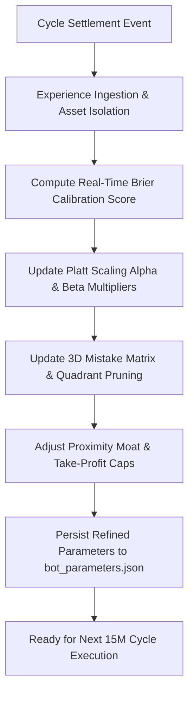

# Autonomous Continuous Learning Loop

**Architecture:** Online Bayesian Experience Buffer & Microstructural Platt Calibrator  
**Cycle Horizon:** Settled 15-Minute Expiration Cycles  

---

## 1. Continuous Learning Flow

---

## 2. Granular Learning Mechanisms

### 2.1 Online Platt Calibration
Upon settlement of each cycle experience $i$:
1. The true empirical win rate is computed across binary outcome indicators $a_i \in \{0.0, 1.0\}$:
   $$\text{Empirical Win Rate} = \frac{\sum_{i=1}^N a_i}{N}$$
   *(Audited fix: replaces the count bug that previously forced empirical win rate to identically 1.0).*
2. The confidence bias is calculated:
   $$\text{Confidence Bias} = \overline{P}_{\text{confidence}} - \text{Empirical Win Rate}$$
3. The Platt scaling multiplier $\alpha$ is adjusted:
   $$\alpha_{t+1} = \begin{cases} \max\big(0.65, \; 1.0 - 1.5 \cdot \text{Bias}\big), & \text{if Bias} > 0.05 \text{ (Overconfident)} \\ \min\big(1.10, \; 1.0 - \text{Bias}\big), & \text{otherwise} \end{cases}$$
4. When $\alpha$ drops (e.g. to $0.65$), Kev's calibrated probability drops proportionally, activating the confidence leash and suppressing entries during drawdowns.

### 2.2 3D Mistake Matrix & Causal Pruning (Feature Parity)
Every loss is mapped across 3 microstructural axes:
1. **Entry Spot-to-Strike Distance:** Tight ($< \$2.00$ ETH / $< \$25$ BTC), Mid ($< \$5.00$ ETH / $< \$60$ BTC), Wide.
   *Audited fix: uses recorded `entry_spot_diff` from trade inception rather than post-settlement drift, guaranteeing training-to-inference feature parity.*
2. **Time to Expiry ($\tau$):** Early ($> 600\text{s}$), Mid ($180\text{s}–600\text{s}$), Late ($\le 180\text{s}$).
3. **Macro Wave Region:** Storm, Chop, Bleed, Healing.

If losses cluster in a specific quadrant (e.g., Late-Cycle Chop with Tight Proximity), that quadrant is **pruned** from the active playbook, preventing repeated failure.

### 2.3 Shadow Oracle Validation (Kev AI Co-Evolution)
The system stores both active engine decisions and Kev AI Shadow Oracle recommendations. As outcomes settle, the system tracks Kev AI's predictive precision relative to the primary engine, enabling autonomous shifting of decision weights.

### 2.4 Pre-Inference Zero Credit Burning Gate (AGENTS.md Rule 8 & Law 2)
To prevent blackhole credit burning, the bot evaluates the 1-trade-per-cycle lock and active open inventory *before* invoking `kev_oracle.evaluate()`. If a trade is already completed or held for the cycle, Kev LLM inference is bypassed entirely.

### 2.5 Counterfactual Regret Learning (The One-Decision Telemetry Stream)
In accordance with [`ONE_DECISION_FRAMEWORK_SWEETSPOT.md`](file:///f:/012D_TRADE/Kalshi%20Simulator/docs/01_ARCHITECTURE/ONE_DECISION_FRAMEWORK_SWEETSPOT.md), the learning loop does not solely learn from executed trades. For every 15-minute cycle where candidate entry is evaluated but vetoed (`WAIT`), an immutable `QualificationTicket` records the `first_failed_gate` (G1 Silas Pinning, G5 Vance Depth & Ask Floor, or G12 Nash Slippage Stress). 

During 6-trade batch reviews:
1. **Regret Attribution:** Skipped candidate directions are counterfactually compared against actual market settlement.
2. **True Negatives vs. False Negatives:** If vetoed candidates would have resulted in losses, gate efficacy is confirmed. If vetoed candidates would have won, the Quant Council detects over-conservatism and recalibrates `ALLOWED_PARAMETER_BOUNDS` (e.g., widening `silas_pinning_blackout_seconds` or adjusting `min_viable_ask_floor`).
3. **Hot-Sync Invariant:** Newly calibrated gate parameters are hot-synced into live engine memory via `batch_supervisor.py` without restarting the process.

---

## 3. The Supreme Governor: Learning as the Constitutional Leader

In accordance with [`BALANCED_DIVISION_OF_POWER.md`](file:///f:/012D_TRADE/Kalshi%20Simulator/docs/01_ARCHITECTURE/BALANCED_DIVISION_OF_POWER.md), the **Continuous Learning Engine is the true supreme leader** of the trading fleet:

1. **Executive Leash Over the Lead Taker (Kev):**
   - While Kev acts as the in-flight tactical driver, Kev operates on a strict empirical leash.
   - If Kev exhibits overconfidence bias during losing streaks, the Learning Engine's Platt scaling multiplier $\alpha$ contracts below $1.0$, suppressing Kev's effective confidence below the $65\%$ hurdle and forcing a disciplined stand-down.
2. **Dynamic Invariant Governance Over Execution Armor (DRSA):**
   - DRSA does not operate on static dials; it ingests the Learning Engine's output after every cycle.
   - If late-cycle pin losses occur, `adaptive_proximity_moat_multiplier` widens the required spot cushion ($1.25\times$).
   - If high-price entries lose, the Learning Engine clamps `active_price_cap` to $\$0.50\text{--}\$0.55$.
3. **In-Flight Derisking Feedback (Valley Ejector):**
   - The Learning Engine's autopsy forensic records (`trade_failure_autopsies`) evaluate whether early exits via the **Valley Ejector** (`Rule 6`) successfully salvaged capital (e.g. salvaging $25\text{¢}\text{--}38\text{¢}$ vs $0\text{¢}$ wipeout) or were prematurely whipsawed, continuously fine-tuning the persistence thresholds (`DoF-04`).

