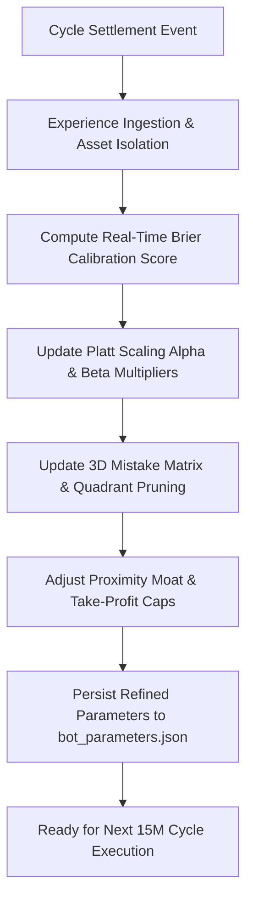

# Autonomous Continuous Learning Loop

**Architecture:** Online Bayesian Experience Buffer & Microstructural Platt Calibrator  
**Cycle Horizon:** Settled 15-Minute Expiration Cycles  

---

## 1. Continuous Learning Flow

---

## 2. Granular Learning Mechanisms

### 2.1 Online Platt Calibration
Upon settlement of each cycle experience $i$:
1. The error gradient is computed between predicted probability $P_i$ and realized binary outcome $Y_i \in \{0, 1\}$.
2. The Platt confidence multiplier $\alpha$ is adjusted using bounded stochastic gradient descent:
   $$\alpha_{t+1} = \text{clip}\left(\alpha_t - \eta \cdot (P_{\text{cal}} - Y_i) \cdot z_i, \; 0.80, \; 1.20\right)$$
3. If overconfidence is detected ($\text{Brier} > 0.25$), $\alpha$ scales downward, suppressing marginal trade entry until reliability recovers.

### 2.2 3D Mistake Matrix & Causal Pruning
Every loss is mapped across 3 microstructural axes:
1. **Spot-to-Strike Distance:** Tight ($\le \$2.00$ ETH / $\le \$20$ BTC), Mid ($\le \$5.00$ ETH / $\le \$60$ BTC), Far.
2. **Time to Expiry ($\tau$):** Early ($> 600\text{s}$), Mid ($300\text{s}–600\text{s}$), Late ($< 300\text{s}$).
3. **Macro Wave Region:** Storm, Chop, Bleed, Healing.

If losses cluster in a specific quadrant (e.g., Late-Cycle Chop with Tight Proximity), that quadrant is **pruned** from the active playbook, preventing repeated failure.

### 2.3 Shadow Oracle Validation (Kev AI Co-Evolution)
The system stores both active engine decisions and Kev AI Shadow Oracle recommendations. As outcomes settle, the system tracks Kev AI's predictive precision relative to the primary engine, enabling autonomous shifting of decision weights.
