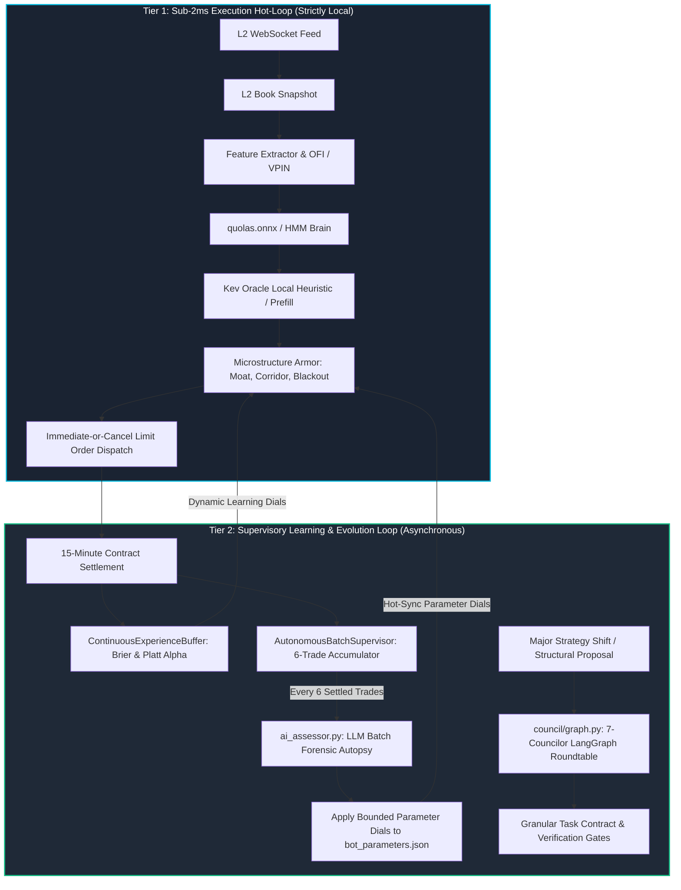
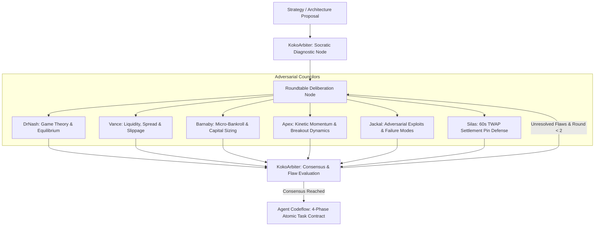

# Autonomous Self-Improvement & Parameter Evolution Architecture

**System:** Kalshi Autonomous Multi-Asset Trading Platform (`KXBTC15M` & `KXETH15M`)  
**Operational Framework:** Two-Tier Runtime Hierarchy, 6-Trade Batch Supervisory Assessment & 7-Councilor LangGraph Deliberation  
**Classification:** Canonical Autonomous Learning & Dynamic Parameter Evolution Specification  
**Standard Enforced:** Zero Float Financial Math (`decimal.Decimal`) & Blast-Radius Bounded Self-Improvement  

---

## 1. Executive Mandate & Core Philosophy

The Kalshi Simulator achieves continuous operational improvement without human intervention through a **Two-Tier Runtime Hierarchy**:
1. **The Sub-2ms Hot Path:** Low-latency, deterministic execution on local hardware. Zero network dependencies, zero LLM calls during order evaluation, and zero blocking I/O.
2. **The Asynchronous Supervisory Path:** Periodic multi-cycle evaluation where AI reasoning modules ([`ai_assessor.py`](file:///f:/012D_TRADE/Kalshi%20Simulator/src/kalshi_sim/ai_assessor.py), [`batch_supervisor.py`](file:///f:/012D_TRADE/Kalshi%20Simulator/src/kalshi_sim/batch_supervisor.py), and [`council/graph.py`](file:///f:/012D_TRADE/Kalshi%20Simulator/src/kalshi_sim/council/graph.py)) review settled batches, diagnose microstructure failure modes, adjust parameters within strict mathematical bounds, and stress-test major strategy evolutions.

---

## 2. Two-Tier Runtime Architecture



### Critical Separation Directives:
- **No LLM in the Hot Loop:** Kalshi 15-minute binary contracts require sub-millisecond reaction speeds. Calling external APIs on the tick evaluation loop introduces 500ms–2000ms latency, causing stale quote fills and front-running by high-frequency liquidity providers.
- **Deterministic Hot Execution:** On-tick direction is evaluated by `quolas.onnx`, `HMMBrain`, and local deterministic heuristics.
- **Supervisory Deliberation:** Deep reasoning, qualitative forensic evaluation, and parameter adaptation occur exclusively after settlement events or across 6-trade batches.

---

## 3. High-Impact Autonomous Quant Capabilities

The system delegates quant and systems engineering tasks across 5 core capabilities:

| Capability | Target Modules | Primary Objective & Value Delivered |
| :--- | :--- | :--- |
| **1. Forensic Loss Autopsy & Telemetry Mining** | [`data/kalshi_history.db`](file:///f:/012D_TRADE/Kalshi%20Simulator/data/kalshi_history.db), [`data/win_loss_reports.json`](file:///f:/012D_TRADE/Kalshi%20Simulator/data/win_loss_reports.json) | Queries trade lifecycle forensics ($T_1$ entry, $T_2$ mid-cycle, $T_3$ settlement) to isolate exact root-cause failure codes (`ERR_DOOMED_HOLD_TO_ZERO`, `ERR_TWAP_PIN_VICTIM`, `ERR_COUNTER_TREND`). |
| **2. Cross-Module Bug & State Invariant Hunting** | [`schemas.py`](file:///f:/012D_TRADE/Kalshi%20Simulator/src/kalshi_sim/schemas.py), [`bot1_v4_engine.py`](file:///f:/012D_TRADE/Kalshi%20Simulator/src/kalshi_sim/ml/bot1_v4_engine.py), [`btc_bot1v4_engine.py`](file:///f:/012D_TRADE/Kalshi%20Simulator/src/kalshi_sim/ml/btc_bot1v4/btc_bot1v4_engine.py), [`eth_bot1v4_engine.py`](file:///f:/012D_TRADE/Kalshi%20Simulator/src/kalshi_sim/ml/eth_bot1v4/eth_bot1v4_engine.py) | Detects state mismatches between the central simulator and standalone daemons (e.g. ticker suffix strike corruption `-00`, unwired exit evaluators, or parameter reload race conditions). |
| **3. In-Flight Exit & Payoff Math Tuning** | [`domination_exit_evaluator.py`](file:///f:/012D_TRADE/Kalshi%20Simulator/src/kalshi_sim/ml/domination_exit_evaluator.py), [`statistical_ev_engine.py`](file:///f:/012D_TRADE/Kalshi%20Simulator/src/kalshi_sim/ml/statistical_ev_engine.py) | Optimizes the 6-rule exit matrix (Rule 5.1 $0.78 bargain lock, trailing HWM ratchet, Silas 60s TWAP defense, stepped salvage floors) to cut tail loss drag. |
| **4. ONNX Feature Engineering & Retraining** | [`feature_extractor.py`](file:///f:/012D_TRADE/Kalshi%20Simulator/src/kalshi_sim/ml/feature_extractor.py), [`train_model.py`](file:///f:/012D_TRADE/Kalshi%20Simulator/src/kalshi_sim/ml/train_model.py), [`export_onnx.py`](file:///f:/012D_TRADE/Kalshi%20Simulator/src/kalshi_sim/ml/export_onnx.py) | Retrains `models/quolas.onnx` and `models/hmm_latest.pkl` using rolling microstructural features (OFI skew, VPIN toxicity, 3s spot velocity) in Turnover-Sniper mode. |
| **5. Zero-Float & Guardrail Certification** | [`agent_guardrails.py`](file:///f:/012D_TRADE/Kalshi%20Simulator/src/kalshi_sim/agent_guardrails.py), [`law_order_agent.py`](file:///f:/012D_TRADE/Kalshi%20Simulator/src/kalshi_sim/law_order_agent.py), [`tests/`](file:///f:/012D_TRADE/Kalshi%20Simulator/tests/) | Enforces `decimal.Decimal` compliance, 1-contract micro-bankroll sizing, 1-trade-per-cycle locks, and CFTC compliance prior to AWS EC2 deployment. |

---

## 4. 6-Trade Batch Supervisory Assessment (`ai_assessor.py`)

Every 6 settled trades, the [`AutonomousBatchSupervisor`](file:///f:/012D_TRADE/Kalshi%20Simulator/src/kalshi_sim/batch_supervisor.py) bundles trade records, Brier calibration scores, Platt $\alpha$, and wave regime telemetry, dispatching them to [`ai_assessor.py`](file:///f:/012D_TRADE/Kalshi%20Simulator/src/kalshi_sim/ai_assessor.py).

### Immutable Parameter Evolution Envelope (`ALLOWED_PARAMETER_BOUNDS`):
To prevent catastrophic model drift or curve-fitting to recent noise, no AI assessment can ever adjust parameters beyond these constitutional boundaries:

| Parameter Key | Description | Min Allowed | Max Allowed | Max Delta / Batch |
| :--- | :--- | :---: | :---: | :---: |
| `discount_limit_price` | Maker entry discount limit price | $\$0.42$ | $\$0.52$ | $\pm \$0.02$ |
| `min_confidence` | Minimum required ONNX / Bayesian confidence % | $75.0\%$ | $88.0\%$ | $\pm 2.0\%$ |
| `min_ev_dollars` | Expected value hurdle per contract | $\$0.015$ | $\$0.040$ | $\pm \$0.005$ |
| `min_spot_diff` | Minimum spot-to-strike distance | $\$18.00$ | $\$35.00$ | $\pm \$5.00$ |
| `vpin_toxic_threshold` | Maximum tolerable orderflow toxicity | $0.50$ | $0.75$ | $\pm 0.05$ |
| `take_profit_price_threshold` | Peak take-profit limit target | $\$0.80$ | $\$0.95$ | $\pm \$0.03$ |
| `min_take_profit_roi` | Minimum scalp return-on-investment % | $30.0\%$ | $55.0\%$ | $\pm 5.0\%$ |
| `moneyness_moat_multiplier` | Proximity moat volatility scaling | $1.00\times$ | $1.50\times$ | $\pm 0.10\times$ |

---

## 5. 7-Councilor Adversarial LangGraph Deliberation (`council/graph.py`)

When substantial architectural or structural modifications are proposed, the system routes the proposal through the 7-member Adversarial Council orchestrated via LangGraph:



### Councilor Specializations:
1. **DrNash:** Verifies Nash equilibrium in order placement (maker rebates vs. taker certainty).
2. **Vance:** Audits L2 orderbook depth, bid-ask spread friction, and queue priority.
3. **Barnaby:** Guarantees Kelly-optimal micro-bankroll protection (1-contract sizing, hard drawdown locks).
4. **Apex:** Evaluates kinetic price momentum and directional drift velocity.
5. **Jackal:** Adversarial red-team auditor; actively hunts edge-case liquidation and toxic sweep traps.
6. **Silas:** Specializes in CF Benchmarks 30s/60s TWAP index settlement mechanics and pin risk.
7. **KokoArbiter:** Synthesizes votes, filters emotional noise, resolves deadlocks, and outputs binding task contracts.

---

## 6. Root-Cause Failure Attribution Taxonomy

To ensure objective self-improvement without subjective excuses, losing trades are classified into deterministic failure codes:

```
┌─────────────────────────────────────────────────────────────────────────────────────────┐
│                           ROOT-CAUSE FAILURE TAXONOMY                                   │
├──────────────────────────┬──────────────────────────────────────────────────────────────┤
│ Failure Code             │ Deterministic Microstructural Definition                     │
├──────────────────────────┼──────────────────────────────────────────────────────────────┤
│ ERR_DOOMED_HOLD_TO_ZERO  │ Contract decayed to $0.00 when mid-cycle exit was salvageable │
│                          │ at ≥ $0.15 (Failure of Valley Ejector Rule 6).               │
├──────────────────────────┼──────────────────────────────────────────────────────────────┤
│ ERR_TWAP_PIN_VICTIM      │ Spot crossed strike during cycle, but CF Benchmarks TWAP     │
│                          │ settlement in final 60s pinned out-of-the-money.             │
├──────────────────────────┼──────────────────────────────────────────────────────────────┤
│ ERR_COUNTER_TREND        │ Trade fought institutional 1-hour macro exponential slope.   │
├──────────────────────────┼──────────────────────────────────────────────────────────────┤
│ STRIKE_PROXIMITY_TRAP    │ Entered within the coin-flip noise band (|Spot - Strike| < M)│
│                          │ without sufficient volatility breakout energy.               │
├──────────────────────────┼──────────────────────────────────────────────────────────────┤
│ ERR_DISPERSION_EXCURSION │ Realized spot volatility expanded beyond 3σ of expected      │
│                          │ normal distribution during 15-minute lifespan.               │
└──────────────────────────┴──────────────────────────────────────────────────────────────┘
```

---

## 7. Online Bayesian Governance & Experience Feedback

The [`ContinuousExperienceBuffer`](file:///f:/012D_TRADE/Kalshi%20Simulator/src/kalshi_sim/ml/experience_buffer.py) acts as the autonomous supreme governor over the active trading engines:

1. **Platt Scaling Leash ($\alpha$):**
   - Computes empirical Brier score and confidence bias on every settled trade.
   - If a bot experiences loss streaks, Platt $\alpha$ dynamically contracts ($1.0 \to 0.70$), mathematically suppressing model confidence below the entry threshold ($60\%$) until market conditions normalize.
2. **3D Mistake Matrix Quadrant Pruning:**
   - Tracks loss clusters across 3 coordinates: Entry Proximity ($|\Delta \text{Spot}|$), Time-to-Expiry ($\tau$), and Macro Wave Regime (Chop/Storm/Bleed/Healing).
   - Automatically blacklists quadrants exhibiting statistically significant failure rates.
3. **Adaptive Moat Expansion:**
   - Widens proximity moats ($1.25\times\text{--}1.50\times$) during elevated volatility to reject high-risk coin-flip entries.

---

## 8. Operational Directives & Cache Invalidation Protocol (Rule 6)

Following **AGENTS.md Rule 6**:
- Parameter modifications, ONNX tensor updates, or codebase upgrades **never rely on hot-reloading**.
- All deployments forcefully restart daemons, clear RAM caches, and flush buffer locks:
  ```bash
  sudo systemctl restart kalshi-bot kalshi-btc-bot kalshi-eth-bot
  ```
- Strict adherence to Zero Float Financial Math (`decimal.Decimal`) is verified before any update is certified for live capital execution.
