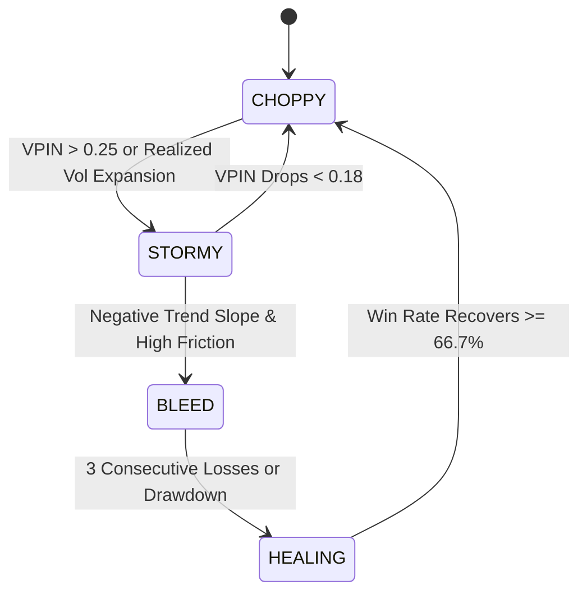

# Autonomous Self-Improvement & Parameter Evolution

**System:** Kalshi Autonomous Multi-Asset Trading Platform  
**Operational Framework:** Blast-Radius Contained Parameter Tuning & Model Re-Freshening  

---

## 1. Parameter Evolution Bounds

To prevent runaway feedback loops, catastrophic parameter drift, or curve-fitting to noise, all autonomous parameter evolutions are strictly constrained within mathematical guardrails:

| Parameter Key | Description | Min Allowed | Max Allowed | Max Delta / Batch |
| :--- | :--- | :---: | :---: | :---: |
| `min_entry_prob` | Minimum required $P_{\text{win}}$ for entry | $0.52$ | $0.65$ | $\pm 0.02$ |
| `max_entry_price` | Highest acceptable limit price (cents) | $\$0.40$ | $\$0.50$ | $\pm \$0.02$ |
| `min_spot_distance` | Proximity moat around strike | $\$15.00$ | $\$45.00$ | $\pm \$5.00$ |
| `take_profit_threshold` | Target maker exit price | $\$0.75$ | $\$0.92$ | $\pm \$0.03$ |
| `stop_loss_threshold` | Salvage exit trigger price | $\$0.10$ | $\$0.25$ | $\pm \$0.02$ |
| `vpin_storm_threshold` | Orderflow toxicity breakout trigger | $0.18$ | $0.35$ | $\pm 0.03$ |

---

## 2. Market Condition Dynamic Adaptation

The system automatically pivots between 4 pre-calibrated operational regimes:

1. **Choppy (Range-Bound Compression):**
   - Focus: Warrior 2 Deep Discount limits ($0.38–$0.42).
   - Proximity: Strict coin-flip dead zone enforcement ($\pm \$25$).
2. **Stormy (Volatile Expansion):**
   - Focus: Warrior 1 Breakout Momentum ($0.42–$0.45).
   - Proximity: Widened proximity moats to prevent wick whipsaws.
3. **Bleed (Friction & Macro Drag):**
   - Focus: High hurdle rate ($P_{\text{win}} \ge 0.62$), maker discount only.
4. **Healing (Probationary Capital Protection):**
   - Focus: Defensive posture, contract size pinned at 1, extended cooldowns.

---

## 3. Protocol for Model Retraining & Cache Invalidation

Following **AGENTS.md Directive #6**:
1. When new historical data triggers offline tensor retraining (`train_model.py` / `export_onnx.py`), new ONNX weights are validated on hold-out validation sets.
2. The orchestrator never relies on hot-reloading.
3. Background trading tasks are cleanly stopped, RAM caches cleared, and daemons restarted via systemd to guarantee immediate execution on upgraded tensors.
