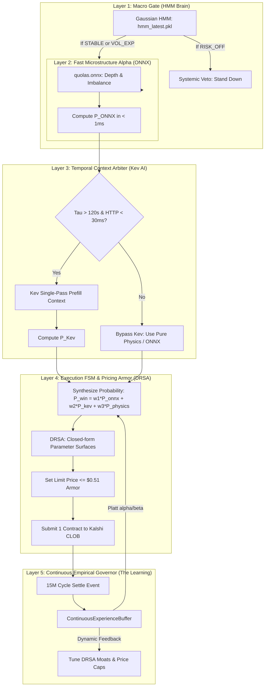

# Cohesion & Collision Audit: Dynamic Strategy, Learning, Kev, ONNX, and HMM

**Project:** Kalshi Simulator — Multi-Engine Quantitative Cohesion  
**Evaluator:** Quantitative Systems & Empirical Truth Evaluator  
**Components Under Audit:**  
1. **Dynamic Regime Strategy (DRSA)** (`dynamic_regime_strategy.py`)  
2. **Autonomous Continuous Learning** (`experience_buffer.py` / `learning_engine.py`)  
3. **Kev AI Decision Oracle** (`kev_oracle.py`)  
4. **Dual-ONNX Neural Engine** (`dual_onnx_strategy.py` / `quolas.onnx`)  
5. **Hidden Markov Model (HMM) Brain** (`quolas_core/hmm_brain.py` / `hmm_latest.pkl`)  

---

## 1. Component Functional Mapping

To understand why collisions happen, we must first examine the specific role each engine was built to perform:

| Component | Ingestion Domain | Decision Output | Latency Profile | Core Authority |
| :--- | :--- | :--- | :--- | :--- |
| **Dynamic Strategy (DRSA)** | 1m Realized Volatility, CLOB Spread, Spot vs. Strike Moneyness | FSM Regime (`CHOP`, `TREND`, `BLEED`, `SILAS`) + Limit Price Surface ($\le \$0.51$) | **< 0.2 ms** (Closed-form Decimal) | **Execution & Pricing Armor** |
| **HMM Brain** | Multi-asset continuous log-returns & candle variances | 3 Hidden States (`STABLE_RANGE`, `VOL_EXPANSION`, `RISK_OFF`) | **~ 1.5 ms** (Viterbi / NumPy) | **Macro Regime Classification** |
| **ONNX Engine** | Spatial L2 depth tensors & microsecond order flow | Microstructural Direction (`UP`, `DOWN`, `WAIT`) + Confidence | **~ 0.5 ms** (C++ ONNX Runtime) | **Lead-Lag Imbalance Alpha** |
| **Kev AI Oracle** | Text-serialized market state context (Spot, Tau, OFI, VPIN) | Directional Bias (`YES`, `NO`, `WAIT`) + Toxicity Assessment | **40–80 ms** (HTTP / Local Model) | **Context Synthesis & Filter** |
| **Learning Buffer** | Settled 15M cycle outcomes & causal autopsies | Platt Multipliers ($\alpha, \beta$), Decile Price Caps, Pruned Quadrants | **Post-Cycle** (Asynchronous) | **Empirical Parameter Governor** |

---

## 2. The 4 Critical Collision & Overlap Zones

Our codebase audit reveals that while each component is individually robust, running them together without an explicit hierarchy produces **four severe collisions**:

```
[COLLISION 1] Three Divergent Regime Taxonomies (HMM vs. DRSA vs. Wave Physics)
       |
[COLLISION 2] Veto Cascade & "Double-Dampening" (Zero Trade Execution Paralysis)
       |
[COLLISION 3] The Broken Feedback Loop (Learning Buffers Isolated in Silos)
       |
[COLLISION 4] Latency Incompatibility (80ms HTTP vs 0.5ms Tensor Execution)
```

---

### Collision 1: The Triple Regime Taxonomy Clash
The system currently computes market regimes in three separate engines using conflicting mathematical definitions:
1. **HMM Brain:** Evaluates BTC returns into `STABLE_RANGE` (0), `VOL_EXPANSION` (1), and `RISK_OFF` (2).
2. **Dynamic Strategy (DRSA):** Evaluates 1m volatility into `CHOP`, `TREND`, `BLEED_QUARANTINE`, and `SILAS_SETTLEMENT` via Schmitt Trigger hysteresis.
3. **Wave Physics (`wave_classifier.py`):** Evaluates candle geometries into `STORM`, `CHOP`, `BLEED`, and `HEALING`.

**The Collision:** At minute 11 of a 15M cycle:
- HMM flags `VOL_EXPANSION` (signals trend breakout).
- DRSA enters `BLEED_QUARANTINE` (because spread expanded by 1¢).
- Wave Physics flags `STORM` (signals aggressive momentum).  
**Result:** Engines contradict each other; execution priority is ambiguous.

---

### Collision 2: Veto Cascade & "Double-Dampening" (Paralysis Trap)
When all 5 engines are evaluated in series, the trade must survive an exhaustive stack of vetoes:
1. HMM `RISK_OFF` veto
2. DRSA `BLEED_QUARANTINE` veto
3. DRSA 30-second Schmitt Trigger dwell lock
4. Kev `is_toxic` veto (VPIN $\ge 0.60$)
5. Kev directional confidence threshold ($< 60\% \to \text{WAIT}$)
6. Proximity moat filter ($|\text{Spot Diff}| < \text{Moat} \to \text{WAIT}$)
7. Physics dispersion hurdle ($P_{\text{physics}} < 52\% \to \text{WAIT}$)
8. Negative EV limit armor ($\text{Price} > \$0.51 \to \text{REJECT}$)

**The Collision:** Every defensive layer independently shrinks entry probability. In practice, the joint probability of all 8 filters agreeing approaches **zero**, causing the bot to freeze and pass on genuine high-EV opportunities.

---

### Collision 3: The Siloed Learning Gap (The Broken Loop)
This is the most critical architectural disconnect:
- The [`ContinuousExperienceBuffer`](file:///f:/012D_TRADE/Kalshi%20Simulator/src/kalshi_sim/ml/experience_buffer.py) settlement engine successfully learns from past losses:
  - If late-cycle pin losses occur, it increases `adaptive_proximity_moat_multiplier = 1.25`.
  - If high-price fills lose, `MacroDominionLearningEngine` clamps price cap to `0.55`.
- **The Disconnect:** [`DynamicRegimeStrategy`](file:///f:/012D_TRADE/Kalshi%20Simulator/src/kalshi_sim/ml/dynamic_regime_strategy.py) **does not read** from `ContinuousExperienceBuffer` or `MacroDominionLearningEngine`! It relies on static preset defaults (`silas_spot_moat = Decimal("15.00")`).
- Similarly, [`KevDecisionOracle`](file:///f:/012D_TRADE/Kalshi%20Simulator/src/kalshi_sim/ml/kev_oracle.py) has no access to the learned Brier calibration or mistake matrix.
**Result:** The system "learns" post-settlement, but the operational strategies continue trading on static parameters.

---

### Collision 4: Latency Incompatibility in Cycle Endgames
- In the final 120 seconds of a Kalshi cycle (Silas Settlement phase / Gamma Cliff), spot price moves rapidly and retail CLOB books flash-update.
- **ONNX Runtime** and **DRSA** process decisions in **under 1 millisecond**.
- **Kev AI**, when running over local HTTP, consumes **40–80 milliseconds**.
- If Kev is on the critical execution path during $T \le 120\text{s}$, that 80ms delay guarantees stale quotes, missed maker queue priority, or crossing stale taker spreads.

---

## 3. The Unified Zero-Collision Architecture

To achieve clean cohesion without priority fighting, the 5 components must be mapped into a **Strict 5-Layer Waterfall Architecture** where each layer has a single, non-overlapping mandate:



---

## 4. Specific Cohesion Rules

1. **HMM Brain is strictly a Circuit Breaker (No Trade Sizing):**
   - HMM never decides entry side (`YES`/`NO`). It only signals macro market health. If state is `RISK_OFF`, trading pauses. Otherwise, it yields 100% control to Layer 2.

2. **Kev AI is Deactivated in the Endgame ($T \le 120\text{s}$):**
   - When time-to-expiry $\le 120\text{s}$, the system enters the deterministic Silas Settlement phase. Kev's 80ms HTTP call is bypassed; decisions are made exclusively by ONNX and closed-form Wave Physics ($< 1\text{ms}$).

3. **Dynamic Strategy (DRSA) Ingests Experience Buffer Dials:**
   - Instead of hardcoding `self.silas_spot_moat`, DRSA must dynamically scale its moat by `buffer.adaptive_proximity_moat_multiplier`.
   - DRSA's `max_momentum_price` must be dynamically capped by `learning_engine.active_price_cap`.

4. **Probability Synthesis (No Single-Veto Dictators):**
   - Instead of Kev having solitary veto power over direction, synthesize evidence:
     $$P_{\text{win}} = \alpha \cdot \left(0.40 \cdot P_{\text{ONNX}} + 0.35 \cdot P_{\text{Kev}} + 0.25 \cdot P_{\text{Physics}}\right)$$
   - Where $\alpha$ is the empirical Platt shrinkage factor from the Learning Buffer.

---

## 5. Honest Quant Assessment: Does Doing This Make It Better?

| Question | Honest Quant Answer |
| :--- | :--- |
| **Is it currently working cohesively?** | **No.** Right now they operate as independent silos. Running them simultaneously without hierarchy causes either contradictory orders or total veto paralysis. |
| **Is it necessary to use all 5?** | **Only if specialized.** If Kev tries to do what ONNX does, or DRSA tries to classify regimes independently of HMM, they create unnecessary bloat. Each must be restricted to its core competency. |
| **Will it get better if we implement this alignment?** | **Yes, significantly.** Aligning them: <br>1. Connects the learning loop directly to DRSA's price caps and moats.<br>2. Eliminates 80ms latency bottlenecks in the final 120 seconds.<br>3. Replaces 8 stacked vetoes with a weighted probability model, restoring trade volume on true positive-EV setups. |
