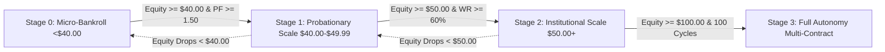

# Autonomous System Success Criteria & Scale-Up Gates

**System:** Kalshi Autonomous Multi-Asset Trading Platform  
**Authority:** POE (Post-Occupancy Evaluator) & Quantitative Governance Council  
**Reference Document:** [`docs/SCALEUP.md`](file:///f:/012D_TRADE/Kalshi%20Simulator/docs/SCALEUP.md)  

---

## 1. Scale-Up Progression Hierarchy

Capital sizing is governed strictly by empirical equity milestones and verified stability gates:

---

## 2. Quantitative Gate Thresholds

| Stage Gate | Balance Threshold | Sizing Limit | Required Metrics | Governance Rule |
| :--- | :--- | :---: | :--- | :--- |
| **Stage 0 (Micro)** | $\$0.00 – \$39.99$ | **Strictly 1 Contract** | Baseline expectancy $> \$0.00$ | Strict capital defense; no scale-up permitted. |
| **Stage 1 (Probation)** | $\$40.00 – \$49.99$ | **Strictly 1 Contract** | Win Rate $\ge 60\%$, $\text{PF} \ge 1.50$ | Verifies equity stability before allowing size increases. |
| **Stage 2 (Scaled)** | $\$50.00 – \$99.99$ | **Max 2 Contracts** | Win Rate $\ge 62\%$, $\text{MDD} < 10\%$ | Permitted 2 contracts only when $EV \ge \$0.10$. |
| **Stage 3 (Apex)** | $\ge \$100.00$ | **Dynamic Kelly (1-3 cts)** | 100-Cycle Forward Validation Passed | Full autonomous sizing based on fractional Kelly criterion. |

---

## 3. Production Readiness Verification Gates

A strategy or model is certified for live capital allocation if and only if it passes all 5 gates simultaneously:

1. **Gate 1: Win Rate Significance**
   - Empirical win rate across $\ge 30$ settled cycles must exceed $60.0\%$ ($p < 0.05$).
2. **Gate 2: Profit Factor & Fee Armor**
   - Profit Factor $\ge 1.50$ net of all Kalshi exchange taker fees.
3. **Gate 3: Drawdown Containment**
   - Historical maximum drawdown strictly under $15.0\%$.
4. **Gate 4: 100-Cycle Forward Validation**
   - Strategy demonstrated positive alpha across at least 100 real-market forward cycles.
5. **Gate 5: Cryptographic Integrity Shield**
   - Verified SHA-256 Seal of Excellence present on disk matching running code hashes.
