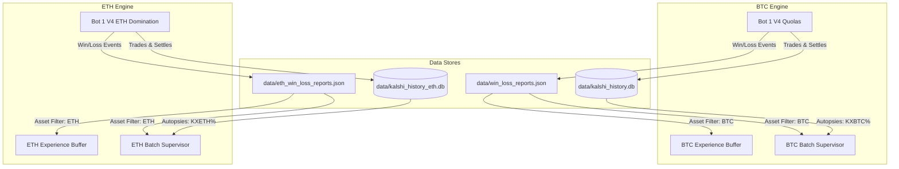

# Asset-Level History Isolation & Contamination Remediation

**Document Classification:** Institutional Core Architecture & Forensic Remediation  
**Status:** FULLY IMPLEMENTED, SANITIZED, & OPERATIONAL ON AWS EC2  
**Date:** October 14, 2026  
**Target Fleet:** Bot 1 V4 (BTC Quolas) & Bot 1 V4 (ETH Domination)  

---

## 1. Executive Summary & Root Problem

In a dual-asset algorithmic trading fleet (Bitcoin `KXBTC15M` and Ethereum `KXETH15M`), cross-asset historical contamination undermines Bayesian calibrations, online Platt scalers, failure autopsies, and autonomous batch evolutions.

Prior to this patch:
1. `data/win_loss_reports.json` aggregated both BTC and ETH trade settlements in a unified JSON array.
2. `ContinuousExperienceBuffer` ingested the full settlement history regardless of whether the active bot was trading Bitcoin or Ethereum, polluting Brier score calculations and 3D mistake matrix clustering.
3. `AutonomousBatchSupervisor` evaluated 6-trade batches on a rolling basis without asset filtering, allowing ETH settlements to trigger Bitcoin parameter calibrations and vice-versa.
4. `HistoricalQueryService` defaulted to `kalshi_history.db` for all queries, resulting in 0-row misses or contaminated failure autopsy scorecards when querying Ethereum performance.

---

## 2. 5-Layer Isolation Architecture



### Layer 1: Continuous Experience Buffer (`src/kalshi_sim/ml/experience_buffer.py`)
- **Initial Load Isolation:** `_load_initial_history()` extracts records strictly matching `self.asset` (BTC excludes `ETH` and `KXETH`; ETH excludes `BTC` and `KXBTC`).
- **Live Ingestion Shield:** `record_settled_cycle(exp)` validates asset match before accepting experiences into memory or recalibrating Platt/Brier parameters.

### Layer 2: Autonomous Batch Supervisor (`src/kalshi_sim/batch_supervisor.py`)
- **Deterministic Asset Matching:** Added `_is_asset_match(report)` checking ticker prefixes (`KXBTC%` vs `KXETH%`), asset fields, and bot types.
- **Dedicated Batch Counters:** The 6-trade evaluation threshold accumulates only on trades belonging to the target asset.
- **Asset-Isolated Gemini Prompt & Reports:**
  - BTC generates `docs/assessment_{date}_#{num}_BTC_.md`.
  - ETH generates `docs/assessment_{date}_#{num}_ETH_.md`.
  - Database persistence writes to `get_db_writer()` for BTC and `get_eth_db_writer()` for ETH.

### Layer 3: AI Assessor Forensic Autopsies (`src/kalshi_sim/ai_assessor.py`)
- **Asset-Routed SQLite Queries:** Section 2.1 Failure Attribution Scorecards dynamically connect to `data/kalshi_history_eth.db` for ETH and `data/kalshi_history.db` for BTC using `WHERE ticker LIKE 'KX{asset}%'`.
- **Target Parameter Scoping:** Autonomous parameter evolutions write strictly to `data["assets"][asset]`.

### Layer 4: Historical Query Service (`src/kalshi_sim/db/queries.py`)
- **Dynamic Database Manager Resolution:** `_resolve_db_manager(asset, ticker, bot_type)` automatically switches between `get_db()` and `get_eth_db()`.
- **Dual-Database Maintenance:** `reset_history`, `delete_trade`, `delete_settlement`, and `delete_ai_prediction` cleanly operate across both databases without leaving orphaned records.

### Layer 5: REST Analytics & Export Router (`src/kalshi_sim/routers/analytics.py`)
- **Strict Report Filtering:** `/api/reports/win-loss`, `/api/reports/full`, and CSV/JSON export endpoints filter `all_reports` using `_is_asset_match(r, effective_asset)`.
- **Pure Metric Summaries:** `all_summary`, `live_summary`, `sim_summary`, and `today_summary` reflect solely the requested asset.

---

## 3. Contamination Sanitization Results (AWS EC2 & Local Workstation)

Execution of [`scripts/sanitize_history_contamination.py`](file:///f:/012D_TRADE/Kalshi%20Simulator/scripts/sanitize_history_contamination.py) yielded the following empirical results:

### Local Workstation Sanitization
- **JSON Reports:** Sanitized 100 pure BTC reports into `data/win_loss_reports.json` and 9 pure ETH reports into `data/eth_win_loss_reports.json`.
- **SQLite Database:** Purged 8 contaminated ETH rows from `kalshi_history.db` trades and 6 contaminated ETH rows from `kalshi_history.db` settlements.

### AWS EC2 (`13.63.158.94`) Sanitization
- **JSON Reports:** Sanitized 91 pure BTC reports into `data/win_loss_reports.json` and 18 pure ETH reports into `data/eth_win_loss_reports.json`.
- **SQLite Database:**
  - Purged 7 contaminated ETH rows from `kalshi_history.db` trades.
  - Purged 7 contaminated ETH rows from `kalshi_history.db` settlements.
  - Purged 3 contaminated ETH rows from `kalshi_history.db` failure autopsies.
  - Verified 0 contaminated BTC rows inside `data/kalshi_history_eth.db`.

---

## 4. Verification Suite (ASVL)

A comprehensive regression suite was executed locally and on AWS EC2:
- [`tests/test_asset_history_isolation.py`](file:///f:/012D_TRADE/Kalshi%20Simulator/tests/test_asset_history_isolation.py): 5/5 PASSED.
- Full engine regression suite: 27/27 PASSED.

---

## 5. Live Production Status on AWS EC2

```
● kalshi-bot.service (PID 233914)     - Active & Running (Headless BTC Quolas Engine)
● kalshi-eth-bot.service (PID 233912) - Active & Running (Headless ETH Domination Engine)
```

Both engines are now operating with zero cross-asset interference, pure experience memory buffers, and independent failure forensic scorecards.
