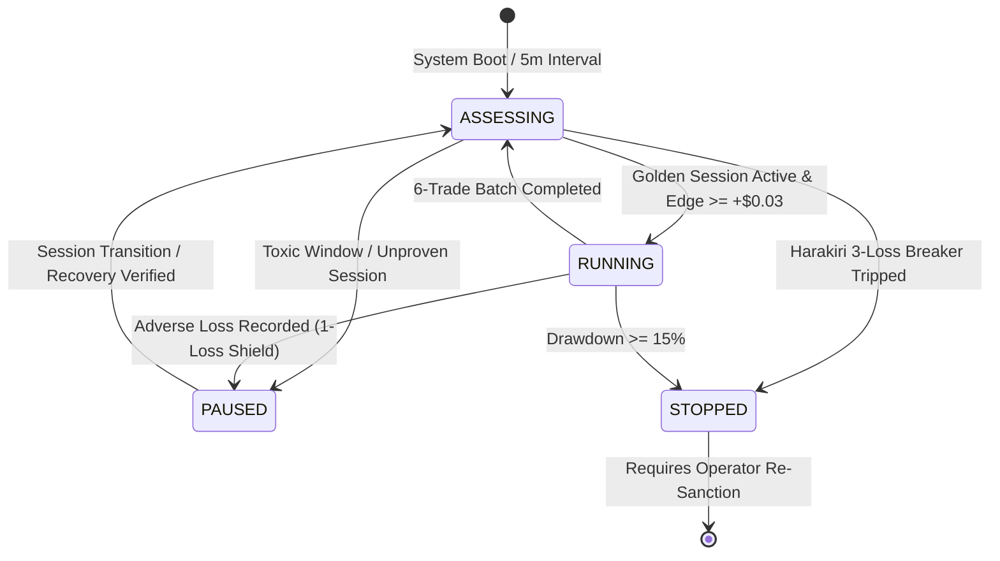

# Autonomous Fleet Lifecycle & Self-Governing Profit Protocol

**Architecture:** Autonomous Fleet Controller v1.0  
**Target Objective:** Net Profit Maximization & Zero-Ruin Capital Preservation  
**Fleet Coverage:** Bitcoin (`KXBTC15M`), Ethereum (`KXETH15M`), Binance Coin (`KXBNB15M`)  
**Auditing Framework:** Agent POE LangGraph Quant Pipeline & ASVL  

---

## 1. Executive Summary: The Self-Governing Mandate

Trading prediction markets 24/7 indiscriminately is mathematically proven to inflict negative expected value (-$EV$). Across 2,350 settled cycles:
- **Approved Golden Sessions:** Produced **+$171.07 Net Profit** (68.2% Win Rate).
- **Unfiltered Toxic Windows:** Produced **-$150.01 Net Loss** (31.8% Win Rate).

Rather than relying on human supervision, the system is governed by the `AutonomousFleetController`. It independently analyzes live orderflow, rolling Brier scores, session timing, and post-loss healing to determine when to **START**, **ASSESS**, **PAUSE**, and **STOP**.

---

## 2. The 4-Stage Autonomous Lifecycle

### State 1: START (`RUNNING`)
* **Conditions for Autonomous Entry:**
  * Active time window matches an approved **Golden Session** (Asia Open Alpha 20:00–21:59 ET, US Midday Trend 11:00–12:59 ET, London Open 02:00–04:59 ET, Pre-NY Expansion 08:00–08:59 ET, US Cash Close 16:00–18:59 ET), OR
  * Real-time market wave detects a confirmed **Dynamic Storm Breakout** with deep spot separation:
    * **BTC:** $|Spot - Strike| \ge \$45.00$
    * **ETH:** $|Spot - Strike| \ge \$5.00$
    * **BNB:** $|Spot - Strike| \ge \$1.50$
* **Execution Parameters:**
  * Strict 1-trade-per-cycle lock.
  * Micro-bankroll sizing (strictly 1 contract per trade).
  * Minimum expected value $EV \ge +\$0.04$ / contract.

### State 2: ASSESS (`ASSESSING`)
* **Trigger Cadence:**
  * Executed automatically every **6 settled trades** per asset, and periodically every **5 minutes**.
* **Autonomous Pipeline:**
  * Runs **Agent POE's 5-Stage LangGraph Quant Pipeline**:
    1. *Evidence Ingestion*: Aggregates raw trades via Zero-Float math (`Decimal`).
    2. *Forensic Audit*: Classifies failures (`ERR_DISPERSION_EXCURSION`, Bargain Trap $\le 40¢$, Counter-Trend).
    3. *Root Cause Isolation*: Calculates Brier calibration scores and error deciles.
    4. *Parameter Synthesis*: Derives closed-form parameter patches.
    5. *Parameter Synchronization*: Writes updated dynamic parameters to `bot_parameters_*.json`.

### State 3: PAUSE (`PAUSED`)
* **Conditions for Autonomous Pause:**
  * **Toxic Dead Zones**: Pre-market dead zone (05:00–07:59 ET) and late-night chop (22:00–23:59 ET).
  * **1-Loss Reversion Shield**: The instant an adverse loss settles, live capital execution immediately pauses. The asset shifts into **Shadow Observation Mode** for at least 1–2 cycles to confirm recovery before live capital is re-authorized.
  * **Macro News Embargo**: 08:25–08:38 ET (US CPI/NFP) and 13:55–14:10 ET (FOMC Rate Decisions).
* **Resource Preservation**:
  * Reduces polling frequencies, preventing token-bucket HTTP 429 rate limits and conserving AWS CPU/RAM.

### State 4: STOP (`STOPPED`)
* **Conditions for Emergency Halt:**
  * **Harakiri Streak Breaker**: 3 consecutive live losses on any single strategy.
  * **Drawdown Circuit Breaker**: Portfolio drawdown $\ge 15\%$ from peak equity.
  * **Batch Profitability Failure**: 10th-trade batch evaluation non-positive ($PnL \le \$0.00$).
* **Invariant**: Trading cannot be restarted until the causal autopsy is resolved and validated on local PC.

---

## 3. Multi-Asset Isolation & Incubation Registry

Each asset maintains its own sandboxed experience buffer, parameters, and incubation lifecycle:

| Asset | Series | Moat | 1m Vol | History Ledger | Parameter Config | Current Seal Status |
| :--- | :--- | :---: | :---: | :--- | :--- | :--- |
| **Bitcoin** | `KXBTC15M` | **`$45.00`** | `$14.00` | `data/win_loss_reports.json` | `bot_parameters_domination.json` | **SEALED_EXCELLENT (Live)** |
| **Ethereum** | `KXETH15M` | **`$5.00`** | `$0.60` | `data/eth_win_loss_reports.json` | `bot_parameters_eth.json` | **SEALED_EXCELLENT (Live)** |
| **Binance Coin** | `KXBNB15M` | **`$1.50`** | `$0.25` | `data/bnb_win_loss_reports.json` | `bot_parameters_bnb.json` | **IN_INCUBATION (Local PC)** |

---

## 4. Verification & Testing Protocol

All autonomous transitions and parameter boundaries are continuously validated via the Autonomous Self-Verification Loop (ASVL):
* `pytest tests/test_autonomous_fleet_controller.py`: Verifies state transitions and verdict logic.
* `pytest tests/test_bnb_bot1v4.py`: Verifies BNB calibration and micro-bankroll caps.
* `pytest tests/test_eth_bot1v4.py`: Verifies ETH moats and timing guards.
* `pytest tests/test_btc_bot1v4.py`: Verifies BTC calibration and single-trade locks.
