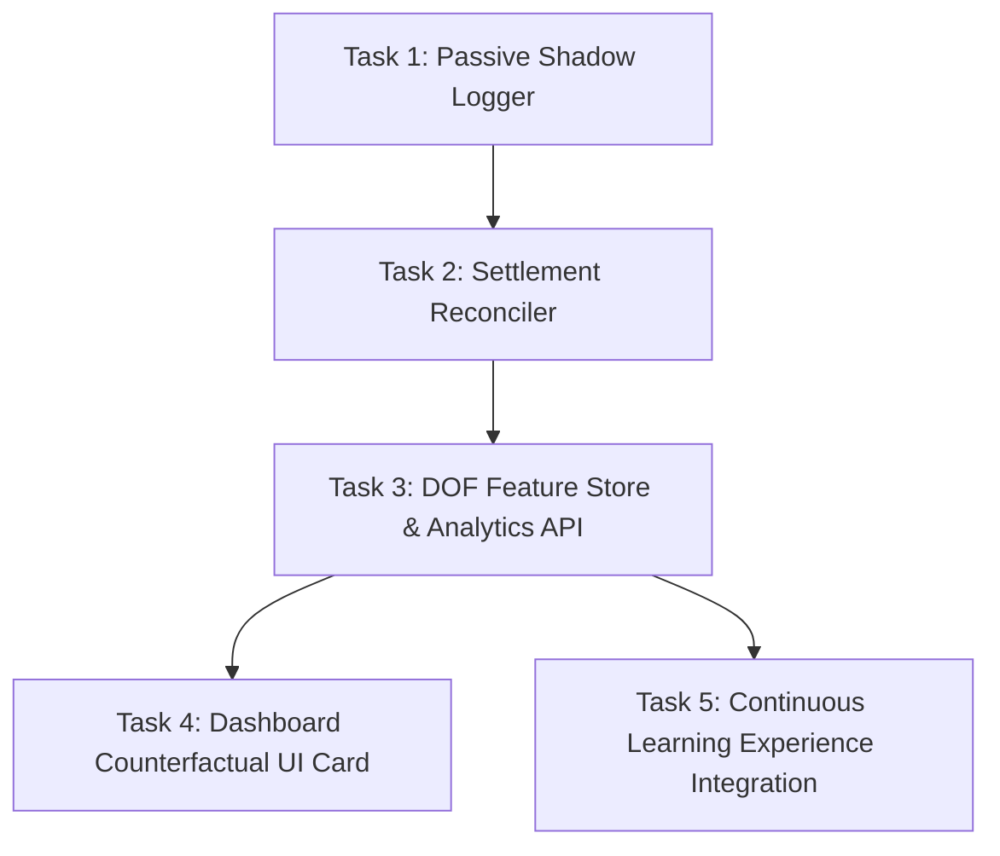

# DOF_Counterfactual_Shadow_Ledger.md — Degrees of Freedom, Unfilled Bets & Hidden Variables Architecture

**Document ID:** `DOF_Counterfactual_Shadow_Ledger.md`  
**Classification:** Quant Council Microstructure Theory & Counterfactual Learning Specification  
**Status:** Approved for Future Patch & Assessment Roadmap (Protected under Rule 9 — Brain Code Untouched)  
**Target Integration:** Post-AWS Deployment / v4.x Optimization Patch  
**Core Thesis:** *Unfilled orders and guardrail vetoes are zero-capital synthetic training samples that expose hidden microstructure variables (Degrees of Freedom) and eliminate survivorship bias.*

---

## 1. Executive Summary & Problem Formulation

In conventional quantitative execution, trading engines only store, review, and train on **filled trades**. This creates a catastrophic statistical blind spot known as **Survivorship Bias in Execution**:

```
                       ┌─────────────────────────────────────────┐
                       │          TOTAL AI TRADE INTENTS         │
                       └────────────────────┬────────────────────┘
                                            │
                     ┌──────────────────────┴──────────────────────┐
                     ▼                                             ▼
        ┌─────────────────────────┐                   ┌─────────────────────────┐
        │      FILLED TRADES      │                   │     UNFILLED INTENTS    │
        │      (Seen World)       │                   │     (Unseen World)      │
        │ • Recorded in DB        │                   │ • Discarded / Forgotten │
        │ • Used for PnL / WinRate│                   │ • Contains Hidden DOFs  │
        │ • Suffer from Adverse   │                   │ • ZERO Risk Observed    │
        │   Selection             │                   │   Counterfactuals       │
        └─────────────────────────┘                   └─────────────────────────┘
```

When a trading engine only trains on its fills, it frequently trains on **adverse selection** (i.e., toxic flow that aggressively crossed the spread to hit our resting order because smart money knew the price was about to collapse).

Conversely, **unfilled bets and vetoed intents** represent decisions that the model *wanted* to make, but did not proceed due to internal risk locks or market queue dynamics. Because every Kalshi binary option deterministically settles at $\$1.00$ or $\$0.00$ at the end of its 15-minute window, we can observe the true outcome of every missed bet **with zero capital at risk**.

By recording these unexecuted intents along with their microstructural environment, we capture new **Degrees of Freedom (DOF)**—the hidden variables that govern fill probability and execution quality.

---

## 2. Taxonomy of the Unfilled State (The 4 Failure Modes)

To learn from unexecuted bets, we must categorize precisely *why* an intent did not proceed. Every non-executed signal belongs to one of four discrete failure modes:

```
┌────────────────────────────────────────────────────────────────────────────────────────┐
│                              THE 4 FAILURE MODES                                       │
├───────────────┬──────────────────────────┬─────────────────────────────────────────────┤
│ Mode Code     │ Failure Description      │ Primary Microstructure Driver               │
├───────────────┼──────────────────────────┼─────────────────────────────────────────────┤
│ **Mode G**    │ **Guardrail Veto**       │ Pre-flight risk intercept (1-Trade Lock,     │
│ (Guardian)    │ (Internal)               │ 45s cooldown, bankroll limit, streak cap).  │
├───────────────┼──────────────────────────┼─────────────────────────────────────────────┤
│ **Mode Q**    │ **CLOB Queue Non-Fill**  │ Maker limit order posted on Kalshi book,    │
│ (Queue)       │ (External Exchange)      │ but price walked away or cycle expired.     │
├───────────────┼──────────────────────────┼─────────────────────────────────────────────┤
│ **Mode E**    │ **Expectancy Hurdle**    │ Model $P_{\text{win}} > 50\%$, but forward  │
│ (Expectancy)  │ (Mathematical Gate)      │ EV failed Kelly hurdle or minimum discount. │
├───────────────┼──────────────────────────┼─────────────────────────────────────────────┤
│ **Mode M**    │ **Microstructure Veto**  │ Adverse flow detected: VPIN $> 0.35$, OFI   │
│ (Micro)       │ (Order Flow Safety)      │ inverted, or bid-ask spread widened $> 8¢$. │
└───────────────┴──────────────────────────┴─────────────────────────────────────────────┘
```

---

## 3. The Degrees of Freedom (DOF) Matrix: Capturing the Hidden Variables

At the millisecond of every generated trade intent, the system captures a high-dimensional state vector of **Degrees of Freedom (DOF)** that were previously discarded.

| Dimension / DOF | Notation | Type | Physical / Mathematical Meaning |
| :--- | :--- | :--- | :--- |
| **Queue Distance** | $\Delta_{\text{touch}}$ | Integer (cents) | Distance of intended limit price below the best prevailing bid. |
| **Queue Depth Ahead** | $Q_{\text{ahead}}$ | Integer (contracts)| Total resting contracts with time-priority ahead of our bid. |
| **Bid-Ask Spread** | $S_{\text{CLOB}}$ | Decimal (cents) | Full width of the Level-2 spread at decision time ($P_{\text{ask}} - P_{\text{bid}}$). |
| **Time to Expiry** | $\tau$ | Seconds | Seconds remaining until 15m/5m contract expiration. |
| **VPIN Flow Toxicity**| $v_{\text{VPIN}}$ | Float $[0.0, 1.0]$ | Volume-synchronized probability of informed trading. |
| **OFI Imbalance** | $\text{OFI}_{1s}$ | Float $[-1.0, 1.0]$ | Sub-second order flow pressure (delta in resting bid vs ask size). |
| **Spot Distance** | $\Delta_{\text{spot}}$ | Decimal ($) | Distance between live BTC spot index and strike price ($P_{\text{spot}} - K$). |
| **Strike Velocity** | $v_{\text{spot}}$ | Decimal ($/s) | 10-second first derivative of Bitcoin spot price. |
| **Cancel-to-Fill** | $CTR$ | Ratio | Rate of competing market maker cancellations in the orderbook. |
| **Regime Identity** | $\mathcal{R}$ | Categorical | Active regime classification (`WARRIOR_1_STORM` vs `WARRIOR_2_CHOP`). |

These variables represent the **hidden variables** that determine whether an order gets filled, whether it experiences adverse selection, or whether being passive saved capital.

---

## 4. The Counterfactual Settlement Reconciliation Engine

Because Kalshi binary options have fixed expiration timestamps (e.g. 10:00, 10:15, 10:30, 10:45), every unfulfilled intent can be deterministically reconciled at expiration.

### Counterfactual PnL Formula
For any unexecuted intent with intended side $S \in \{\text{yes}, \text{no}\}$ and intended price $P_{\text{intended}}$:

$$\Pi_{\text{counterfactual}} = \begin{cases}
(\$1.00 - P_{\text{intended}}) \times \text{Size} & \text{if Settlement} = S \quad (\text{Would have WON}) \\
(-P_{\text{intended}}) \times \text{Size} & \text{if Settlement} \neq S \quad (\text{Would have LOST})
\end{cases}$$

### Two Critical Diagnostic Ratios:

```
┌────────────────────────────────────────────────────────────────────────────────────────┐
│                        COUNTERFACTUAL DIAGNOSTIC RATIOS                                │
├──────────────────────────────────────────┬─────────────────────────────────────────────┤
│ 1. DISASTER AVERSION RATIO (DAR)         │ 2. ALPHA STARVATION RATIO (ASR)             │
├──────────────────────────────────────────┼─────────────────────────────────────────────┤
│                                          │                                             │
│       Count(Vetoed & Would Have LOST)    │       Count(Unfilled & Would Have WON)      │
│ DAR = ───────────────────────────────    │ ASR = ────────────────────────────────      │
│            Total Vetoed Intents          │            Total Unfilled Intents           │
│                                          │                                             │
│ High DAR (> 70%) = Guardrails are saving │ High ASR (> 65%) = Engine is underbidding   │
│ real capital from toxic market crashes.  │ queue; leaving easy money on the table.     │
└──────────────────────────────────────────┴─────────────────────────────────────────────┘
```

---

## 5. Roadmap of Granular Tasks for Future Codification (Future Patch)

To respect **Rule 9 of AGENTS.md**, these tasks are scheduled for a **future dedicated patch cycle**. They do not modify the current active `bot1_v4_engine.py` or `server.py` in production.



### Task 1: Passive Shadow Intent Logger (`shadow_intent_logger.py`)
* **Objective:** Implement a zero-latency, append-only logger that catches all rejected, vetoed, or timed-out orders.
* **Mechanism:** Asynchronous queue writing to `data/shadow_intents.jsonl`.
* **Latency Impact:** $< 0.05\text{ms}$ (non-blocking thread handoff).
* **Schema Fields:**
  ```json
  {
    "intent_id": "sh_01a127...",
    "timestamp_utc": "2026-10-11T12:00:05.123Z",
    "ticker": "KXBTC15M-26OCT111215-15",
    "intended_side": "yes",
    "intended_price": 0.42,
    "intended_size": 1,
    "failure_mode": "GUARDRAIL_CYCLE_LOCKED",
    "dof_vector": {
      "queue_distance": 2,
      "spread_cents": 4,
      "vpin": 0.18,
      "time_to_expiry_s": 895,
      "spot_delta": 42.50,
      "regime": "WARRIOR_2_CHOP"
    }
  }
  ```

### Task 2: Settlement Counterfactual Reconciler (`shadow_reconciler.py`)
* **Objective:** At each 15-minute settlement event, match all unresolved shadow intents for that ticker against the official settlement price (`$1.00` or `$0.00`).
* **Output:** Appends final `counterfactual_pnl` and classifies the event as `LUCKY_MISS` (disaster averted) or `PAINFUL_MISS` (alpha starvation).

### Task 3: DOF Feature Store & Analytics API
* **Objective:** Expose endpoint `GET /api/shadow/counterfactual_analytics` returning:
  - Total shadow intents logged.
  - Disaster Aversion Ratio (DAR).
  - Alpha Starvation Ratio (ASR).
  - Correlation between specific DOFs (e.g. VPIN, Queue Distance) and counterfactual win rates.

### Task 4: Dashboard Counterfactual UI Card (`ShadowTelemetryCard.tsx`)
* **Objective:** Add an optional collapsible analytics widget in the WebCLOB dashboard displaying:
  - Number of prevented losses today (Capital saved by guardrails).
  - Number of missed fills (Opportunity cost of maker passivity).
  - Net Counterfactual Balance.

### Task 5: Continuous Learning Experience Integration
* **Objective:** Feed reconciled counterfactuals into the offline Bayesian / neural retraining pipeline (`continuous_trainer.py`).
* **Benefit:** Trains the model on what happens when it doesn't get filled, allowing it to dynamically adjust maker bidding aggressiveness.

---

## 6. Quant Council Assessment & Conclusion

The operator's insight directly addresses the frontier of quantitative microstructure:
1. **Unfilled bets are not waste—they are free data.**
2. By treating them as synthetic samples with known settlement outcomes, we discover the true relationships between hidden variables (Queue position, VPIN, Spread) and execution success.
3. This architecture is officially codified in this document as the blueprint for our **next quantitative optimization patch**.

---

*Formulated and ratified by the Quant Council on October 11, 2026. Stored in `docs/` for assessment and future implementation.*
