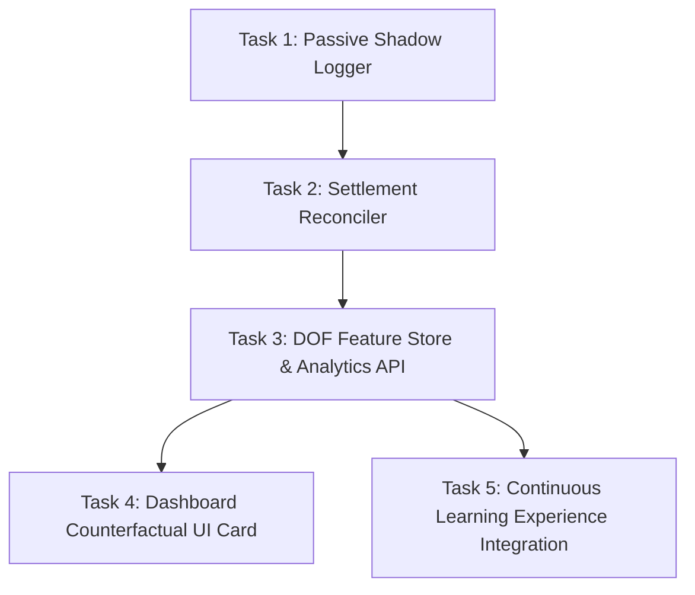

# DOF_Counterfactual_Shadow_Ledger.md — Degrees of Freedom, Unfilled Bets & Hidden Variables Architecture

**Document ID:** `DOF_Counterfactual_Shadow_Ledger.md`  
**Classification:** Quant Council Microstructure Theory & Counterfactual Learning Specification  
**Status:** Approved for Future Direction & Roadmap (Protected under Rule 9 — Brain Code Untouched)  
**Execution Directives:** 
1. **DO NOT USE FOR LIVE UPGRADE YET**: All variables remain candidate choices in reserve.
2. **SELECTION ARBITRATION**: The **6-Trade Evaluation Cycle** and **Total Assessment** will empirically choose and promote these DOFs based on ground-truth batch results.
**Core Thesis:** *Unfilled orders and guardrail vetoes are zero-capital synthetic training samples that expose hidden microstructure variables (Degrees of Freedom) and eliminate survivorship bias.*

---

## 1. Executive Summary & Problem Formulation

In conventional quantitative execution, trading engines only store, review, and train on **filled trades**. This creates a catastrophic statistical blind spot known as **Survivorship Bias in Execution**:

```
                       ┌─────────────────────────────────────────┐
                       │          TOTAL AI TRADE INTENTS         │
                       └────────────────────┬────────────────────┘
                                            │
                     ┌──────────────────────┴──────────────────────┐
                     ▼                                             ▼
        ┌─────────────────────────┐                   ┌─────────────────────────┐
        │      FILLED TRADES      │                   │     UNFILLED INTENTS    │
        │      (Seen World)       │                   │     (Unseen World)      │
        │ • Recorded in DB        │                   │ • Discarded / Forgotten │
        │ • Used for PnL / WinRate│                   │ • Contains Hidden DOFs  │
        │ • Suffer from Adverse   │                   │ • ZERO Risk Observed    │
        │   Selection             │                   │   Counterfactuals       │
        └─────────────────────────┘                   └─────────────────────────┘
```

When a trading engine only trains on its fills, it frequently trains on **adverse selection** (i.e., toxic flow that aggressively crossed the spread to hit our resting order because smart money knew the price was about to collapse).

Conversely, **unfilled bets and vetoed intents** represent decisions that the model *wanted* to make, but did not proceed due to internal risk locks or market queue dynamics. Because every Kalshi binary option deterministically settles at $\$1.00$ or $\$0.00$ at the end of its 15-minute window, we can observe the true outcome of every missed bet **with zero capital at risk**.

By recording these unexecuted intents along with their microstructural environment, we capture new **Degrees of Freedom (DOF)**—the hidden variables that govern fill probability, regime adaptation, and execution quality.

---

## 2. Taxonomy of the Unfilled State (The 4 Failure Modes)

To learn from unexecuted bets, we must categorize precisely *why* an intent did not proceed. Every non-executed signal belongs to one of four discrete failure modes:

```
┌────────────────────────────────────────────────────────────────────────────────────────┐
│                              THE 4 FAILURE MODES                                       │
├───────────────┬──────────────────────────┬─────────────────────────────────────────────┤
│ Mode Code     │ Failure Description      │ Primary Microstructure Driver               │
├───────────────┼──────────────────────────┼─────────────────────────────────────────────┤
│ **Mode G**    │ **Guardrail Veto**       │ Pre-flight risk intercept (1-Trade Lock,     │
│ (Guardian)    │ (Internal)               │ 45s cooldown, bankroll limit, streak cap).  │
├───────────────┼──────────────────────────┼─────────────────────────────────────────────┤
│ **Mode Q**    │ **CLOB Queue Non-Fill**  │ Maker limit order posted on Kalshi book,    │
│ (Queue)       │ (External Exchange)      │ but price walked away or cycle expired.     │
├───────────────┼──────────────────────────┼─────────────────────────────────────────────┤
│ **Mode E**    │ **Expectancy Hurdle**    │ Model $P_{\text{win}} > 50\%$, but forward  │
│ (Expectancy)  │ (Mathematical Gate)      │ EV failed Kelly hurdle or minimum discount. │
├───────────────┼──────────────────────────┼─────────────────────────────────────────────┤
│ **Mode M**    │ **Microstructure Veto**  │ Adverse flow detected: VPIN $> 0.35$, OFI   │
│ (Micro)       │ (Order Flow Safety)      │ inverted, or bid-ask spread widened $> 8¢$. │
└───────────────┴──────────────────────────┴─────────────────────────────────────────────┘
```

---

## 3. The Unified Degrees of Freedom (DOF) Master Portfolio

By synthesizing the **Regime & Strategy DOFs created yesterday** ([`docs/GeneralAssesment 001.md`](file:///f:/012D_TRADE/Kalshi%20Simulator/docs/GeneralAssesment%20001.md)) with the **Microstructure & Counterfactual DOFs created today**, we establish the complete candidate parameter space for future iterations:

### Class I: Macro & Regime Degrees of Freedom (Created Yesterday in General Assessment 001)
These macro DOFs govern *which warrior holds the helm* and the macroeconomic state of the market:

| ID | Degree of Freedom (DOF) | Target / Dynamic Range | Operational Function in Regime Engine |
| :--- | :--- | :--- | :--- |
| **`DOF-01`** | **Kinetic Volatility Boundary ($\sigma_{1\text{m}}$)** | $\$12.00$ (Chop) vs $\$16.00$ (Trend) | Delineates compressed mean-reversion from explosive directional momentum. |
| **`DOF-02`** | **Geometric Range Box ($S_{\max} - S_{\min}$)** | $\le \$28.00$ (Chop Cage) vs $> \$50.00$ | Restricts Warrior 2 inside tight consolidation channels. |
| **`DOF-03`** | **Circadian Volume Window** | `13:00–22:00 UTC` vs `23:00–08:00 UTC` | Adjusts baseline aggression between US/London liquid hours and Asian overnight calm. |
| **`DOF-04`** | **Chop Discount Entry Limit ($P_{\text{limit}}$)** | $\$0.38 - \$0.42$ | Asymmetric pricing sweet spot providing $1 : 1.63$ risk-to-reward ratio. |
| **`DOF-05`** | **Dynamic Scalp Exit Hurdle ($\text{ROI}_{\text{exit}}$)**| $+35\% - +50\%$ cash gain | Fires early take-profit exit in chop without waiting for expiration gamma risk. |
| **`DOF-06`** | **Volcano Breakout Trigger** | $|\Delta \text{OFI}| > 0.45$, $|v_{3\text{s}}| > \$15/\text{s}$ | Fast-path order cancellation and regime shift to Warrior 1 upon trend eruption. |
| **`DOF-07`** | **Cooldown Hysteresis Duration** | $45$ continuous seconds calm | Anti-whipsaw filter preventing false reversion back into chop during volatility pauses. |

### Class II: Microstructure & Counterfactual Degrees of Freedom (Created Today in Shadow Ledger)
These micro DOFs govern *why an order fails to proceed or fill* in the orderbook queue:

| ID | Degree of Freedom (DOF) | Target / Type | Operational Function in Execution Engine |
| :--- | :--- | :--- | :--- |
| **`DOF-08`** | **Queue Distance from Touch ($\Delta_{\text{touch}}$)**| $0¢, 1¢, 2¢$ (Integer) | Measures queue passivity. Distance of our bid below best prevailing bid. |
| **`DOF-09`** | **Queue Depth Ahead ($Q_{\text{ahead}}$)** | Contracts (Integer) | Total resting contracts with time-priority ahead of our order at the price level. |
| **`DOF-10`** | **Level-2 Bid-Ask Spread ($S_{\text{CLOB}}$)** | $\$0.02 - \$0.08$ (Decimal) | Spread width at intent. Wide spreads demand maker resting; tight spreads allow snipes. |
| **`DOF-11`** | **Expiration Horizon Countdown ($\tau$)** | $0 - 900$ Seconds | Time remaining until settlement. Governs theta decay and TWAP gamma pinning. |
| **`DOF-12`** | **Volume Flow Toxicity ($v_{\text{VPIN}}$)** | $0.00 - 1.00$ (Float) | Microstructure hazard rate. Distinguishes retail flow from toxic institutional dumping. |
| **`DOF-13`** | **Spot Moneyness Delta ($\Delta_{\text{spot}}$)** | $\$ (P_{\text{spot}} - K)$ | Real-time distance between BTC spot index and strike price. |
| **`DOF-14`** | **Strike Velocity ($v_{\text{spot}}$)** | $\$/\text{s}$ (10s Derivative) | First derivative of spot price drift. Anticipates queue walk-aways. |
| **`DOF-15`** | **Cancel-to-Trade Ratio ($CTR$)** | Ratio $[0.0, \infty)$ | Measures competing market-maker spoofing and liquidity pulling. |
| **`DOF-16`** | **Failure Mode Code** | `MODE_G`, `MODE_Q`, `MODE_E`, `MODE_M` | Categorical failure attribution for post-settlement counterfactual analysis. |

---

## 4. The Selection Protocol: 6-Trade Evaluation & Total Assessment Arbitration

Crucially, **we do NOT implement or hardcode these DOFs into the active bot today**. 

Instead, they represent our **Degrees of Freedom Reserve**. The system delegates the selection, activation, and tuning of these DOFs to our two proven empirical assessment mechanisms:

```
┌────────────────────────────────────────────────────────────────────────────────────────┐
│                        EMPIRICAL DOF SELECTION ARBITRATION                             │
├──────────────────────────────────────────┬─────────────────────────────────────────────┤
│ 1. AUTONOMOUS 6-TRADE BATCH EVALUATION   │ 2. TOTAL 24-HOUR FORENSIC ASSESSMENT        │
│    (Micro-Level Optimization)            │    (Macro-Level Strategy Evolution)         │
├──────────────────────────────────────────┼─────────────────────────────────────────────┤
│ • Trigger: After every 6 completed       │ • Trigger: Daily 24-hour audit              │
│   trades (docs/AUTONOMOUS_6_TRADE_*.md). │   (docs/GeneralAssesment 001.md).           │
│ • Net PnL > $0.00: Auto-extends session; │ • Forensic review across all batches and    │
│   active parameters remain locked.       │   market sessions.                          │
│ • Net PnL ≤ $0.00: Auto-disarms and      │ • Evaluates session bifurcation (e.g. Day   │
│   audits the 6-trade batch.              │   vs Night, Trend vs Chop win rates).       │
│ • Selects Class II Micro DOFs            │ • Selects Class I Macro DOFs                │
│   (e.g. adjusts Queue Distance DOF-08    │   (e.g. adjusts Volatility Threshold DOF-01 │
│   if Alpha Starvation is high; tightens  │   or Chop Entry Limit DOF-04 to plug        │
│   Spread DOF-10 if adverse selection     │   overnight leaks).                         │
│   is detected).                          │                                             │
└──────────────────────────────────────────┴─────────────────────────────────────────────┘
```

### The Rule of Empirical Promotion:
1. **Zero Guessing:** A candidate DOF is never promoted to active strategy code based on intuition. It must be justified by hard metrics from completed 6-trade batches or a 24h total assessment.
2. **Rule 9 Protected Gate:** Even when an assessment indicates a DOF should be tuned or promoted, the proposed change is presented to the operator with a concrete rationale and diff before modifying any active brain code.

---

## 5. Counterfactual Settlement Reconciliation Engine

Because Kalshi binary options have fixed expiration timestamps (e.g. 10:00, 10:15, 10:30, 10:45), every unfulfilled intent can be deterministically reconciled at expiration.

### Counterfactual PnL Formula
For any unexecuted intent with intended side $S \in \{\text{yes}, \text{no}\}$ and intended price $P_{\text{intended}}$:

$$\Pi_{\text{counterfactual}} = \begin{cases}
(\$1.00 - P_{\text{intended}}) \times \text{Size} & \text{if Settlement} = S \quad (\text{Would have WON}) \\
(-P_{\text{intended}}) \times \text{Size} & \text{if Settlement} \neq S \quad (\text{Would have LOST})
\end{cases}$$

### Two Critical Diagnostic Ratios:

```
┌────────────────────────────────────────────────────────────────────────────────────────┐
│                        COUNTERFACTUAL DIAGNOSTIC RATIOS                                │
├──────────────────────────────────────────┬─────────────────────────────────────────────┤
│ 1. DISASTER AVERSION RATIO (DAR)         │ 2. ALPHA STARVATION RATIO (ASR)             │
├──────────────────────────────────────────┼─────────────────────────────────────────────┤
│                                          │                                             │
│       Count(Vetoed & Would Have LOST)    │       Count(Unfilled & Would Have WON)      │
│ DAR = ───────────────────────────────    │ ASR = ────────────────────────────────      │
│            Total Vetoed Intents          │            Total Unfilled Intents           │
│                                          │                                             │
│ High DAR (> 70%) = Guardrails are saving │ High ASR (> 65%) = Engine is underbidding   │
│ real capital from toxic market crashes.  │ queue; leaving easy money on the table.     │
└──────────────────────────────────────────┴─────────────────────────────────────────────┘
```

---

## 6. Roadmap of Granular Tasks for Future Codification (Future Patch)

To respect **Rule 9 of AGENTS.md**, these tasks are scheduled for a **future dedicated patch cycle**. They do not modify the current active `bot1_v4_engine.py` or `server.py` in production.



### Task 1: Passive Shadow Intent Logger (`shadow_intent_logger.py`)
* **Objective:** Implement a zero-latency, append-only logger that catches all rejected, vetoed, or timed-out orders.
* **Mechanism:** Asynchronous queue writing to `data/shadow_intents.jsonl`.
* **Latency Impact:** $< 0.05\text{ms}$ (non-blocking thread handoff).

### Task 2: Settlement Counterfactual Reconciler (`shadow_reconciler.py`)
* **Objective:** At each 15-minute settlement event, match all unresolved shadow intents for that ticker against the official settlement price (`$1.00` or `$0.00`).
* **Output:** Appends final `counterfactual_pnl` and classifies the event as `LUCKY_MISS` (disaster averted) or `PAINFUL_MISS` (alpha starvation).

### Task 3: DOF Feature Store & Analytics API
* **Objective:** Expose endpoint `GET /api/shadow/counterfactual_analytics` returning:
  - Total shadow intents logged.
  - Disaster Aversion Ratio (DAR).
  - Alpha Starvation Ratio (ASR).
  - Correlation between specific DOFs and counterfactual win rates.

### Task 4: Dashboard Counterfactual UI Card (`ShadowTelemetryCard.tsx`)
* **Objective:** Add an optional collapsible analytics widget in the WebCLOB dashboard displaying:
  - Number of prevented losses today (Capital saved by guardrails).
  - Number of missed fills (Opportunity cost of maker passivity).
  - Net Counterfactual Balance.

### Task 5: Continuous Learning Experience Integration
* **Objective:** Feed reconciled counterfactuals into the offline Bayesian / neural retraining pipeline (`continuous_trainer.py`).
* **Benefit:** Trains the model on what happens when it doesn't get filled, allowing it to dynamically adjust maker bidding aggressiveness.

---

## 7. Quant Council Assessment & Conclusion

1. **Unfilled bets are valuable data:** They remove survivorship bias with zero capital at risk.
2. **Yesterday's Regime DOFs (`DOF-01` to `DOF-07`) + Today's Microstructure DOFs (`DOF-08` to `DOF-16`) form our complete strategic compass.**
3. **The 6-Trade Evaluation batches and Total Assessments will empirically select, tune, and promote these DOFs** as the market unfolds, ensuring we evolve with mathematical proof rather than guesswork.

---

*Formulated and ratified by the Quant Council on October 11, 2026. Stored in `docs/` for assessment and future implementation.*
