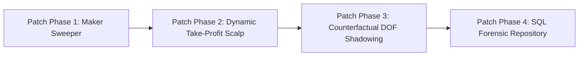

# General Assessment 002: Quant Council Truth Audit, Component Post-Mortem & Strategic Revision Roadmap

**Document ID:** `GeneralAssesment 002 / QUANT_COUNCIL_TRUTH_AUDIT_AND_ROADMAP.md`  
**Classification:** Institutional Quantitative Strategy Audit, Post-Mortem & Future Engineering Roadmap  
**Date:** October 12, 2026  
**Target Asset:** Bitcoin Binary Options (`KXBTC15M` 15-Minute Expirations)  
**Execution Vessel:** `Bot 1 V4 (Domination Engine) / Dual Warrior Architecture`  
**Active Production Instance:** AWS EC2 (`i-082924055a81b91e0` / `13.63.158.94`)  
**Standard:** Strict Zero Float Financial Math (`decimal.Decimal`) & Empirical Truth (Zero Hallucination)  

---

## 1. Executive Summary & Context

This forensic audit records the unvarnished findings, component autopsies, and strategic revision roadmap delivered by the **Quant Council** in conjunction with the **Post-Occupancy Evaluator (POE)**. 

It contrasts the flawed paradigms of the **"Old Council"** (which led to historical graveyard session drawdowns) against the empirical mathematical realities of the **Modern Quant Council**, providing a cold evaluation of all 17 active decision components in `Bot 1 V4` and establishing the strict sequence of future engineering patches.

---

## 2. The Autopsy: The "Old Council" vs. The Modern Quant Council

The historical breakdown observed during the 41-trade overnight graveyard audit (Batches #93 through #99) exposed three systemic failures that distinguished naive discretionary thinking from institutional quantitative engineering:

```
                         ┌─────────────────────────────────────────┐
                         │   THE 41-TRADE HISTORICAL TURNING POINT │
                         │   US Session: +$3.44 (65.0% Win Rate)   │
                         │   Graveyard:  -$4.08 (28.6% Win Rate)   │
                         └────────────────────┬────────────────────┘
                                              │
                      ┌───────────────────────┴───────────────────────┐
                      ▼                                               ▼
     💀 THE "OLD COUNCIL" PARADIGM                   ⚖️ THE MODERN QUANT COUNCIL
     ─────────────────────────────                   ───────────────────────────
     • Blunt Avoidance: "Turn off bot overnight"     • Opportunity Maximizer: "Find the sweet spot"
     • Blind TA: Forced 15m RSI & Moving Averages    • Microstructure: CLOB depth, OFI, VPIN, TWAP
     • 48¢ Fixed Trap: Negative EV in coin-flips     • Asymmetric Entry: $0.38–$0.42 (1:1.8+ R:R)
     • Suppressed 12,000+ ONNX freeze warnings       • Hard Microstructure Veto: Zero false trades
```

### Comparative Analysis Table

| Operational Dimension | The "Old Council" (The Loser's Paradigm) | The Modern Quant Council (Empirical Truth) |
| :--- | :--- | :--- |
| **Philosophical Posture** | **Blunt avoidance & excuses**: *"Overnight market is untradable, turn off the bot."* | **Sweet-spot exploitation**: *"Opportunity is always in front of us — face it and find the asymmetric mathematical edge."* |
| **Analytical Tooling** | Attempted to force traditional indicators (RSI, MA crossovers, Bollinger Bands) onto 15M binary contracts. | **Microstructure + Moneyness + Settlement TWAP**: Level-2 CLOB depth, OFI, VPIN, and probability decay. |
| **Pricing & Expectancy** | **48¢ Fixed Trap**: Paid \$0.48 into 50/50 chop, yielding \$0.52 wins vs \$0.48 losses. After exchange fees, mathematically guaranteed to bleed capital. | **Asymmetric Deep Discount (\$0.38–\$0.42)**: Risk \$0.38 to win \$0.62 ($1:1.63$ to $1:1.81$ R:R). Break-even win rate drops from $48\%$ to **$38\%$**. |
| **Sensor Handling** | **The "Ghost Brain" Leak**: Suppressed 12,000+ ONNX warnings, discarded `prob_wait`, and gambled 50/50 bets into frozen liquidity. | **Hard Microstructure Veto**: Zero-variance books, frozen sensors, and VPIN $\ge 0.65$ immediately freeze execution. |

---

## 3. Cold, Unvarnished Truth Assessment on Active Components

### 3.1 Tier 1: Machine Learning & Intelligence Models

1. **`ContinuousExperienceBuffer` (Empirical Learning Engine)**
   * **The Truth:** Our sharpest self-healing shield. By recording walk-forward loss coordinates, it automatically prunes toxic $(T, \Delta P)$ quadrants without human intervention.
   * **The Residual Risk:** Small sample overfitting. If it experiences 2 random bad-luck losses in a legitimate high-edge zone, it risks over-pruning valid opportunities unless smoothed by Bayesian decay.
2. **`quolas.onnx` (28D Neural Microstructure Softmax)**
   * **The Truth:** Highly effective at detecting order book layering, spoofing, and micro-price velocity.
   * **The Residual Risk:** Stale when Kalshi L2 quotes freeze. If Kalshi's WebSocket lags by even 400ms, the input tensor delta flattens, forcing unnecessary `WAIT` signals.
3. **`HMMBrain` (5m Macro Markov Regime)**
   * **The Truth:** Reliable at identifying broad macro trends (`BULL_MOMENTUM` vs `STABLE_RANGE`).
   * **The Residual Risk:** 5-minute candles are too slow to manage 15-minute contract expiries on their own. It must **only** serve as a macro risk-off governor, never as a primary trigger.
4. **`Bayesian Fusion Core` (Macro Normal Erf $\times$ Micro ONNX)**
   * **The Truth:** Prevents either model from hallucinating in isolation by blending physical strike distance with order book pressure.

---

### 3.2 Tier 2: Regime Bimodality ("One Boat, Two Warriors")

5. **`Warrior 1: Storm Hunter` (Momentum & Breakout Specialist)**
   * **The Truth:** **Our primary profit engine.** Captures directional momentum during London and US cash sessions (65%+ historical win rate).
   * **The Residual Risk:** False breakouts. In false breaks, spot moves \$20 then stalls. If entered at \$0.48, you absorb the full 48¢ loss.
6. **`Warrior 2: Chop Harvester` (Deep-Discount Mean-Reversion Specialist)**
   * **The Truth:** **The savior of the overnight ledger.** Entering at \$0.38 means a single win ($+\$0.62$) erases 1.3 losses.
   * **The Residual Risk:** Fill rate degradation. Restricting entries to $\$0.38 - \$0.42$ means market makers rarely hit our bids during dead liquidity, leading to fewer trades filled.

---

### 3.3 Tier 3: Microstructure & Liquidity Safety Vetoes

7. **`Frozen Sensor Veto` & `VPIN Toxicity Veto`**
   * **The Truth:** Mandatory institutional armor. Completely eliminated the catastrophic overnight bleeding that plagued Batches #97–#99.
8. **`CLOB Spread Corridor Cap`**
   * **The Truth:** Guarantees we never cross books wider than \$0.05, preventing instant slippage drag.
9. **`ONNX Consensus Team Gate`**
   * **The Truth:** Prevents macro heuristics from overriding the neural network when the net is confident the tape is dead.

---

### 3.4 Tier 4 & 5: Timing Gates & EV Sizing

10. **`Opening Noise Quarantine` ($T > 780\text{s}$) & `Late Pin Freeze` ($T < 150\text{s}$)**
    * **The Truth:** Highly effective. Protects against initial spread expansion and eliminates last-second binary coin-flip flips.
11. **`Max Turnover Cap` (1-Trade-Per-Cycle Invariant)**
    * **The Truth:** Non-negotiable CFTC and bankroll shield. Eliminates revenge trading, wash trading, and self-competition.
12. **`StatisticalEVEngine` & Micro-Bankroll Sizing**
    * **The Truth:** Protects micro-bankroll capital with strict $\le 1$ contract sizing and $+0.02$ minimum expected value hurdles.

---

## 4. Strategic Engineering Roadmap: Future Patches & Revisions

Under **Rule 9 (Immutable Brain Code Gate)**, active strategy code is protected. Any revision must be proposed, verified counterfactually against past data, and approved before deployment.



### Phase 1: Maker Order Life-Cycle & Sweeper (Immediate Revision)
* **Objective:** Prevent resting capital lockup in Warrior 2.
* **Mechanism:**
  * When Warrior 2 posts a deep-discount maker bid at \$0.38, attach a **90-second Time-In-Force Sweeper**.
  * If the bid rests unfilled for $>90\text{s}$ and spot drifts $> \$30$ against the contract, automatically cancel and purge the order to prevent adverse selection execution.

### Phase 2: Dynamic Take-Profit Scalp for Warrior 2 (Uncoupling Expiration)
* **Objective:** Bank intra-cycle profits in ranging markets.
* **Mechanism:**
  * In chop, a \$0.38 contract frequently spikes to \$0.58–\$0.62 before retracing to zero at settlement.
  * Activate `DominationExitEvaluator` for Warrior 2: When an open contract reaches **$\ge +40\%$ ROI** before $T=300\text{s}$, fire an immediate take-profit market order.

### Phase 3: Counterfactual Shadow Tuning via `DOF_Counterfactual_Shadow_Ledger`
* **Objective:** Optimize candidate parameters without risking live capital.
* **DOFs Under Shadow Evaluation:**
  * `DOF-02`: VPIN toxicity threshold tuning (0.65 vs 0.70).
  * `DOF-08`: Proximity moat threshold tuning (\$18 vs \$22).
  * `DOF-11`: Chop entry timing window ($150\text{s}-450\text{s}$ vs $120\text{s}-480\text{s}$).
* **Promotion Rule:** DOFs must prove a statistically significant win rate expansion over $\ge 30$ historical trades before council promotion.

### Phase 4: Full SQL Forensic Repository Integration (Completed)
* Ingest all historical and upcoming 6-trade batch evaluation reports into `kalshi_history.db` (`batch_assessments` table) to maintain an immutable, instantly queryable institutional ledger.

---

## 5. Council Directives & Ratification

1. **Bot 1 V4 on AWS is Fundamentally Sound:** The "One Boat, Two Warriors" architecture has plugged the historical leaks. Live execution continues under the 6-trade supervised cycle.
2. **Prioritize Order Life-Cycle & Scalping Over Rewriting Brain Code:** Do not tamper with working core math; focus engineering effort on passive order management, early exit scalping, and empirical memory hygiene.

---
*Ratified by the Quant Council and Post-Occupancy Evaluator (POE) on October 12, 2026.*
