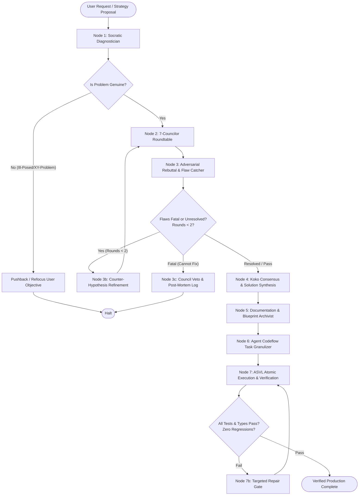

# LANGGRAPH COUNCIL ORCHESTRATOR: ARCHITECTURAL SPECIFICATION & WORKFLOW PROTOCOL

**Version:** 1.0  
**Status:** RATIFIED DESIGN SPECIFICATION  
**Author:** Principal Quantitative Architect & Council Arbiter (Koko)  
**Governing Directives:** AGENTS.md (Law 1 Zero Float, Law 2 Execution Guardrails, Law 7 Zero Hallucination, Law 8 Zero Blackhole Token Burning)  

---

## 1. Executive Summary & Core Mandate

The **LangGraph Council Orchestrator** is a deterministic, state-graph-governed multi-agent decision engine for the Kalshi Trading System. It enforces an absolute operational law:

$$\mathbf{\text{DIRECTIVE:}} \quad \text{Never proceed to coding immediately. Prioritize documentation, debate, and task formulation first.}$$

By modeling multi-agent decision making as a **Cyclic Directed Acyclic Graph (DAG) with State Checkpointing**, the system replaces fragmented, reactive prompt-and-code habits with an adversarial crucible where:
1. Ideas are rigorously debated and rebutted by **7 specialized, orthogonal Councilors**.
2. Hidden flaws, fee drag, async race conditions, and blast-radius risks are registered before execution.
3. Every approved initiative produces an explicit, bounded **Granular Task Contract** and **Formal Documentation** before any code is modified.
4. Execution is strictly handed to the **Autonomous Self-Verification Loop (ASVL)** with unambiguous **Definitions of Done**.

---

## 2. The 3-Stage Engineering Pipeline

```
┌────────────────────────────────────────────────────────────────────────┐
│                   STAGE 1: ADVERSARIAL FORMULATION                     │
│               (The Council & Rebuttal Debate Crucible)                 │
└───────────────────────────────────┬────────────────────────────────────┘
                                    │
                         Consensus & Solution
                                    ▼
┌────────────────────────────────────────────────────────────────────────┐
│               STAGE 2: DOCUMENTATION & SPECIFICATION                   │
│        (Architectural Blueprint, Invariants & File Boundaries)         │
└───────────────────────────────────┬────────────────────────────────────┘
                                    │
                         Ratified Specification
                                    ▼
┌────────────────────────────────────────────────────────────────────────┐
│               STAGE 3: TASK CONTRACT & ATOMIC EXECUTION                │
│             (Agent Codeflow Granulizer ──► ASVL Verification)          │
└────────────────────────────────────────────────────────────────────────┘
```

---

## 3. LangGraph State Graph Topology

The entire lifecycle is governed by an immutable, typed state container (`CouncilState`) processed across specialized functional nodes linked by conditional routing edges.

### 3.1 State Graph Architecture (Mermaid)



---

## 4. State Schema Definition (`CouncilState`)

```python
from typing import TypedDict, List, Dict, Optional, Literal, Annotated
from decimal import Decimal
import operator

class CouncilorVote(TypedDict):
    councilor: str                     # "nash", "vance", "barnaby", "apex", "jackal", "silas"
    verdict: Literal["PASS", "VETO", "ADJUST"]
    critique: str                      # Concise 1-2 sentence core reasoning
    hard_bounds: Dict[str, str]        # Quantitative constraints enforced by this councilor

class IdentifiedFlaw(TypedDict):
    flaw_id: str
    category: Literal["fee_drag", "dead_zone", "race_condition", "blast_radius", "float_math", "twap_mismatch"]
    description: str
    severity: Literal["FATAL", "HIGH", "MEDIUM", "LOW"]
    counter_measure: str

class GranularTaskStep(TypedDict):
    step_id: int
    phase: Literal["1_schemas", "2_core_logic", "3_ui_state", "4_verification"]
    target_file: str
    allowed_access: Literal["write", "append", "read_only"]
    action_description: str
    definition_of_done: str

class CouncilState(TypedDict):
    # Input
    raw_prompt: str
    core_objective: str
    target_asset: str                  # "BTC", "ETH", "SYSTEM"
    
    # Deliberation State
    debate_round: Annotated[int, operator.add]
    max_rounds: int                    # Hard cap = 2 (Law 8: Anti-Blackhole Token Conservation)
    council_votes: Dict[str, CouncilorVote]
    flaw_registry: Annotated[List[IdentifiedFlaw], operator.add]
    
    # Consensus
    consensus_verdict: Optional[Literal["APPROVED", "REJECTED", "CONDITIONALLY_APPROVED"]]
    synthesized_solution: Optional[str]
    non_negotiable_invariants: List[str]
    
    # Documentation & Task Contract
    specification_document_path: Optional[str]
    file_boundary_matrix: Dict[str, Literal["write", "append", "read_only", "forbidden"]]
    task_contract: List[GranularTaskStep]
    
    # Verification State
    verification_status: Literal["PENDING", "IN_PROGRESS", "PASSED", "FAILED"]
    test_results: Dict[str, bool]
```

---

## 5. Roster of the 7 Councilors & Orthogonal Domains

To enforce **Law 4 & Law 8 (Zero Context Bloat & Zero Redundancy)**, councilors never parrot each other. Each evaluates strictly through an orthogonal lens:

```
                                  [ KOKO ]
                    (Consensus Arbiter & Chief Strategist)
                                     │
    ┌───────────────┬────────────────┴────────────────┬───────────────┐
    │               │                                 │               │
[ DR. NASH ]    [ VANCE ]                         [ APEX ]       [ THE JACKAL ]
(Math & EV)   (CLOB & Fees)                     (Smart Flow)     (Exploits/Bugs)
    │                                                                 │
[ BARNABY ] <───────────────────────────────────────────────────> [ SILAS ]
(Retail Inversion)                                              (TWAP Settlement)
```

| Councilor | Title & Role | Orthogonal Domain | Uncompromising Gate Check |
| :--- | :--- | :--- | :--- |
| **Dr. Nash** | The Quantitative Mathematician | Probability, Kelly fractions, fee drag algebra, Decimal math invariants. | $\mathbb{E}[\text{Net EV}] > 0$ after Kalshi quadratic taker fee $\lceil 0.07 \cdot C \cdot P(1-P) \rceil$. |
| **Vance** | The CLOB Microstructure Executioner | L2 book depth, maker vs taker fee advantage, spread crossing penalty ($> \$0.05$). | Order fill realism: Must never rely on optimistic fills or wide-spread crossing. |
| **Barnaby** | The Chronic Retail Loser (Inverted Indicator) | Retail FOMO, chasing green candles at cycle peaks, panic-selling bottoms. | Inversion rule: If amateur intuition urges taking this trade, demand $3\times$ higher statistical edge. |
| **Apex** | The Institutional Smart Flow Tracker | CME basis, institutional accumulation, ETF flows, macro event blackouts. | Never step in front of institutional trending waves or MM gamma squeezes. |
| **The Jackal** | The Adversarial Exploit Hunter | Async race conditions, sequence continuity, in-flight intent locks, bankroll protection. | Worst-case attack: Expose the 1-in-1,000 edge case that causes cascading liquidation. |
| **Silas** | The TWAP Settlement Arbiter | CME CF Benchmarks 60s trailing TWAP (`cfbenchmarks_value_5hz`), settlement pinning. | Expiration parity: In last 120s, instantaneous spot is meaningless if 60s TWAP cannot physically cross strike. |
| **Koko** | The General & Sparring Arbiter | Socratic challenge, debate moderation, solution synthesis, task formulation. | Weaves all 6 perspectives into an unassailable engineering specification. |

---

## 6. Detailed Node Execution Protocols

### Node 1: Socratic Diagnostician (Koko)
- **Mandate:** Anti-sycophancy filter. Refuse to solve the wrong problem.
- **Rule:** When the user asks for a feature (e.g. "add 5 new indicator dials"), diagnose what the actual trading pain point is (e.g. "entering in the Brownian dead zone $\pm \$25$").
- **Output:** Canonical problem statement with explicit **Non-Goals** declared first.

### Node 2 & 3: Adversarial Council Roundtable & Rebuttal (Nash, Vance, Barnaby, Apex, Jackal, Silas)
- **Mandate:** Single-turn highly dense debate. Each councilor delivers a hard, quantified assessment.
- **Flaw Registry Insertion:** Any identified flaw (fee drag, race condition, float math, blast radius) is immediately logged in `state['flaw_registry']`.
- **Debate Termination Condition:**
  - If flaws are fatal and mathematically irreconcilable $\rightarrow$ **Veto & Exit**.
  - If rounds $\ge 2$ $\rightarrow$ **Force Decision (Prevent Infinite Loop)**.
  - If flaws are addressable $\rightarrow$ **Transition to Node 4 (Solution Synthesis)**.

### Node 4: Koko Consensus & Solution Synthesis
- **Mandate:** Synthesize a hardened, concrete architectural solution that directly neutralizes every entry in `flaw_registry`.
- **Output:** Approved specifications with **Non-Negotiable Invariants** (e.g., Maker limit orders at $\$0.48$, strictly 1 contract, 15s in-flight lock TTL, Decimal typing).

### Node 5: Documentation & Blueprint Archivist
- **Mandate:** **Documentation Prioritization Protocol**.
- **Action:** Before touching code:
  1. Author the technical specification in `docs/`.
  2. Record any institutional lessons in `.agents/skills/lessons-learned/`.
  3. Define the exact Pydantic/TypeScript interfaces.

### Node 6: Agent Codeflow Task Granulizer
- **Mandate:** Impenetrable blast-radius containment.
- **Action:** Break the ratified design into atomic micro-steps across 4 distinct phases:
  - **Phase 1: Schemas & Types** (Zero floats, strict Decimal).
  - **Phase 2: Core Logic & Services** (Guardrails, math engine, router).
  - **Phase 3: State & UI Binding** (Components, WebSocket streams, error boundaries).
  - **Phase 4: Automated Verification** (Unit tests, typecheck, build).
- **Blast-Radius Matrix:** Declares Write files, Append-Only registry files, Read-Only reference files, and the **Forbidden Zone** (all untouched repo files).

### Node 7: Autonomous Self-Verification Loop (ASVL)
- **Mandate:** Empirical proof of correctness (Rule 3 & Rule 7).
- **Execution Rule:** Execute step-by-step. Never assume code works.
- **Completion Gate:**
  - Backend: `python -m pytest tests/test_<target>.py -v` $\rightarrow$ 100% PASS.
  - Frontend: `npm run typecheck` & `npm run build` $\rightarrow$ 0 errors.

---

## 7. Zero Blackhole Token & Credit Governance (Law 8)

To eliminate runaway token consumption:
1. **Single-Turn Roundtable:** Councilors are simulated within a single dense structured prompt turn rather than 7 chatty independent subagents talking in circles.
2. **Fast-Track Targeted Mode:** For micro-changes (e.g. fee formula fix), invoke strictly Koko + Dr. Nash + Vance, bypassing unneeded councilors and saving 70% of tokens.
3. **Hard Cap on Debate Cycles:** `max_rounds = 2`. If a proposal cannot be hardened in 2 rounds, it is rejected for redesign.
4. **Tool Batching:** File reads, greps, and tests are batched in single parallel calls.

---

## 8. Permanent Codebase Directory Restructuring Plan

To cleanly decouple systems and reflect this architectural standard, the repository structure is formalized as:

```
kalshi_simulator/
├── src/kalshi_sim/
│   ├── core/                  # Pure math, Decimal models, exchange invariants, types
│   │   ├── decimal_math.py    # Zero-float financial math operations
│   │   ├── invariants.py      # Bankroll caps, 1-trade locks, dead-zone thresholds
│   │   └── schemas.py         # OrderSide, L2BookState, TradeEvent
│   ├── council/               # LangGraph State Graph & Multi-Agent Engine
│   │   ├── state.py           # CouncilState, CouncilorVote, FlawRegistry schemas
│   │   ├── graph.py           # LangGraph StateGraph builder, nodes & edge routers
│   │   ├── councilors/        # Modular personas (nash, vance, barnaby, apex, jackal, silas)
│   │   └── orchestrator.py    # Main debate controller & synthesis engine
│   ├── quant/                 # CLOB microstructure, EV engines, VPIN, TWAP
│   │   ├── orderbook.py       # L2 orderbook reconstruction
│   │   ├── statistical_ev.py  # Binary payoff expected value engine
│   │   └── vpin_engine.py     # Toxic flow and adverse selection scorer
│   ├── ml/                    # Neural networks, continuous trainer, regime detection
│   │   ├── continuous_trainer.py # Autonomous PyTorch training & zero-bloat pruner
│   │   ├── onnx_engine.py     # Sub-millisecond CPU ONNX runtime
│   │   ├── wave_classifier.py # 4-Region market physics (CHOP, STORM, BLEED, HEAL)
│   │   └── bot1_v4_engine.py  # Champion Domination strategy engine
│   ├── execution/             # Risk guardian, order routing, exchange clients
│   │   ├── agent_guardrails.py # Pre-trade intent gatekeeper
│   │   ├── virtual_order_router.py # Live & shadow execution engine
│   │   └── process_lock.py    # Single-process live execution mutex
│   └── services/              # Headless daemons, FastAPI, telemetry
│       ├── server.py          # Unified application server
│       └── notifications.py   # Webhook & email alert dispatcher
├── docs/                      # Architectural specifications & runbooks (Documentation First)
└── tests/                     # ASVL test suites corresponding 1:1 with src/
```

---

## 9. Immediate Operational Rules for Antigravity & Fleet

1. **Before any code change is attempted**, formulate the proposal using the Council Evaluation Template.
2. **If any Council veto is active**, coding is strictly prohibited.
3. **Document first**: Write or update the architecture doc in `docs/` before touching code.
4. **Produce a 4-Phase Granular Task Contract** with explicit file boundaries.
5. **Verify empirically via ASVL** before declaring complete.
