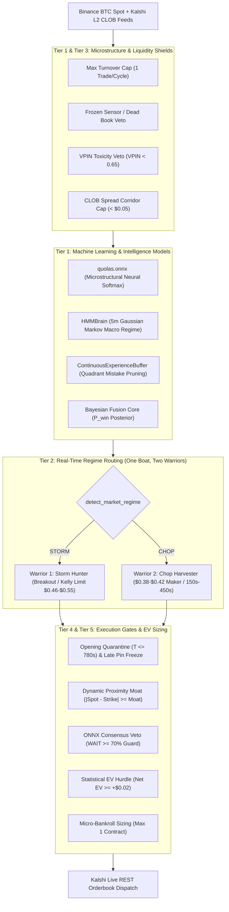

# Institutional System Architecture: Bot 1 V4 (QuoLas) Complete Decision & Component Breakdown

**Document Name:** `Overallcomponent of bot1v4.md`  
**Classification:** Quantitative Trading Infrastructure & Signal Processing Hierarchy  
**Asset Target:** Kalshi Bitcoin Binary Options (`KXBTC15M` 15-Minute Expirations)  
**Execution Vessel:** `Bot 1 V4 (Domination Engine) / Dual Warrior Architecture`  
**Environment:** AWS EC2 Live Production Daemon (`kalshi-quolas.service`)  
**Mathematical Standard:** Strict Zero Float Financial Math (`decimal.Decimal`)  

---

## Executive Summary

Bot 1 V4 ("QuoLas") operates as a multi-tier, defense-first algorithmic trading engine. No trade is permitted to reach the Kalshi Central Limit Order Book (CLOB) based on a single heuristic or indicator. Instead, decisions flow through an immutable pipeline of machine learning models, microstructure filters, real-time regime classifiers, cycle timing gates, and strictly bounded Expected Value (EV) math.

If **any single component** in the pipeline flags an anomaly, toxicity, frozen liquidity, or negative expected value, the decision instantly resolves to `WAIT` (`recommended_contracts = 0`).

---

## Detailed Component Catalog

### 1. Tier 1: Machine Learning & Probabilistic Intelligence Models

1. **`ContinuousExperienceBuffer` (Empirical Online Learning Engine)**
   * **Location:** [`src/kalshi_sim/ml/continuous_experience.py`](file:///F:/012D_TRADE/Kalshi%20Simulator/src/kalshi_sim/ml/continuous_experience.py)
   * **Role:** Dynamic online self-sharpening buffer updated in RAM and persisted to disk after every settled trade.
   * **Decision Responsibilities:**
     * **Mistake Quadrant Pruner:** Automatically vetoes entries if the current time-to-expiry ($T$) and strike separation ($\Delta P$) fall into an empirically unprofitable quadrant based on historical losses.
     * **Online Platt Sigmoid Recalibration:** Dynamically updates calibration scalars ($A, B$) using walk-forward settlement outcomes so probability forecasts do not suffer from overconfidence drift.

2. **`quolas.onnx` (Low-Latency Deep Microstructure Model)**
   * **Location:** [`models/quolas.onnx`](file:///F:/012D_TRADE/Kalshi%20Simulator/models/quolas.onnx)
   * **Role:** High-frequency neural network evaluated via ONNX Runtime at microsecond latency on L2 orderbook delta, micro-price velocity, and trade imbalance.
   * **Decision Responsibilities:**
     * Outputs 3-class softmax vector: `[P(UP), P(DOWN), P(WAIT)]`.
     * Outputs microstructural confidence and flags informed toxic order flow.

3. **`HMMBrain` (Gaussian Hidden Markov Model / 5m Macro Regime)**
   * **Location:** [`src/kalshi_sim/ml/quolas_core/hmm_brain.py`](file:///F:/012D_TRADE/Kalshi%20Simulator/src/kalshi_sim/ml/quolas_core/hmm_brain.py)
   * **Role:** Continuous 30-second background Markov chain analyzing Binance 5-minute OHLCV candles.
   * **Decision Responsibilities:**
     * Classifies the macro state into `BULL_MOMENTUM`, `BEAR_MOMENTUM`, or `STABLE_RANGE`.
     * Enforces the **`HMM RISK_OFF Veto`**: Automatically suppresses directional trading if macro transition volatility spikes.

4. **`Bayesian Fusion Core` (Macro Normal Erf $\times$ Micro ONNX)**
   * **Location:** [`src/kalshi_sim/ml/bot1_v4_engine.py`](file:///F:/012D_TRADE/Kalshi%20Simulator/src/kalshi_sim/ml/bot1_v4_engine.py#L420-L460)
   * **Role:** Blends macro physical probability (Gaussian cumulative distribution / error function `math.erf`) with microstructural ONNX predictions.
   * **Decision Responsibilities:**
     * Computes the calibrated posterior win probabilities: $P_{\text{win}}(\text{YES})$ and $P_{\text{win}}(\text{NO})$.

---

### 2. Tier 2: Real-Time Market Regime Classifier (One Boat, Two Warriors)

5. **`detect_market_regime` (Warrior Selector)**
   * **Role:** Evaluates live 15-minute cycle range ($\Delta P_{\text{cycle}}$), 1s/3s spot velocity, and orderbook VPIN.
   * **Decision Responsibilities:**
     * Dynamically switches the engine mode between **Warrior 1 (Storm Hunter)** and **Warrior 2 (Chop Harvester)**.

6. **`Warrior 1: Storm Hunter` (Momentum & Breakout Specialist)**
   * **Active Regime:** `STORM` (Volatile, directional trending market).
   * **Decision Responsibilities:**
     * Captures directional momentum, breakout surges, and trend continuation.
     * Operates dynamic limit pricing up to $\$0.48 - \$0.55$ when edge is confirmed.

7. **`Warrior 2: Chop Harvester` (Deep-Discount Mean-Reversion Specialist)**
   * **Active Regime:** `CHOP` (Ranging, oscillating compression market).
   * **Decision Responsibilities:**
     * Restricts execution strictly to the **$150\text{s} \le T \le 450\text{s}$** window (waits for boundaries to establish, freezes before late-cycle pin risk).
     * Enforces asymmetric deep-discount maker entries: **$\$0.38 - \$0.42$** (delivering an asymmetric $1:1.8+$ risk-to-reward payoff).

---

### 3. Tier 3: Microstructure & Liquidity Safety Vetoes

8. **`Frozen Sensor / Dead Book Veto` (Tier 1 Anti-Illiquidity Guardrail)**
   * **Trigger:** `veto_reason == "FROZEN_SENSOR_ZERO_VARIANCE"` or ONNX `prob_wait >= 0.99`.
   * **Decision Responsibilities:**
     * Immediately blocks all trading into dead or static orderbooks where quotes have halted.

9. **`VPIN Toxicity Veto` (Volume-Synchronized Probability of Toxicity)**
   * **Trigger:** $\text{VPIN} \ge 0.65$ or `onnx_vpin_veto == True`.
   * **Decision Responsibilities:**
     * Detects aggressive institutional informed flow and front-running; suspends entries until flow toxicity subsides.

10. **`CLOB Spread Corridor Cap` (Vance Liquidity Gate)**
    * **Trigger:** $\text{Spread} = (\text{Best Ask} - \text{Best Bid}) > \$0.05$.
    * **Decision Responsibilities:**
      * Rejects orders during wide bid-ask dislocation, avoiding crossing wide books.

11. **`ONNX Consensus Team Gate` (Partner Discipline)**
    * **Trigger:** `onnx_signal == "WAIT"` with confidence $\ge 70\%$.
    * **Decision Responsibilities:**
      * Prohibits macro heuristics from fighting the micro neural net; forces `WAIT` unless an extraordinary macro breakout edge is present.

---

### 4. Tier 4: Cycle Timing & Spatial Geometry Gates

12. **`Opening Cycle Noise Quarantine Gate`**
    * **Trigger:** $T > 780\text{s}$ (the first 120 seconds of the 15-minute expiration cycle).
    * **Decision Responsibilities:**
      * Enforces silence while the new contract orderbook forms and initial price discovery settles.

13. **`Late-Cycle Pin Freeze Gate`**
    * **Trigger:** $T < 150\text{s}$ (during chop regime) or near-settlement jump window.
    * **Decision Responsibilities:**
      * Blocks late entries to protect against final-minute binary pin jumps and Kalshi settlement latency.

14. **`Dynamic Proximity Moat Filter`**
    * **Trigger:** $|\text{Spot} - \text{Strike}| < \text{Moat}(T)$.
    * **Decision Responsibilities:**
      * Calculates volatility-scaled minimum distance; vetoes orders hovering too close to strike where binary outcome is a coin flip.

15. **`Max Turnover Cap` (1-Trade-Per-Cycle Invariant)**
    * **Trigger:** $\text{Turnovers} \ge 1$ round-trip trade per cycle.
    * **Decision Responsibilities:**
      * Hard lock preventing cannibalism, wash trading, or double-entry within the same 15-minute expiration window.

---

### 5. Tier 5: Quantitative EV & Position Sizing Engine

16. **`StatisticalEVEngine` & Minimum EV Hurdle Gate**
    * **Formula:** $\text{EV} = P_{\text{win}} \times \$1.00 - \text{LimitPrice} - \text{ExchangeFeeBuffer}$.
    * **Decision Responsibilities:**
      * Blocks entry unless $\text{EV} \ge +\$0.02$ to $+\$0.04$ net profit expectation.

17. **`Kelly Sizing & Conviction Tier Engine`**
    * **Formula:** Fractional Kelly ($\frac{1}{4}$ Kelly) $\times$ Conviction Score $\times$ Star Player Seal.
    * **Decision Responsibilities:**
      * Allocates position sizing: strictly **1 contract max** under micro-bankroll capital preservation law.

---

## Component Matrix Reference Table

| # | Component Name | Module File | Decision Power | Type |
| :-: | :--- | :--- | :--- | :--- |
| **1** | `ContinuousExperienceBuffer` | `ml/continuous_experience.py` | Quadrant Pruning & Platt Calibration | ML / Adaptive Memory |
| **2** | `quolas.onnx` | `models/quolas.onnx` | L2 Imbalance Softmax & Confidence | ML / Deep Neural Net |
| **3** | `HMMBrain` | `ml/quolas_core/hmm_brain.py` | 5m Macro Regime & RISK_OFF Veto | ML / Markov Model |
| **4** | `Bayesian Fusion Core` | `ml/bot1_v4_engine.py` | Blended $P_{\text{win}}(\text{YES/NO})$ Posterior | Probabilistic Engine |
| **5** | `detect_market_regime` | `ml/bot1_v4_engine.py` | STORM vs. CHOP Routing | Dynamic Classifier |
| **6** | `Warrior 1: Storm Hunter` | `ml/bot1_v4_engine.py` | Momentum & Breakout Execution | Execution Module |
| **7** | `Warrior 2: Chop Harvester` | `ml/bot1_v4_engine.py` | Deep-Discount Maker ($0.38 - $0.42) | Execution Module |
| **8** | `Frozen Sensor Veto` | `ml/bot1_v4_engine.py` | Zero-Variance Orderbook Shield | Safety Veto |
| **9** | `VPIN Toxicity Veto` | `ml/bot1_v4_engine.py` | Toxic Order Flow Shield ($\ge 0.65$) | Safety Veto |
| **10** | `CLOB Spread Corridor Cap`| `ml/bot1_v4_engine.py` | Spread Width Gate ($>\$0.05$) | Liquidity Gate |
| **11** | `ONNX Consensus Team Gate` | `ml/bot1_v4_engine.py` | Neural Net Veto Override ($\ge 70\%$) | Consensus Gate |
| **12** | `Opening Noise Quarantine` | `ml/bot1_v4_engine.py` | First 120s Cycle Shield ($T > 780\text{s}$) | Timing Gate |
| **13** | `Late Pin Freeze Gate` | `ml/bot1_v4_engine.py` | Near-Settlement Protection ($T < 150\text{s}$) | Timing Gate |
| **14** | `Dynamic Proximity Moat` | `ml/bot1_v4_engine.py` | Minimum Volatility Distance | Spatial Filter |
| **15** | `Max Turnover Cap` | `ml/bot1_v4_engine.py` | 1-Trade-Per-Cycle Lock | Risk Limit |
| **16** | `StatisticalEVEngine` | `ml/statistical_ev.py` | Net Expected Value Hurdle ($>+\$0.02$) | Quantitative Gate |
| **17** | `Kelly Sizing Engine` | `ml/statistical_ev.py` | Micro-Bankroll Sizing (1 Contract Max) | Capital Preservation |

---
*Generated autonomously and archived under the Kalshi Simulator Quantitative Documentation Series.*
