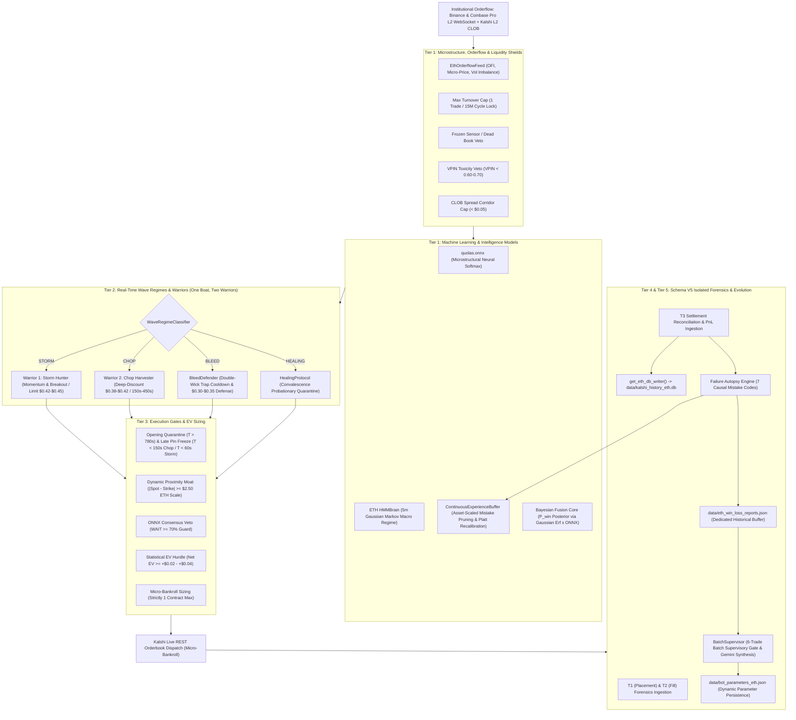

# Institutional System Architecture: ETH Bot 1 V4 (QuoLas) Complete Decision & Component Breakdown

**Document Name:** `Overallcomponent of eth_bot1v4.md`  
**Classification:** Quantitative Trading Infrastructure & Signal Processing Hierarchy  
**Asset Target:** Kalshi Ethereum Binary Options (`KXETH15M` 15-Minute Expirations)  
**Execution Vessel:** `ETH Bot 1 V4 (Domination Engine) / Dual Warrior Architecture`  
**Environment:** Workstation Production Daemon (`python src/kalshi_sim/ml/eth_bot1v4/paper_trade_ethbot.py --mode live`)  
**Mathematical Standard:** Strict Zero Float Financial Math (`decimal.Decimal`)  
**Seal of Excellence:** SHA-256 Token `SEAL-ETH_-A37A256E23B8` (Verified & Authorized on Disk)  
**Persistence Architecture:** Schema V5 Fully Isolated Persistence (`kalshi_history_eth.db`, `eth_win_loss_reports.json`, `bot_parameters_eth.json`)  

---

## Executive Summary

ETH Bot 1 V4 ("QuoLas") operates as a multi-tier, defense-first algorithmic trading engine calibrated specifically for the Ethereum binary-options market on Kalshi. Following the **PR-014 / Schema V5** quantitative upgrade, the ETH bot possesses 100% physical database isolation, an asset-scaled learning curve, full trade lifecycle forensics ($T_1 \to T_2 \to T_3$), and causal failure autopsies.

No trade reaches the Kalshi Central Limit Order Book (CLOB) based on a single heuristic or indicator. Instead, decisions flow through an immutable pipeline of real-time orderflow feeds, machine learning models, microstructure filters, real-time regime classifiers, cycle-timing gates, and strictly bounded Expected Value (EV) math.

If **any single component** in the pipeline flags an anomaly, toxic flow, dead liquidity, excessive spread, or negative expected value, the decision instantly resolves to `WAIT` (`recommended_contracts = 0`).

---

## Detailed Component Catalog

### 1. Tier 1: Microstructure, Orderflow & Liquidity Shields

1. **`EthOrderflowFeed` (Institutional Dual-Exchange L2 Orderflow Stream)**
   * **Location:** [`src/kalshi_sim/orderflow/eth_orderflow_feed.py`](file:///f:/012D_TRADE/Kalshi%20Simulator/src/kalshi_sim/orderflow/eth_orderflow_feed.py)
   * **Role:** High-speed WebSocket client maintaining continuous live Level-2 orderbook depth and tick trades from Binance (`wss://stream.binance.com:9443/ws/ethusdt@depth20@100ms`, `ethusdt@trade`) and Coinbase Pro.
   * **Decision Responsibilities:**
     * Computes Level-1 Order Flow Imbalance ($\text{OFI}_{L1}$):
       $$\text{OFI}_{t} = \Delta \text{BidSize} - \Delta \text{AskSize}$$
     * Computes high-frequency Volume Imbalance and Micro-Price:
       $$P_{\text{micro}} = \frac{P_{\text{bid}} \cdot Q_{\text{ask}} + P_{\text{ask}} \cdot Q_{\text{bid}}}{Q_{\text{bid}} + Q_{\text{ask}}}$$
     * Supplies sub-millisecond spot price telemetry for dynamic strike proximity and velocity calculations.

2. **`Max Turnover Cap` (1-Trade-Per-Cycle Lock)**
   * **Location:** [`src/kalshi_sim/ml/eth_bot1v4/eth_bot1v4_engine.py#L362-L366`](file:///f:/012D_TRADE/Kalshi%20Simulator/src/kalshi_sim/ml/eth_bot1v4/eth_bot1v4_engine.py#L362-L366)
   * **Role:** Absolute quantitative execution invariant enforcing CFTC compliance and anti-churn rules (AGENTS.md Law 2).
   * **Decision Responsibilities:**
     * Tracks completed round-trip entries per 15-minute event (`KXETH15M`).
     * Once a contract is traded or filled within a cycle, turnover locks at 1 (`max_turnover_per_event = 1`). All subsequent signals for that expiration instantly resolve to `WAIT`.

3. **`Frozen Sensor / Dead Book Veto`**
   * **Location:** [`src/kalshi_sim/ml/bot1_v4_engine.py#L240-L260`](file:///f:/012D_TRADE/Kalshi%20Simulator/src/kalshi_sim/ml/bot1_v4_engine.py#L240-L260)
   * **Role:** Safety circuit-breaker guarding against exchange API feed stalls and phantom quotes.
   * **Decision Responsibilities:**
     * Triggers an immediate veto if orderbook update timestamps exceed 15.0 seconds.
     * Vetoes execution if bid/ask book depth collapses to zero on either side.

4. **`VPIN Toxicity Veto` (Volume-Synchronized Probability of Toxicity)**
   * **Location:** [`src/kalshi_sim/ml/bot1_v4_engine.py#L265-L280`](file:///f:/012D_TRADE/Kalshi%20Simulator/src/kalshi_sim/ml/bot1_v4_engine.py#L265-L280)
   * **Role:** Protects market maker orders from being adversely picked off by informed traders.
   * **Decision Responsibilities:**
     * Vetoes any new entry when orderflow toxicity $\text{VPIN} \ge 0.60 - 0.70$.
     * Prevents buying into adverse institutional sweeps during rapid inventory imbalances.

5. **`CLOB Spread Corridor Cap`**
   * **Location:** [`src/kalshi_sim/ml/bot1_v4_engine.py#L285-L295`](file:///f:/012D_TRADE/Kalshi%20Simulator/src/kalshi_sim/ml/bot1_v4_engine.py#L285-L295)
   * **Role:** Liquidity width gate preventing excessive slippage.
   * **Decision Responsibilities:**
     * Enforces $\text{Spread} \le \$0.04 - \$0.05$ on the Kalshi YES/NO book.
     * Automatically silences order placement if market makers widen spreads or retract liquidity.

---

### 2. Tier 1: Machine Learning & Probabilistic Intelligence Models

6. **`ContinuousExperienceBuffer` (Asset-Scaled Online Learning Engine)**
   * **Location:** [`src/kalshi_sim/ml/experience_buffer.py`](file:///f:/012D_TRADE/Kalshi%20Simulator/src/kalshi_sim/ml/experience_buffer.py)
   * **Role:** Self-sharpening online buffer updated dynamically upon every settlement and persisted to [`data/eth_win_loss_reports.json`](file:///f:/012D_TRADE/Kalshi%20Simulator/data/eth_win_loss_reports.json).
   * **Asset-Specific Dynamic Scaling (ETH vs BTC):**
     * **Tight Spot Diff Threshold:** $\$2.00$ for ETH (vs $\$25.00$ for BTC).
     * **Mid Spot Diff Threshold:** $\$5.00$ for ETH (vs $\$50.00$ for BTC).
     * **Momentum Inversion Threshold:** $\$6.00$ for ETH (vs $\$40.00$ for BTC).
     * **Gamma Pin Threshold:** $\$1.50$ for ETH (vs $\$20.00$ for BTC).
   * **Decision Responsibilities:**
     * **3D Mistake Matrix Pruning:** Tracks historical loss clusters by `(Regime, Spot Diff Bucket, VPIN Bucket)`. Rejects trades if a quadrant records $\ge 3$ losses and win rate $< 25\%$.
     * **Online Platt Sigmoid Recalibration:** Continuously updates probability calibration slope ($\alpha$) and Brier scoring:
       $$\hat{P}_{\text{calibrated}} = \frac{1}{1 + \exp(-\alpha \cdot z)}$$

7. **`quolas.onnx` (Low-Latency Deep Microstructure Neural Softmax)**
   * **Location:** [`models/quolas.onnx`](file:///f:/012D_TRADE/Kalshi%20Simulator/models/quolas.onnx)
   * **Role:** Sub-millisecond neural network evaluated via ONNX Runtime on orderbook depth, micro-price velocity, and trade flow.
   * **Decision Responsibilities:**
     * Generates normalized 3-state probability vector: $[P(\text{UP}), P(\text{DOWN}), P(\text{WAIT})]$.
     * Provides microstructural conviction weighting and triggers **ONNX Consensus Veto** if $P(\text{WAIT}) \ge 70\%$.

8. **`ETH HMMBrain` (Gaussian Hidden Markov Model / 5m Macro Regime)**
   * **Location:** [`src/kalshi_sim/ml/quolas_core/hmm_brain.py`](file:///f:/012D_TRADE/Kalshi%20Simulator/src/kalshi_sim/ml/quolas_core/hmm_brain.py)
   * **Role:** Continuous 30-second background Markov chain analyzing Binance 5-minute OHLCV candles for ETH.
   * **Decision Responsibilities:**
     * Classifies macro state into `BULL_MOMENTUM`, `BEAR_MOMENTUM`, or `STABLE_RANGE`.
     * Enforces the **`HMM RISK_OFF Veto`**: Automatically suppresses directional trading if macro transition volatility spikes or regime confidence collapses.

9. **`Bayesian Fusion Core` (Macro Normal Erf $\times$ Micro ONNX)**
   * **Location:** [`src/kalshi_sim/ml/bot1_v4_engine.py#L480-L530`](file:///f:/012D_TRADE/Kalshi%20Simulator/src/kalshi_sim/ml/bot1_v4_engine.py#L480-L530)
   * **Role:** Fuses macro physical probability (Gaussian distribution error function $\text{erf}$) with microstructural ONNX predictions.
   * **Decision Responsibilities:**
     * Physical Gaussian Cumulative Probability:
       $$Z = \frac{\text{Spot} - \text{Strike}}{\sigma \cdot \sqrt{\tau}}, \quad P_{\text{physical}} = \frac{1}{2} \left[ 1 + \text{erf}\left(\frac{Z}{\sqrt{2}}\right) \right]$$
     * Blends posterior probabilities $P_{\text{win}}(\text{YES})$ and $P_{\text{win}}(\text{NO})$ weighted by micro-fusion parameters.

---

### 3. Tier 2: Real-Time Wave Regimes & Warriors (Dual Warrior Architecture)

10. **`WaveRegimeClassifier` (Four-Regime Dynamic Classifier)**
    * **Location:** [`src/kalshi_sim/ml/wave_regimes.py`](file:///f:/012D_TRADE/Kalshi%20Simulator/src/kalshi_sim/ml/wave_regimes.py)
    * **Role:** Classifies market dynamics into four distinct operating regimes:
      1. **`CHOP`:** Range-bound compression, low kinetic velocity.
      2. **`STORM`:** Directional expansion, strong kinetic trend.
      3. **`BLEED`:** Adverse whipsaws, double-wick traps, elevated toxic flow.
      4. **`HEALING`:** Post-drawdown probationary quarantine.

11. **`Warrior 1: Storm Hunter` (Momentum & Breakout Specialist)**
    * **Active Regime:** `STORM` (Spot Range $\ge \$7.50$ on ETH or 1m Rolling Vol $\ge \$0.60$).
    * **Decision Responsibilities:**
      * Captures momentum, breakout surges, and trend continuation.
      * Operates maker/taker limit pricing up to $\$0.42 - \$0.45$ with strict Kelly edge validation.

12. **`Warrior 2: Chop Harvester` (Deep-Discount Mean-Reversion Specialist)**
    * **Active Regime:** `CHOP` (Spot Range $< \$7.50$, Vol $< \$0.60$).
    * **Decision Responsibilities:**
      * Restricts entry to the calibrated sweet spot window: **$150\text{s} \le \tau \le 450\text{s}$** (waits 90s for opening boundaries to establish; freezes before late-cycle pin risk).
      * Enforces asymmetric deep-discount maker entries: **$\$0.38 - \$0.42$** (securing an asymmetric $1:1.4+$ to $1:1.8+$ risk-to-reward ratio).

13. **`BleedDefender` (Anti-Meatgrinder Protocol)**
    * **Location:** [`src/kalshi_sim/ml/wave_regimes.py#L180-L240`](file:///f:/012D_TRADE/Kalshi%20Simulator/src/kalshi_sim/ml/wave_regimes.py#L180-L240)
    * **Role:** Activates immediately upon consecutive losses or adverse selection detection.
    * **Decision Responsibilities:**
      * Arms an instant **1-cycle cooldown** upon any settled loss to terminate whipsaw death spirals.
      * Drops entry price limits to deep defensive levels: **$\$0.30 - \$0.35$**.
      * Increases required strike proximity buffer to **$\$5.00+$** on ETH.

14. **`HealingProtocol` (Probationary Capital Convalescence)**
    * **Location:** [`src/kalshi_sim/ml/wave_regimes.py#L250-L310`](file:///f:/012D_TRADE/Kalshi%20Simulator/src/kalshi_sim/ml/wave_regimes.py#L250-L310)
    * **Role:** Protects equity following drawdown excursions.
    * **Decision Responsibilities:**
      * Requires 2 consecutive verified wins in paper or conservative mode before restoring standard Warrior parameters.
      * Suppresses live capital risk during quarantine.

---

### 4. Tier 3: Execution Gates & Timing Sweet Spots

15. **`Opening Cycle Noise Quarantine Gate`**
    * **Rule:** Silences trading during the first 90s–120s of cycle inception ($\tau > 780\text{s}$).
    * **Rationale:** Kalshi orderbooks experience wild opening spread anomalies and erratic price discovery during the opening 90 seconds.

16. **`Late-Cycle Pin Freeze Gate`**
    * **Rule:** Blocks new entries when $\tau < 150\text{s}$ in Chop mode or $\tau < 60\text{s}$ in Storm mode.
    * **Rationale:** Expiration gamma explodes in the final two minutes; market maker pinning and TWAP settlement noise render directional predictions statistically unreliable.

17. **`Dynamic Proximity Moat Filter`**
    * **Rule:** Enforces minimum strike separation: $|\text{Spot} - \text{Strike}| \ge \$2.50$ on ETH.
    * **Rationale:** In binary options, trading directly on the strike is a coin flip; the moat ensures a statistical probability cushion.

18. **`StatisticalEVEngine & EV Hurdle`**
    * **Location:** [`src/kalshi_sim/ml/statistical_ev.py`](file:///f:/012D_TRADE/Kalshi%20Simulator/src/kalshi_sim/ml/statistical_ev.py)
    * **Formula:**
      $$\text{EV}_{\text{net}} = P_{\text{win}} \cdot \$1.00 - P_{\text{entry}} - \text{ExchangeFeeBuffer}$$
    * **Gate:** Requires $\text{EV}_{\text{net}} \ge +\$0.02 - +\$0.04$ ($2\% - 4\%$ net edge after fees).

19. **`Micro-Bankroll Sizing Engine`**
    * **Rule:** Strictly **1 contract maximum** per trade (AGENTS.md Law 2).
    * **Rationale:** Preserves micro-bankroll capital, prevents Gambler's Ruin, and enforces disciplined positive-sum edge harvesting.

---

### 5. Tier 4 & Tier 5: Schema V5 Isolated Persistence & Causal Autopsies

20. **`Isolated SQLite Database` (`kalshi_history_eth.db`)**
    * **Location:** [`data/kalshi_history_eth.db`](file:///f:/012D_TRADE/Kalshi%20Simulator/data/kalshi_history_eth.db)
    * **Role:** Dedicated SQLite database containing 15 tables with Schema V5 enhancements, completely decoupled from Bitcoin data (`kalshi_history.db`).
    * **Tables:** `trade_lifecycle_forensics`, `trade_failure_autopsies`, `unfilled_orders`, `settlements`, `trades`, `ticks`, `batch_assessments`, `general_assessments`, `equity_snapshots`, `ai_predictions`, `circuit_breaker_events`, `perp_positions`, `perp_orders`, `schema_migrations`, `sqlite_sequence`.

21. **`Dedicated Database Writer` (`get_eth_db_writer`)**
    * **Location:** [`src/kalshi_sim/db/writer.py`](file:///f:/012D_TRADE/Kalshi%20Simulator/src/kalshi_sim/db/writer.py)
    * **Role:** Asynchronous background worker (`asyncio.Queue`) providing non-blocking bulk inserts and transactions into `kalshi_history_eth.db`.

22. **`Trade Lifecycle Forensics Ledger` ($T_1 \to T_2 \to T_3$)**
    * **Table:** `trade_lifecycle_forensics`
    * **Role:** Captures three-point quantitative telemetry across each trade:
      * **$T_1$ (Order Placement):** Spot price, strike diff, VPIN, wave regime, 1-hour macro slope, and timestamp.
      * **$T_2$ (CLOB Fill):** Spot price, fill timestamp, fill latency, fill regime, and fill VPIN.
      * **$T_3$ (Contract Settlement):** Settlement spot, 60-second TWAP, TWAP vs spot divergence, settlement regime, outcome, and net PnL.

23. **`Trade Failure Autopsy Engine` (7 Causal Mistake Codes)**
    * **Table:** `trade_failure_autopsies` & [`data/eth_win_loss_reports.json`](file:///f:/012D_TRADE/Kalshi%20Simulator/data/eth_win_loss_reports.json)
    * **Role:** Assigns deterministic causal mistake attributions to every loss:

| Failure Code | Forensic Rationale | ETH Asset Threshold |
| :--- | :--- | :---: |
| **`ERR_TWAP_PIN_VICTIM`** | Spot crossed strike during final 60s TWAP settlement | $|\text{Spot} - \text{TWAP}| \le \$1.50$ |
| **`ERR_COUNTER_TREND`** | Trade placed against adverse 1h macro drift | $\text{Slope}_{1h} > 1.0\sigma$ against side |
| **`ERR_DOUBLE_WICK_TRAP`** | High-volatility whipsaw oscillating through strike | Rolling Volatility $> \$0.60$ |
| **`ERR_DOOMED_HOLD_TO_ZERO`** | Failed to harvest salvage bid before zero expiration | Bid $\le \$0.08$ |
| **`STRIKE_PROXIMITY_TRAP`** | Entry too close to strike at placement ($T_1$) | $|\text{Spot} - \text{Strike}| \le \$2.00$ |
| **`ADVERSE_SELECTION_SWEEP`** | Filled into an informed toxic order sweep at $T_2$ | $\text{VPIN}_{T_2} \ge 0.70$ |
| **`ERR_DISPERSION_EXCURSION`** | Tail event volatility breakout beyond normal distribution | Volatility Breakout |

24. **`Dynamic Parameter Vault` (`data/bot_parameters_eth.json`)**
    * **Location:** [`data/bot_parameters_eth.json`](file:///f:/012D_TRADE/Kalshi%20Simulator/data/bot_parameters_eth.json)
    * **Role:** Stores active parameters, wave regime state, bleed defender metrics, and healing status. Automatically loaded via `load_persisted=True` on daemon boot.

25. **`BatchSupervisor & 6-Trade Evolution Gate`**
    * **Location:** [`src/kalshi_sim/batch_supervisor.py`](file:///f:/012D_TRADE/Kalshi%20Simulator/src/kalshi_sim/batch_supervisor.py)
    * **Role:** Runs automated audits after every 6 settled trades, prompts Gemini AI for forensic review, writes audit documents to `docs/assessment_*.md`, and applies validated parameter tweaks to `data/bot_parameters_eth.json`.

---

## Asset-Specific Calibration: ETH vs BTC Benchmark

| Parameter | BTC Dominator (`bot1_v4`) | ETH Dominator (`eth_bot1v4`) | Mathematical Rationale |
| :--- | :---: | :---: | :--- |
| **Underlying Spot Asset** | Bitcoin (`KXBTC15M`) | Ethereum (`KXETH15M`) | Institutional crypto parity |
| **Strike Step Increments** | $\$50.00 - \$100.00$ | **$\$2.50 - \$5.00$** | Dense strike geography on ETH |
| **Typical 1m Rolling Volatility** | $\$14.00$ | **$\$0.60$** | Scaled to ETH asset price (~$2,500) |
| **Minimum Spot Diff (`min_spot_diff`)** | $\$25.00$ | **$\$2.50$** | Prevents entering coin-flip strikes |
| **Bleed Spot Diff (`min_spot_diff_bleed`)** | $\$35.00$ | **$\$5.00$** | Extra buffer in choppy markets |
| **Chop Range Threshold** | $\$165.00$ | **$\$7.50$** | $0.25\%$ 15-minute range filter |
| **Discount Maker Limit Price** | $\$0.42 - \$0.48$ | **$\$0.42$** | Asymmetric positive EV entry |
| **Maximum Entry Cap** | $\$0.45 - \$0.55$ | **$\$0.45$** | Eliminates negative R:R entries |
| **Chop Maker Limit Price** | $\$0.38$ | **$\$0.38$** | Warrior 2 deep-discount floor |
| **Chop Max Entry Cap** | $\$0.42$ | **$\$0.42$** | Warrior 2 deep-discount ceiling |
| **Bleed Defense Limit Price** | $\$0.30$ | **$\$0.30$** | Defensive posture during bleed |
| **Bleed Defense Max Entry** | $\$0.35$ | **$\$0.35$** | Defensive ceiling during bleed |
| **VPIN Toxic Veto Threshold** | $0.65 - 0.70$ | **$0.60 - 0.70$** | Protects maker orders from adverse sweeps |
| **TWAP Pin Divergence Threshold** | $\$20.00$ | **$\$1.50$** | Attributed to TWAP pin trap on ETH |
| **Primary SQLite Database** | `data/kalshi_history.db` | [`data/kalshi_history_eth.db`](file:///f:/012D_TRADE/Kalshi%20Simulator/data/kalshi_history_eth.db) | Physical data isolation |
| **Historical Win/Loss Reports** | `data/win_loss_reports.json` | [`data/eth_win_loss_reports.json`](file:///f:/012D_TRADE/Kalshi%20Simulator/data/eth_win_loss_reports.json) | Independent forensic ledger |
| **Parameter Configuration File** | `data/bot_parameters.json` | [`data/bot_parameters_eth.json`](file:///f:/012D_TRADE/Kalshi%20Simulator/data/bot_parameters_eth.json) | Isolated dynamic parameter tuning |

---

## Component Matrix Reference Table (ETH)

| # | Component Name | Module File | Decision Power | Type |
| :-: | :--- | :--- | :--- | :--- |
| **1** | `EthOrderflowFeed` | [`src/kalshi_sim/orderflow/eth_orderflow_feed.py`](file:///f:/012D_TRADE/Kalshi%20Simulator/src/kalshi_sim/orderflow/eth_orderflow_feed.py) | L2 WebSocket Ingestion, OFI & Micro-Price | Data Feed / Telemetry |
| **2** | `ContinuousExperienceBuffer` | [`src/kalshi_sim/ml/experience_buffer.py`](file:///f:/012D_TRADE/Kalshi%20Simulator/src/kalshi_sim/ml/experience_buffer.py) | 3D Mistake Matrix Pruning & Platt Sigmoid | ML / Adaptive Memory |
| **3** | `quolas.onnx` | [`models/quolas.onnx`](file:///f:/012D_TRADE/Kalshi%20Simulator/models/quolas.onnx) | Sub-ms L2 Imbalance Softmax & Confidence | ML / Deep Neural Net |
| **4** | `ETH HMMBrain` | [`src/kalshi_sim/ml/quolas_core/hmm_brain.py`](file:///f:/012D_TRADE/Kalshi%20Simulator/src/kalshi_sim/ml/quolas_core/hmm_brain.py) | 5m Macro Regime & RISK_OFF Veto | ML / Markov Model |
| **5** | `Bayesian Fusion Core` | [`src/kalshi_sim/ml/eth_bot1v4/eth_bot1v4_engine.py`](file:///f:/012D_TRADE/Kalshi%20Simulator/src/kalshi_sim/ml/eth_bot1v4/eth_bot1v4_engine.py) | Blended $P_{\text{win}}$ Posterior ($\text{erf} \times \text{ONNX}$) | Probabilistic Engine |
| **6** | `WaveRegimeClassifier` | [`src/kalshi_sim/ml/wave_regimes.py`](file:///f:/012D_TRADE/Kalshi%20Simulator/src/kalshi_sim/ml/wave_regimes.py) | CHOP, STORM, BLEED, HEALING Routing | Dynamic Classifier |
| **7** | `Warrior 1: Storm Hunter` | [`src/kalshi_sim/ml/eth_bot1v4/eth_bot1v4_engine.py`](file:///f:/012D_TRADE/Kalshi%20Simulator/src/kalshi_sim/ml/eth_bot1v4/eth_bot1v4_engine.py) | Momentum & Breakout Execution ($0.42-$0.45) | Execution Module |
| **8** | `Warrior 2: Chop Harvester` | [`src/kalshi_sim/ml/eth_bot1v4/eth_bot1v4_engine.py`](file:///f:/012D_TRADE/Kalshi%20Simulator/src/kalshi_sim/ml/eth_bot1v4/eth_bot1v4_engine.py) | Deep-Discount Maker ($0.38-$0.42, 150s-450s) | Execution Module |
| **9** | `BleedDefender` | [`src/kalshi_sim/ml/wave_regimes.py`](file:///f:/012D_TRADE/Kalshi%20Simulator/src/kalshi_sim/ml/wave_regimes.py) | Double-Wick Trap Cooldown ($0.30-$0.35) | Risk Management |
| **10** | `HealingProtocol` | [`src/kalshi_sim/ml/wave_regimes.py`](file:///f:/012D_TRADE/Kalshi%20Simulator/src/kalshi_sim/ml/wave_regimes.py) | Probationary Quarantine (2 Wins Required) | Capital Preservation |
| **11** | `Frozen Sensor Veto` | [`src/kalshi_sim/ml/bot1_v4_engine.py`](file:///f:/012D_TRADE/Kalshi%20Simulator/src/kalshi_sim/ml/bot1_v4_engine.py) | Stalled / Dead Orderbook Shield | Safety Veto |
| **12** | `VPIN Toxicity Veto` | [`src/kalshi_sim/ml/bot1_v4_engine.py`](file:///f:/012D_TRADE/Kalshi%20Simulator/src/kalshi_sim/ml/bot1_v4_engine.py) | Toxic Order Flow Shield ($\ge 0.60-0.70$) | Safety Veto |
| **13** | `CLOB Spread Corridor Cap` | [`src/kalshi_sim/ml/bot1_v4_engine.py`](file:///f:/012D_TRADE/Kalshi%20Simulator/src/kalshi_sim/ml/bot1_v4_engine.py) | Spread Width Gate ($> \$0.04 - \$0.05$) | Liquidity Gate |
| **14** | `ONNX Consensus Team Gate` | [`src/kalshi_sim/ml/bot1_v4_engine.py`](file:///f:/012D_TRADE/Kalshi%20Simulator/src/kalshi_sim/ml/bot1_v4_engine.py) | Neural Net Veto Override ($P(\text{WAIT}) \ge 70\%$) | Consensus Gate |
| **15** | `Opening Noise Quarantine` | [`src/kalshi_sim/ml/bot1_v4_engine.py`](file:///f:/012D_TRADE/Kalshi%20Simulator/src/kalshi_sim/ml/bot1_v4_engine.py) | First 90s-120s Cycle Shield ($\tau > 780\text{s}$) | Timing Gate |
| **16** | `Late Pin Freeze Gate` | [`src/kalshi_sim/ml/bot1_v4_engine.py`](file:///f:/012D_TRADE/Kalshi%20Simulator/src/kalshi_sim/ml/bot1_v4_engine.py) | Gamma Pin Freeze ($\tau < 150\text{s}$ / $\tau < 60\text{s}$) | Timing Gate |
| **17** | `Dynamic Proximity Moat` | [`src/kalshi_sim/ml/eth_bot1v4/eth_bot1v4_engine.py`](file:///f:/012D_TRADE/Kalshi%20Simulator/src/kalshi_sim/ml/eth_bot1v4/eth_bot1v4_engine.py) | Minimum Spot Distance Buffer ($\ge \$2.50$) | Spatial Filter |
| **18** | `Max Turnover Cap` | [`src/kalshi_sim/ml/eth_bot1v4/eth_bot1v4_engine.py`](file:///f:/012D_TRADE/Kalshi%20Simulator/src/kalshi_sim/ml/eth_bot1v4/eth_bot1v4_engine.py) | 1-Trade-Per-Cycle Lock Invariant | Risk Limit |
| **19** | `StatisticalEVEngine` | [`src/kalshi_sim/ml/statistical_ev.py`](file:///f:/012D_TRADE/Kalshi%20Simulator/src/kalshi_sim/ml/statistical_ev.py) | Net EV Hurdle ($\ge +\$0.02 - +\$0.04$) | Quantitative Gate |
| **20** | `Micro-Bankroll Sizing` | [`src/kalshi_sim/ml/eth_bot1v4/eth_bot1v4_engine.py`](file:///f:/012D_TRADE/Kalshi%20Simulator/src/kalshi_sim/ml/eth_bot1v4/eth_bot1v4_engine.py) | Strictly 1 Contract Max (Zero Float Math) | Capital Preservation |
| **21** | `get_eth_db_writer` | [`src/kalshi_sim/db/writer.py`](file:///f:/012D_TRADE/Kalshi%20Simulator/src/kalshi_sim/db/writer.py) | Dedicated Async Queue Persistence Worker | Database Architecture |
| **22** | `Isolated ETH SQLite DB` | [`data/kalshi_history_eth.db`](file:///f:/012D_TRADE/Kalshi%20Simulator/data/kalshi_history_eth.db) | 15 Schema V5 Isolated Tables | Database Architecture |
| **23** | `Trade Lifecycle Forensics` | [`src/kalshi_sim/ml/eth_bot1v4/eth_bot1v4_engine.py`](file:///f:/012D_TRADE/Kalshi%20Simulator/src/kalshi_sim/ml/eth_bot1v4/eth_bot1v4_engine.py) | $T_1$ (Placement), $T_2$ (Fill), $T_3$ (Settle) | Forensic Ingestion |
| **24** | `Failure Autopsy Engine` | [`src/kalshi_sim/server_settlements.py`](file:///f:/012D_TRADE/Kalshi%20Simulator/src/kalshi_sim/server_settlements.py) | 7 Causal Mistake Codes with ETH Thresholds | Root Cause Attribution |
| **25** | `Dynamic Parameter Vault` | [`data/bot_parameters_eth.json`](file:///f:/012D_TRADE/Kalshi%20Simulator/data/bot_parameters_eth.json) | Dynamic Parameter Persistence & Sync | State Management |
| **26** | `BatchSupervisor` | [`src/kalshi_sim/batch_supervisor.py`](file:///f:/012D_TRADE/Kalshi%20Simulator/src/kalshi_sim/batch_supervisor.py) | 6-Trade Supervised Batch Gate & Gemini Audit | Continuous Evolution |
