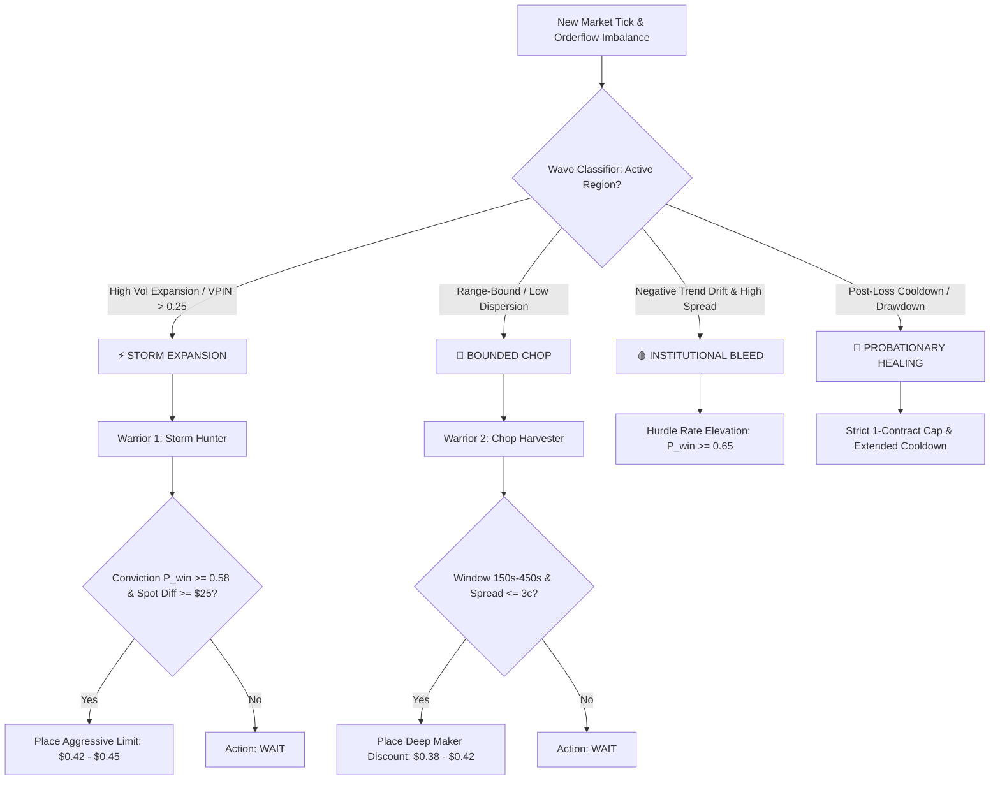

# Master Architecture Diagrams (Mermaid)

**Classification:** System Architecture & Topology Blueprints  
**Standard:** Mermaid Specification  

---

## 1. End-to-End System Component Topology

```mermaid
flowchart TB
    subgraph External Infrastructure
        KALSHI_API[Kalshi Exchange REST & WebSocket v2]
        BINANCE_WS[Binance Spot WebSocket L2 Depth20]
        COINBASE_WS[Coinbase Pro WebSocket Match Feed]
        CF_TWAP[CF Benchmarks Index Provider]
    end

    subgraph AWS EC2 Production Host
        subgraph Mother Server Monolith
            ROUTERS[FastAPI API Routers]
            STATE_PAYLOAD[State Snapshot Engine]
            SETTLE_SRV[Server Settlements Engine]
            DB_WRITER[Async SQLite Queue Persistence]
        end

        subgraph Execution Vessels
            B1_BTC[Bot 1 V4 Quolas Engine - BTC]
            B1_ETH[Bot 1 V4 Domination Engine - ETH]
            KEV_SHADOW[Kev AI Decision Oracle]
        end

        subgraph Quantitative Telemetry
            HMM_BRAIN[HMM 3-State Macro Regime Brain]
            ONNX_TENSORS[ONNX Runtime Probability Tensors]
            EXP_BUFFERS[Continuous Experience Buffers]
            BATCH_SUP[Autonomous 6-Trade Supervisors]
        end

        subgraph Persistent Layer
            SQLITE_BTC[(data/kalshi_history.db)]
            SQLITE_ETH[(data/kalshi_history_eth.db)]
            JSON_REPORTS[win_loss_reports.json]
            JSON_ETH_REPORTS[eth_win_loss_reports.json]
        end
    end

    subgraph Client Workstation
        WEB_UI[React / Vite Trading Dashboard]
        LOCAL_DEV[Local Python Development & Backtest]
    end

    KALSHI_API <--> ROUTERS
    BINANCE_WS --> B1_BTC
    BINANCE_WS --> B1_ETH
    COINBASE_WS --> B1_ETH
    CF_TWAP --> SETTLE_SRV

    ROUTERS --> B1_BTC
    ROUTERS --> B1_ETH
    B1_ETH --> KEV_SHADOW

    B1_BTC --> HMM_BRAIN
    B1_BTC --> ONNX_TENSORS
    B1_ETH --> ONNX_TENSORS

    B1_BTC --> EXP_BUFFERS
    B1_ETH --> EXP_BUFFERS
    EXP_BUFFERS --> BATCH_SUP

    B1_BTC --> DB_WRITER
    B1_ETH --> DB_WRITER
    DB_WRITER --> SQLITE_BTC
    DB_WRITER --> SQLITE_ETH

    SETTLE_SRV --> JSON_REPORTS
    SETTLE_SRV --> JSON_ETH_REPORTS

    ROUTERS <--> WEB_UI
    LOCAL_DEV -.->|Git Sync & SSH| AWS EC2 Production Host
```

---

## 2. Dual Warrior & Multi-Region Execution Architecture


