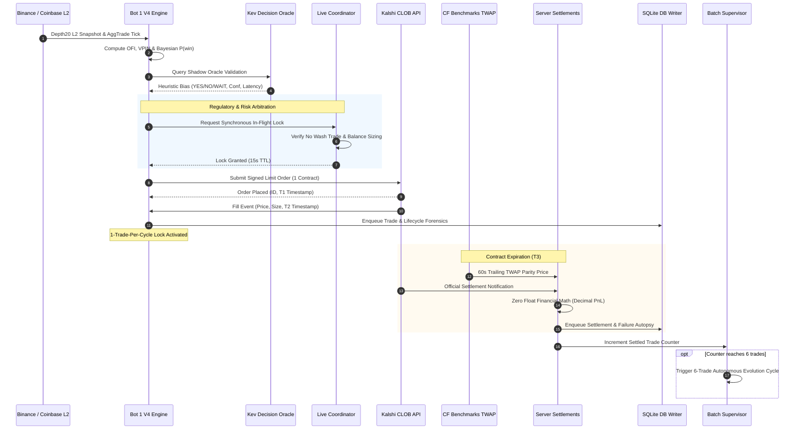
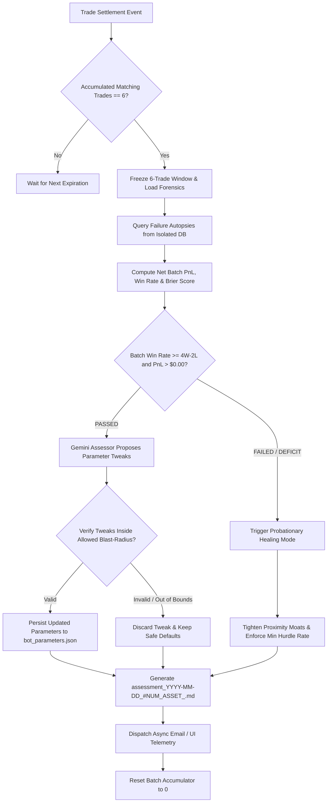

# Master Workflow Diagrams (Mermaid)

**Classification:** Algorithmic Workflow & Operational Process Sequences  
**Standard:** Mermaid Sequence & Flowchart Specification  

---

## 1. Trade Execution & Settlement Sequence Diagram

---

## 2. 6-Trade Autonomous Batch Evaluation & Healing Loop

